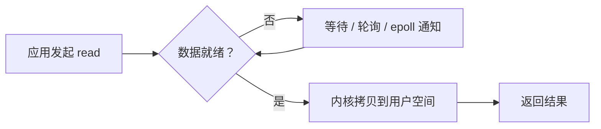

## Table of contents

> 本文属于 Mimas 个人技术博客（Astro 7 + TypeScript + Tailwind CSS 4，中英双语站点）的博客文章，项目语境见 `.trae/rules/doc-gen/00-context.md`。

前端的「异步」不是语言特性，而是宿主对操作系统 I/O 能力的封装。理解 I/O 模型，才能解释为什么 `fetch` 不会阻塞页面，为什么 Node 能用少量线程支撑大量连接，以及为什么并发请求需要自己控制节奏。本文以 Node 作为可运行的 I/O 与并发验证环境，浏览器请求层作为对照。

## 一、I/O 模型

### 1.1 阻塞与非阻塞、同步与异步

- 阻塞：调用发起后线程挂起，直到数据就绪并完成拷贝。
- 非阻塞：调用立即返回，数据未就绪时返回错误码，需要轮询。
- 同步：调用返回时数据已经完成从内核到用户空间的复制。
- 异步：调用立即返回，内核完成全部工作后通过回调或事件通知。

两对概念容易混淆：非阻塞不等于异步，非阻塞 I/O 仍需应用主动读取；异步 I/O 的完成通知由内核负责。

### 1.2 五种 I/O 模型

| 模型 | 等待数据 | 数据拷贝 | 特点 |
| ---- | -------- | -------- | ---- |
| 阻塞 I/O | 阻塞 | 阻塞 | 实现简单，一连接一线程 |
| 非阻塞 I/O | 轮询 | 阻塞 | 轮询消耗 CPU |
| I/O 多路复用 | 阻塞在 select/epoll | 阻塞 | 单线程管理大量连接 |
| 信号驱动 I/O | 信号通知 | 阻塞 | 使用较少 |
| 异步 I/O | 不阻塞 | 不阻塞 | 完成即通知，实现复杂 |

- `select` 与 `poll` 每次调用都要遍历全部描述符，连接数大时效率下降。
- `epoll` 用事件就绪列表避免全量扫描，适合高并发。



### 1.3 水平触发与边缘触发

- 水平触发（LT）在描述符仍可读写时持续通知，编程简单。
- 边缘触发（ET）只在状态变化时通知一次，必须一次读到 `EAGAIN`，否则会丢事件。
- ET 通常配合非阻塞描述符使用，减少重复通知带来的开销。
- 就绪通知与完成通知是两种设计：Reactor 关注「可读可写」，Proactor 关注「已完成」。

### 1.4 前端映射

- 页面的网络请求由浏览器的网络服务处理，渲染进程通过 IPC 获得结果，页面 JS 不直接持有文件描述符。
- `fetch` 返回 Promise，在响应头到达时兑现，响应体通过流逐步读取。
- 页面里的「异步」是应用层语义，底层仍是内核的非阻塞 I/O 加事件通知。
- 浏览器不暴露 `epoll`、`select` 这类接口，前端只能通过并发控制与调度间接影响 I/O 效率。

## 二、事件驱动与事件循环

### 2.1 libuv 与 Node 的事件循环

Node 的 I/O 由 libuv 封装，Linux 使用 epoll，macOS 使用 kqueue，Windows 使用 IOCP。

| 阶段 | 处理内容 |
| ---- | -------- |
| timers | 到期的 `setTimeout`、`setInterval` |
| pending callbacks | 上一轮延迟的系统回调 |
| idle / prepare | 内部准备工作 |
| poll | 等待并处理 I/O 事件 |
| check | `setImmediate` |
| close callbacks | 关闭事件的回调 |

- 每个阶段结束后会清空微任务队列，`process.nextTick` 优先于 Promise 微任务。
- poll 阶段没有就绪事件时会阻塞等待，有 `setImmediate` 则进入 check 阶段。
- 事件循环是单线程的，CPU 密集任务仍会阻塞全部连接。

### 2.2 浏览器的事件循环

- 宏任务包含脚本执行、定时器、事件回调、网络回调。
- 微任务包含 Promise 回调、`queueMicrotask`、`MutationObserver`。
- 每轮宏任务结束后清空微任务，然后浏览器决定是否渲染。
- 渲染包含样式计算、布局、绘制与合成，可能被长任务推迟。
- `requestIdleCallback` 在渲染后有空闲时执行，适合低优先级工作。

```js
console.log("script start");
setTimeout(() => console.log("timeout"), 0);
queueMicrotask(() => console.log("microtask"));
Promise.resolve().then(() => console.log("promise"));
console.log("script end");
// script start → script end → microtask → promise → timeout
```

### 2.3 手写一个最小事件循环

```ts
type Job = () => void;

class MiniLoop {
  private macrotasks: Job[] = [];
  private microtasks: Job[] = [];

  queueMacrotask(job: Job): void {
    this.macrotasks.push(job);
  }

  queueMicrotask(job: Job): void {
    this.microtasks.push(job);
  }

  run(): void {
    while (this.macrotasks.length) {
      const task = this.macrotasks.shift()!;
      task();
      while (this.microtasks.length) {
        this.microtasks.shift()!();
      }
    }
  }
}
```

- 真实实现还要处理渲染时机、定时器排序与 I/O 事件注入。
- 微任务可以继续产生微任务，必须清空后才进入下一个宏任务，因此递归微任务会饿死渲染。
- 这个模型解释了「Promise 回调总在 `setTimeout` 之前执行」的原因。

### 2.4 Node 的线程池与阻塞调用

libuv 默认维护 4 个线程的线程池，文件读写、`dns.lookup`、部分 `crypto` 与 `zlib` 操作都在线程池中执行。

```js
import { readFile } from "node:fs/promises";
import { pbkdf2 } from "node:crypto";

// 两类操作都会占用 libuv 线程池
await Promise.all([
  readFile("large.log"),
  new Promise((resolve, reject) => {
    pbkdf2("password", "salt", 100000, 64, "sha512", (err, key) =>
      err ? reject(err) : resolve(key),
    );
  }),
]);
```

- 网络 I/O 不占线程池，由事件循环依赖 epoll、kqueue 或 IOCP 的就绪通知直接处理。
- 线程池耗尽时，文件与 DNS 操作排队，表现为延迟升高而不是 CPU 打满。
- `UV_THREADPOOL_SIZE` 调整线程池大小，最大 1024，必须在启动前设置。
- 调大线程池不等于更快，超过 CPU 核数会增加上下文切换。
- `dns.lookup` 走线程池，`dns.resolve` 走 c-ares 异步解析，批量解析时后者更可控。
- 容器中应按 CPU limit 设置线程池大小，而不是按宿主机核数。

## 三、并发控制

### 3.1 并发与并行

- 并发是多个任务在重叠的时间段内推进，并行是同一时刻真正同时执行。
- 单线程 JS 只能并发，不能并行；Web Worker 才提供并行能力。
- 并发下的竞态来自共享状态的读写顺序不确定，典型场景是并发请求与重复提交。
- 异步不等于安全：事件回调、Promise 链、定时器都可能交错执行。

### 3.2 锁、信号量与死锁

- 互斥锁保证同一时刻只有一个执行单元进入临界区。
- 信号量用许可数量控制并发度，可用于连接池、并发请求限制。
- 条件变量用于等待某个条件成立，通常与锁配合。
- 死锁四条件：互斥、持有并等待、不可抢占、循环等待。

### 3.3 Promise 互斥锁与信号量

```ts
class Mutex {
  private locked = false;
  private waiters: Array<() => void> = [];

  async acquire(): Promise<void> {
    if (!this.locked) {
      this.locked = true;
      return;
    }
    await new Promise<void>((resolve) => this.waiters.push(resolve));
  }

  release(): void {
    const next = this.waiters.shift();
    if (next) next(); // 所有权直接转移，locked 保持 true
    else this.locked = false;
  }
}

class Semaphore {
  private waiters: Array<() => void> = [];

  constructor(private permits: number) {}

  async acquire(): Promise<void> {
    if (this.permits > 0) {
      this.permits--;
      return;
    }
    await new Promise<void>((resolve) => this.waiters.push(resolve));
  }

  release(): void {
    const next = this.waiters.shift();
    if (next) next();
    else this.permits++;
  }
}
```

- 互斥锁要把 `release` 放在 `finally` 中，避免异常导致永久锁定。
- 信号量的许可数决定并发上限，释放时优先唤醒等待者而不是直接增加许可。
- 这类锁只在单个事件循环内有效，无法跨标签页或跨进程。

### 3.4 共享内存与原子操作

```ts
// main.ts
const shared = new SharedArrayBuffer(4);
const counter = new Int32Array(shared);
const worker = new Worker(new URL("./worker.ts", import.meta.url));

worker.postMessage(shared);
Atomics.add(counter, 0, 1); // 原子自增

// worker.ts
self.onmessage = (event: MessageEvent<SharedArrayBuffer>) => {
  const view = new Int32Array(event.data);
  Atomics.wait(view, 0, 0); // 仅允许在 Worker 中调用，主线程会抛错
  console.log(Atomics.load(view, 0));
};
```

- `SharedArrayBuffer` 需要 COOP 与 COEP 响应头开启跨域隔离，否则不可用。
- `Atomics` 提供原子读写、加减、比较交换与等待通知，避免数据竞争。
- 共享内存适合高频数值交换，复杂对象仍应通过消息传递。
- 一旦引入共享内存，就要重新考虑内存序、死锁与锁的实现，普通业务不必使用。

### 3.5 Node 的 worker_threads 与共享内存

```js
// main.js
import { Worker } from "node:worker_threads";

const shared = new SharedArrayBuffer(4);
const view = new Int32Array(shared);
new Worker(new URL("./counter.js", import.meta.url), { workerData: shared });

Atomics.add(view, 0, 1);
console.log(Atomics.load(view, 0));

// counter.js
import { workerData } from "node:worker_threads";

const view = new Int32Array(workerData);
Atomics.add(view, 0, 1);
```

- `worker_threads` 共享同一进程的内存，`workerData` 与消息默认走结构化克隆。
- `SharedArrayBuffer` 在 Node 中无需跨域隔离，浏览器中则需要 COOP 与 COEP。
- `Atomics.wait` 在 Node 主线程可以调用，但会阻塞事件循环，通常只在 Worker 中使用。
- `BroadcastChannel` 在 Node 中可用，适合 Worker 之间广播，不必经过主线程转发。
- 共享内存适合高频数值交换，复杂对象仍应使用消息传递。

## 四、持久化与文件系统

- 文件描述符是内核维护的打开文件句柄，读取写入都有系统调用开销。
- 缓冲减少系统调用次数，`fsync` 保证数据真正落盘，代价是延迟。
- `localStorage` 同步读写，数据量大时会阻塞主线程，容量通常约 5MB。
- `IndexedDB` 异步、支持事务与索引，适合结构化数据与大量记录。
- Cache Storage 面向请求响应缓存，配合 Service Worker 使用。
- OPFS 提供源私有文件系统，支持 Worker 内同步访问，适合大文件与流式处理。

```ts
const estimate = await navigator.storage.estimate();
console.log(estimate.usage, estimate.quota);
await navigator.storage.persist(); // 申请持久化，降低被清理概率
```

- 存储配额按源计算，浏览器在磁盘紧张时可能清理非持久化数据。
- 写入前评估数据量，避免一次性序列化大对象导致内存峰值。
- 事务内的操作要控制规模，长事务会阻塞其他读写。

## 五、性能与背压

### 5.1 I/O 密集与 CPU 密集

- I/O 密集型任务适合并发等待，CPU 密集型任务需要并行计算或拆分。
- Node 用线程池处理文件与 DNS 等阻塞操作，网络 I/O 由事件循环直接处理。
- 连接池与线程池都能限制并发，避免资源耗尽与上下文切换开销。
- 前端并发请求过多会争抢连接与带宽，需要按优先级排队。

### 5.2 背压

```ts
const response = await fetch("/large-file");
const reader = response.body!.getReader();

while (true) {
  const { done, value } = await reader.read();
  if (done) break;
  await writeChunk(value); // 消费慢时，读取自然放缓
}
```

- 背压是消费者速度低于生产者时的反馈机制，避免数据在内存中堆积。
- 流式读取是拉模型，消费端不调用 `read` 就不会继续读取。
- 上传与下载大文件应使用流，而不是先读入内存再处理。
- 服务端与客户端都要设置缓冲上限，否则背压无法传递。

### 5.3 排查

- Network 面板的 Queueing、Stalled、TTFB、Content Download 分别对应排队、连接等待、服务端处理与传输。
- 请求长时间处于 Queueing 通常是并发连接被占满或浏览器优先级调度。
- Performance 面板可观察长任务、强制同步布局与网络回调的执行位置。
- 服务端可用 `Server-Timing` 把内部阶段透出到前端时间线。

### 5.4 Node 的流与背压

```js
import { createReadStream, createWriteStream } from "node:fs";
import { pipeline } from "node:stream/promises";

await pipeline(createReadStream("input.log"), createWriteStream("output.log"));
```

- `pipeline` 负责背压、错误传播与流销毁，避免手写 `on("data")` 造成缓冲堆积。
- `highWaterMark` 控制内部缓冲区大小，文件流默认约 64KB，普通字节流默认约 16KB。
- 自定义 `Writable` 时，`write` 返回 `false` 表示缓冲已满，应等待 `drain` 再继续写。
- 不要用 `readFile` 读取大文件再整体写出，内存峰值等于文件大小。
- 慢客户端场景要限制服务端可写缓冲，否则数据会堆积在进程内存中。

### 5.5 Node 的排查入口

- `strace -f -e trace=epoll_wait,read,write -p <pid>` 观察事件循环等待与系统调用。
- `node --prof` 生成 CPU profile，再用 `--prof-process` 解析热点。
- `perf_hooks` 的 `eventLoopUtilization()` 衡量事件循环繁忙程度，持续接近 1 说明主线程被占满。
- `clinic` 工具集可生成火焰图与事件循环阻塞分析。
- 容器中同时关注 CPU throttling 与内存 limit，很多「Node 慢」实际是资源限制。
