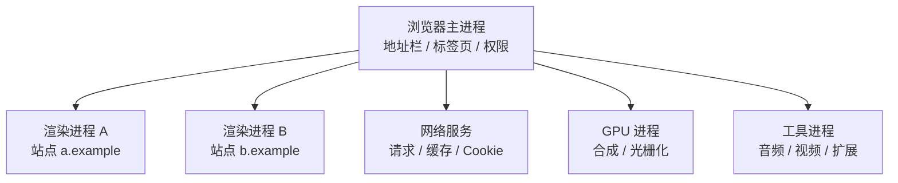

## Table of contents

> 本文属于 Mimas 个人技术博客（Astro 7 + TypeScript + Tailwind CSS 4，中英双语站点）的博客文章，项目语境见 `.trae/rules/doc-gen/00-context.md`。

浏览器是一个小型操作系统：它管理进程、线程、内存、I/O 与调度。前端性能问题往往能在操作系统层面找到解释，例如为什么一个标签页卡死不影响其他页面，为什么长任务会阻塞输入，为什么 Worker 能绕过主线程。本文以 Node 作为可运行、可观测的验证环境，浏览器作为前端映射对象。

## 一、进程与线程

### 1.1 资源边界

| 维度 | 进程 | 线程 |
| ---- | ---- | ---- |
| 定义 | 资源分配的基本单位 | CPU 调度的基本单位 |
| 地址空间 | 独立 | 同进程内共享 |
| 打开文件 | 独立 | 共享 |
| 崩溃影响 | 通常不影响其他进程 | 可能导致整个进程退出 |
| 创建与切换成本 | 高 | 低 |
| 通信方式 | IPC | 共享内存 |

- 进程持有独立的虚拟地址空间、文件描述符表、信号处理与安全上下文。
- 线程共享代码段、堆与全局数据，各自持有栈、寄存器与程序计数器。
- 线程切换只需保存寄存器与栈指针，进程切换还要切换页表，代价更高，且会造成 TLB 与缓存失效。

### 1.2 进程间通信

- 管道与命名管道：单向字节流，适合父子进程。
- 消息队列：带边界的数据块，解耦发送与接收。
- 共享内存：最快的 IPC，需要额外同步机制。
- 套接字：可跨机器，浏览器与本地服务通信常用。
- 信号：异步通知，表达能力有限。

### 1.3 前端映射

- 浏览器用多进程隔离不同站点，本质是安全与稳定性设计。
- 多标签页之间不能直接共享内存，需要 `BroadcastChannel`、`SharedWorker` 或 `storage` 事件通信。
- Service Worker 是独立于页面的执行上下文，页面关闭后仍可处理事件。
- Web Worker 是同源页面派生出的线程，不能操作 DOM，只能通过消息通信。

### 1.4 Node 中的进程与线程

Node 把操作系统的进程与线程能力封装成三层：`process` 描述当前进程，`child_process` 创建子进程，`worker_threads` 创建线程。

```js
import os from "node:os";
import { fork } from "node:child_process";

console.log(process.pid, process.ppid);
console.log(os.cpus().length); // 逻辑核心数

// fork 会建立 IPC 通道，子进程与父进程可以互发消息
const child = fork("./worker.js");
child.on("message", (msg) => console.log("from child:", msg));
child.send({ type: "start" });
```

```js
// worker.js
process.on("message", (msg) => {
  process.send?.({ type: "done", echo: msg.type });
});
```

- `process.pid` 是当前进程 ID，`process.ppid` 是父进程 ID，可用于排查容器与守护进程的层级关系。
- `fork` 建立 IPC 通道，`send` 与 `message` 传递结构化数据，底层使用管道。
- `spawn`、`exec` 用于启动外部命令；`exec` 会把输出缓冲到内存，大输出应改用 `spawn` 流式读取。
- `cluster` 模块基于 `fork` 创建多个工作进程并共享同一端口，用于利用多核，主进程负责分发连接。
- `worker_threads` 创建的是线程，同一进程内共享内存，可用 `SharedArrayBuffer` 交换数据。

```js
import { Worker, isMainThread, parentPort } from "node:worker_threads";

if (isMainThread) {
  const worker = new Worker(new URL(import.meta.url));
  worker.on("message", (result) => console.log(result));
  worker.postMessage({ numbers: [1, 2, 3, 4] });
} else {
  parentPort?.on("message", ({ numbers }) => {
    parentPort?.postMessage(numbers.reduce((sum, n) => sum + n, 0));
  });
}
```

- 多进程隔离彻底，但内存开销大、通信需要序列化；多线程共享内存，但需要处理竞态。
- CPU 密集且需要故障隔离的任务用 `child_process`，需要共享数据的计算用 `worker_threads`。
- Node 的 `worker_threads` 与浏览器 `Worker` 概念对应，但模块加载与 API 不同。

## 二、浏览器多进程架构

### 2.1 进程划分



- 浏览器主进程负责界面、标签页生命周期、权限与进程协调。
- 渲染进程负责 HTML 解析、样式、布局、绘制与 JS 执行，每个站点实例通常独立。
- 网络服务统一处理请求、缓存与认证，页面通过 IPC 发起网络请求。
- GPU 进程承担合成与光栅化，动画与滚动尽量走合成线程。
- 工具进程承载音频、视频解码、扩展等独立能力。

### 2.2 站点隔离与沙箱

- 站点隔离（Site Isolation）让不同站点运行在独立渲染进程，跨站 iframe 也会被拆分，降低旁路攻击风险。
- 渲染进程运行在沙箱中，默认不能直接访问文件系统与系统调用。
- 沙箱意味着页面能力受限，文件、剪贴板、通知等能力都需要显式授权。
- 一个渲染进程崩溃只影响对应标签页，主进程与其他页面继续运行。

### 2.3 崩溃与资源竞争

- 渲染进程崩溃时页面无法通过 JS 捕获，监控需要依赖 Native 层或崩溃上报 SDK。
- 多标签页同时执行重计算会争抢 CPU 与内存，导致整体卡顿。
- 后台标签页的定时器会被节流，隐藏超过一定时间后最低可降至每分钟一次。
- 页面进入后台后 `requestAnimationFrame` 暂停，依赖帧循环的逻辑需要处理可见性变化。

## 三、线程与并发

### 3.1 用户态与内核态

- 应用代码运行在用户态，不能直接执行特权指令或访问硬件。
- 文件读写、网络、内存映射等能力通过系统调用进入内核态完成。
- 系统调用有固定开销，高频小规模调用会显著拖慢性能，批量处理更划算。
- JavaScript 不直接暴露系统调用，所有 I/O 都由宿主环境代理。

### 3.2 竞态、锁与死锁

- 竞态条件指结果依赖多个执行单元的调度顺序，常见于共享可变状态。
- 临界区需要互斥保护，常用互斥锁、信号量、原子操作。
- 死锁的四个必要条件：互斥、持有并等待、不可抢占、循环等待，破坏任意一个即可避免。
- 活锁与饥饿是另外两类并发问题：前者不断重试却无法推进，后者长期得不到资源。

### 3.3 JavaScript 的线程模型

- 主线程只有一个调用栈，同一时刻只执行一段 JS，因此不存在传统意义上的数据竞争。
- 异步编程带来的竞态仍然存在：并发请求返回顺序不确定，旧响应可能覆盖新状态。
- Web Worker 提供真正的并行执行环境，但默认不共享内存。
- `SharedArrayBuffer` 配合 `Atomics` 可在 Worker 间共享内存，但需要跨域隔离响应头（COOP/COEP）。
- 共享内存一旦引入，数据竞争与内存序问题重新出现，普通业务应优先使用消息传递。

## 四、调度

### 4.1 操作系统调度

- 抢占式调度由内核决定何时切换线程，时间片用完即让出 CPU。
- 协作式调度依赖任务主动让出，实现简单但一个任务不让出就会拖住全部。
- 优先级调度保证关键任务先执行，但可能造成低优先级任务饥饿，通常配合老化策略。
- 多级反馈队列根据任务行为动态调整优先级，短任务优先响应，长任务逐步降级。
- 调度目标不是「最快」，而是在吞吐、延迟、公平之间取平衡。

### 4.2 浏览器事件循环

浏览器主线程采用协作式调度：一段 JS 执行完才会处理下一个任务。

```js
console.log("1");
setTimeout(() => console.log("4"), 0);
Promise.resolve().then(() => console.log("3"));
console.log("2");
// 1 2 3 4
```

- 每个宏任务结束后清空微任务队列，再决定是否渲染。
- 渲染时机由浏览器决定，通常与屏幕刷新率对齐。
- 长任务期间输入事件排队，用户感知为点击无响应。
- 任务拆分是前端版的「主动让出时间片」。

### 4.3 手写协作式调度器

```ts
type Task = () => void;

class CooperativeScheduler {
  private queue: Task[] = [];
  private running = false;

  schedule(task: Task): void {
    this.queue.push(task);
    if (!this.running) void this.flush();
  }

  private async flush(): Promise<void> {
    this.running = true;
    const frameBudget = 8; // 留出渲染与输入处理时间

    while (this.queue.length) {
      const start = performance.now();
      while (this.queue.length && performance.now() - start < frameBudget) {
        this.queue.shift()!();
      }
      await new Promise<void>((resolve) => setTimeout(resolve, 0));
    }

    this.running = false;
  }
}
```

- 每轮只占用固定时间预算，剩余工作让出主线程后再继续。
- `setTimeout` 让出会带来最小延迟，低延迟场景可用 `MessageChannel` 或 `scheduler.postTask`。
- 任务应可中断、可取消，并保证重复执行不会产生副作用。
- 与操作系统的抢占式调度不同，JavaScript 无法被强制中断，只能由代码主动让出。

### 4.4 优先级调度

- React Scheduler 把任务分为 Immediate、User Blocking、Normal、Low、Idle 等级，用最小堆按过期时间管理。
- 用户输入与动画属于高优先级，数据预取与日志属于低优先级。
- `requestIdleCallback` 适合真正可延后的工作，但空闲时间不保证，不能承载关键逻辑。
- 优先级反转需要避免：低优先级任务持有高优先级任务依赖的资源时会拖慢整体。

### 4.5 Node 与浏览器调度的差异

```js
setTimeout(() => console.log("timeout"), 0);
setImmediate(() => console.log("immediate"));
process.nextTick(() => console.log("nextTick"));
Promise.resolve().then(() => console.log("promise"));
// nextTick → promise → timeout / immediate（主模块中后两者顺序不确定）
```

- Node 由 libuv 驱动事件循环，分 timers、poll、check 等阶段，网络 I/O 依赖 epoll、kqueue 或 IOCP 的就绪通知。
- `setImmediate` 在 check 阶段执行，`setTimeout(fn, 0)` 在 timers 阶段执行；进入 I/O 回调后 `setImmediate` 通常先于 `setTimeout`。
- `process.nextTick` 在当前操作结束后立即执行，优先于 Promise 微任务，递归调用会饿死 I/O。
- Node 没有渲染步骤与 `requestAnimationFrame`，长任务拖慢的是请求吞吐而不是帧率。
- 计算密集任务应交给 `worker_threads` 或拆成多个 `setImmediate`，避免阻塞事件循环。
- 两者都是协作式调度，区别在于浏览器服务渲染与输入，Node 服务 I/O 吞吐。

## 五、前端场景

- 主线程长任务导致输入延迟，优化方向是拆分、降优先级或迁移到 Worker。
- 同步 XHR 会阻塞渲染与事件处理，现代代码应使用 `fetch` 或异步 XHR。
- 多标签页写同一份 `localStorage` 不会自动同步，需要监听 `storage` 事件并处理冲突。
- 页面崩溃与进程被杀需要单独的监控通道，不能依赖页面内 JS。
- 后台节流影响轮询与心跳，应以服务端时间为准并处理恢复时的补偿。
- Node 服务端同样受单线程限制，CPU 密集的渲染或计算会阻塞其他请求，需要多进程或 Worker 分担。
- 容器中的 Node 进程常作为 1 号进程运行，必须处理 `SIGTERM` 转发与优雅退出，否则重启会中断在途请求。
