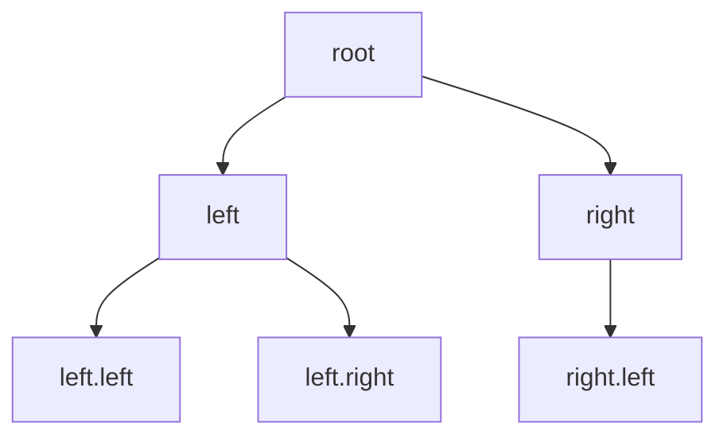

## Table of contents

> 本文属于 Mimas 个人技术博客（Astro 7 + TypeScript + Tailwind CSS 4，中英双语站点）的博客文章，项目语境见 `.trae/rules/doc-gen/00-context.md`。

前端处理的很多对象本身就是树：DOM 是树，AST 是树，组件树、路由树、模块依赖图也是树或图的变形。本文先统一树的遍历方式，再讨论带顺序约束的搜索树、带优先级约束的堆，以及按前缀组织的 Trie。

## 一、树的基本概念与遍历

### 1.1 术语与存储

- 根、父节点、子节点、叶子节点、兄弟节点构成层级关系。
- 节点的度是子节点数量，树的深度是根到节点的边数，高度是节点到最深叶子的边数。
- 二叉树每个节点最多两个子节点；满二叉树每层都填满，完全二叉树除最后一层外都填满且靠左排列。
- 链式存储用左右指针，适合任意形态；完全二叉树可直接用数组存储，下标 `i` 的左右子节点为 `2i + 1`、`2i + 2`，父节点为 `(i - 1) >> 1`。



### 1.2 四种遍历

| 遍历 | 顺序 | 典型用途 |
| ---- | ---- | -------- |
| 前序 | 根 → 左 → 右 | 复制树、序列化 |
| 中序 | 左 → 根 → 右 | 二叉搜索树有序输出 |
| 后序 | 左 → 右 → 根 | 释放资源、计算子树结果 |
| 层序 | 逐层从左到右 | BFS、渲染层级 |

```ts
interface TreeNode<T> {
  value: T;
  left: TreeNode<T> | null;
  right: TreeNode<T> | null;
}

function preorder<T>(node: TreeNode<T> | null, visit: (value: T) => void): void {
  if (!node) return;
  visit(node.value);
  preorder(node.left, visit);
  preorder(node.right, visit);
}

function preorderIterative<T>(root: TreeNode<T> | null, visit: (value: T) => void): void {
  const stack: TreeNode<T>[] = root ? [root] : [];
  while (stack.length) {
    const node = stack.pop()!;
    visit(node.value);
    if (node.right) stack.push(node.right);
    if (node.left) stack.push(node.left);
  }
}
```

- 递归写法简洁，但深度过大时会栈溢出，DOM 深度异常或恶意输入时需要注意。
- 迭代写法用显式栈，栈容量受堆内存限制，不会触发调用栈上限。
- 层序遍历用队列，是 BFS 的标准形态。

### 1.3 前端映射

- DOM 是一棵多叉树，`childNodes` 与 `children` 分别包含文本节点与元素节点。
- `TreeWalker`、`NodeIterator` 提供游标式遍历，适合大文档的增量处理。
- Babel、ESLint、PostCSS 都基于 AST 工作，遍历时通常采用访问者模式。
- 框架的组件树是逻辑树，虚拟 DOM 是它的运行时描述，真实 DOM 是最终渲染结果。

## 二、二叉搜索树

### 2.1 性质与操作

二叉搜索树要求左子树所有节点小于根，右子树所有节点大于根，中序遍历得到有序序列。

```ts
class BST<T> {
  private root: TreeNode<T> | null = null;

  constructor(private compare: (a: T, b: T) => number) {}

  search(value: T): boolean {
    let node = this.root;
    while (node) {
      const diff = this.compare(value, node.value);
      if (diff === 0) return true;
      node = diff < 0 ? node.left : node.right;
    }
    return false;
  }

  insert(value: T): void {
    if (!this.root) {
      this.root = { value, left: null, right: null };
      return;
    }
    let node = this.root;
    while (true) {
      const diff = this.compare(value, node.value);
      if (diff === 0) return; // 重复值不插入
      const side = diff < 0 ? "left" : "right";
      if (!node[side]) {
        node[side] = { value, left: null, right: null };
        return;
      }
      node = node[side];
    }
  }

  remove(value: T): void {
    this.root = this.removeNode(this.root, value);
  }

  private removeNode(node: TreeNode<T> | null, value: T): TreeNode<T> | null {
    if (!node) return null;
    const diff = this.compare(value, node.value);
    if (diff < 0) {
      node.left = this.removeNode(node.left, value);
      return node;
    }
    if (diff > 0) {
      node.right = this.removeNode(node.right, value);
      return node;
    }
    if (!node.left) return node.right;
    if (!node.right) return node.left;
    // 两个子节点：用右子树最小节点（中序后继）替换
    let successor = node.right;
    while (successor.left) successor = successor.left;
    node.value = successor.value;
    node.right = this.removeNode(node.right, successor.value);
    return node;
  }
}
```

- 查找、插入、删除的平均复杂度都是 O(log n)，前提是树保持平衡。
- 删除两个子节点的节点时，用中序后继或前驱替换，再递归删除替换节点。
- 有序插入会退化成链表，复杂度变为 O(n)，这是引入平衡树的直接原因。

### 2.2 前端场景

- 有序数据索引与范围查询，如按时间排序的日志、区间过滤。
- 编辑器中的有序标记、区间树（区间重叠查询）是 BST 的扩展。
- 实际业务优先使用有序数组加二分，只有当插入删除频繁时才需要平衡树。

## 三、平衡树与 B 树

### 3.1 AVL 树

- AVL 树要求任意节点左右子树高度差不超过 1，通过四种旋转恢复平衡：LL、RR、LR、RL。
- 旋转只调整局部指针，单次 O(1)，插入删除后沿路径回溯更新高度。
- AVL 查询性能稳定，但插入删除的旋转次数较多，适合读多写少。

### 3.2 红黑树

- 红黑树通过颜色约束保证最长路径不超过最短路径的两倍，近似平衡而非严格平衡。
- 五条性质：节点非红即黑、根为黑、叶子（NIL）为黑、红节点的子节点必须为黑、任一节点到叶子的黑节点数量相同。
- 插入删除的调整次数比 AVL 少，适合写操作较多的场景。
- Java 的 `TreeMap`、Linux 内核的调度与定时器、部分数据库索引使用红黑树。

### 3.3 B 树与 B+ 树

- B 树是多路平衡树，一个节点保存多个键与多个子节点，降低树高、减少磁盘 I/O。
- B+ 树把数据集中在叶子层并用链表串联叶子，范围查询只需顺序扫描叶子。
- 数据库索引与文件系统广泛使用 B+ 树，前端接触 IndexedDB 索引、SQLite WASM 时间接依赖这类结构。

## 四、堆与优先队列

### 4.1 堆的性质

- 堆是完全二叉树，用数组存储；小顶堆满足父节点不大于子节点，大顶堆相反。
- 堆只保证堆顶是最值，不保证整体有序，因此不能替代排序。
- `push` 上浮 O(log n)，`pop` 下沉 O(log n)，取堆顶 O(1)，建堆 O(n)。

```ts
class MinHeap<T> {
  private items: T[] = [];

  constructor(private compare: (a: T, b: T) => number) {}

  get size(): number {
    return this.items.length;
  }

  peek(): T | undefined {
    return this.items[0];
  }

  push(value: T): void {
    this.items.push(value);
    this.siftUp(this.items.length - 1);
  }

  pop(): T | undefined {
    if (this.items.length === 0) return undefined;
    const top = this.items[0];
    const last = this.items.pop()!;
    if (this.items.length > 0) {
      this.items[0] = last;
      this.siftDown(0);
    }
    return top;
  }

  private siftUp(index: number): void {
    while (index > 0) {
      const parent = (index - 1) >> 1;
      if (this.compare(this.items[index], this.items[parent]) >= 0) break;
      [this.items[index], this.items[parent]] = [this.items[parent], this.items[index]];
      index = parent;
    }
  }

  private siftDown(index: number): void {
    const length = this.items.length;
    while (true) {
      let target = index;
      const left = index * 2 + 1;
      const right = index * 2 + 2;
      if (left < length && this.compare(this.items[left], this.items[target]) < 0) target = left;
      if (right < length && this.compare(this.items[right], this.items[target]) < 0) target = right;
      if (target === index) break;
      [this.items[index], this.items[target]] = [this.items[target], this.items[index]];
      index = target;
    }
  }
}
```

### 4.2 前端场景

- React Scheduler 用最小堆按过期时间管理任务，保证高优先级任务先执行。
- 定时器、延迟任务、节流窗口可以用堆维护最近到期项。
- Top K 问题不需要全量排序，维护大小为 K 的堆即可，复杂度 O(n log K)。
- 合并多个有序列表（如多路日志、多个分页结果）用堆做多路归并。

## 五、前缀树 Trie

### 5.1 结构与实现

Trie 按字符逐层组织字符串，公共前缀共享路径，适合前缀检索。

```ts
class TrieNode {
  children = new Map<string, TrieNode>();
  isWord = false;
}

class Trie {
  private root = new TrieNode();

  insert(word: string): void {
    let node = this.root;
    for (const char of word) {
      let next = node.children.get(char);
      if (!next) {
        next = new TrieNode();
        node.children.set(char, next);
      }
      node = next;
    }
    node.isWord = true;
  }

  search(word: string): boolean {
    return this.walk(word)?.isWord ?? false;
  }

  startsWith(prefix: string): boolean {
    return this.walk(prefix) !== undefined;
  }

  private walk(text: string): TrieNode | undefined {
    let node: TrieNode | undefined = this.root;
    for (const char of text) {
      node = node.children.get(char);
      if (!node) return undefined;
    }
    return node;
  }
}
```

- 插入与查询复杂度为 O(m)，m 为字符串长度，与词表规模无关。
- 空间换时间，节点数量与总字符数相关，中文与表情字符需要按码点处理。
- 压缩 Trie（Radix Tree）合并单链节点，降低内存占用。
- 前缀检索只需从目标节点做一次 DFS，即可枚举所有候选词。

### 5.2 前端场景

- 搜索框联想、命令面板、地址补全。
- 路由匹配中把路径按段组织成前缀树，可实现参数化路由的快速命中。
- 敏感词过滤基于 Trie 做多模式匹配，避免对每个词单独扫描。
- 输入法候选、代码补全同样基于前缀索引。

## 六、选型对照

| 结构 | 查找 | 插入 | 删除 | 适用场景 |
| ---- | ---- | ---- | ---- | -------- |
| 二叉搜索树 | 平均 O(log n) | 平均 O(log n) | 平均 O(log n) | 有序数据、范围查询 |
| AVL / 红黑树 | O(log n) | O(log n) | O(log n) | 频繁增删的有序集合 |
| 堆 | 最值 O(1) | O(log n) | O(log n) | 优先级队列、Top K |
| Trie | O(m) | O(m) | O(m) | 前缀检索、多模式匹配 |

树结构的价值在于用层级关系换取查询效率。选择之前先确认数据是否有序、是否需要范围查询、是否需要最值，再决定用搜索树、堆还是前缀树。
