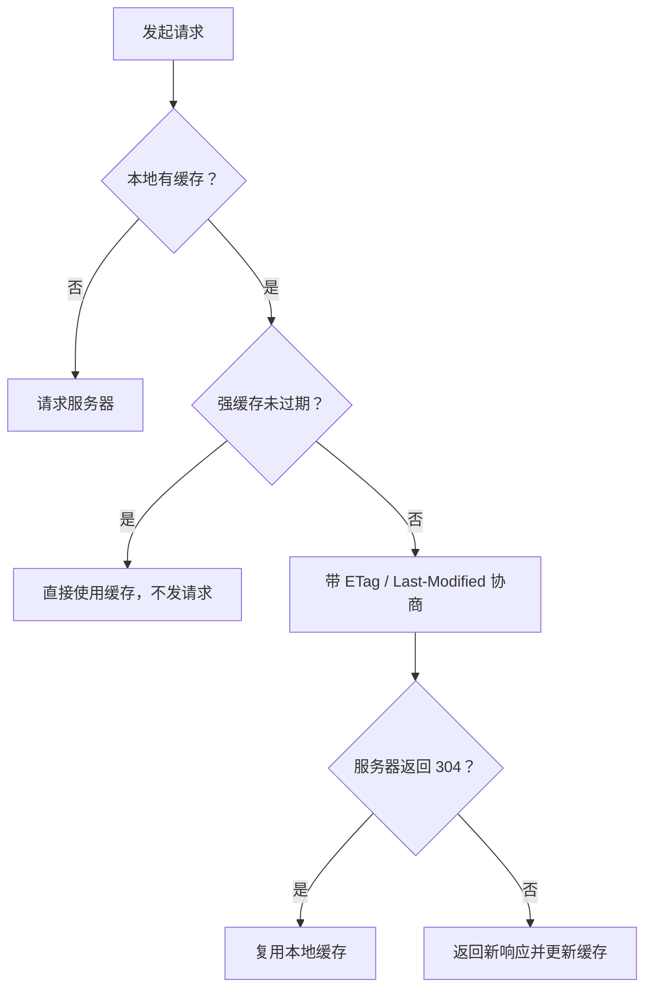

## Table of contents

> 本文属于 Mimas 个人技术博客（Astro 7 + TypeScript + Tailwind CSS 4，中英双语站点）的博客文章，项目语境见 `.trae/rules/doc-gen/00-context.md`。

HTTP 是前端接触最多的协议，也是最容易被当成「调接口」而忽略细节的部分。缓存命中、跨域预检、Cookie 携带、发版白屏，这些问题都源于协议语义。本文先拆报文，再讲缓存与安全，最后给出可落地的判定代码。

## 一、报文结构与语义

### 1.1 报文格式

HTTP/1.1 报文是纯文本：请求行或状态行、若干头部、空行、可选的消息体。

```ts
interface ParsedRequest {
  method: string;
  path: string;
  version: string;
  headers: Record<string, string>;
  body: string;
}

function parseRequest(raw: string): ParsedRequest {
  const [head, ...rest] = raw.split("\r\n\r\n");
  const [requestLine, ...headerLines] = head.split("\r\n");
  const [method, path, version] = requestLine.split(" ");

  const headers: Record<string, string> = {};
  for (const line of headerLines) {
    const index = line.indexOf(":");
    if (index === -1) continue;
    headers[line.slice(0, index).trim().toLowerCase()] = line
      .slice(index + 1)
      .trim();
  }

  return { method, path, version, headers, body: rest.join("\r\n\r\n") };
}
```

- 头部名大小写不敏感，解析时统一转为小写。
- 首行以空格分隔，消息体与头之间用一个空行分隔。
- HTTP/2 改为二进制分帧，语义保留但报文形态完全不同。
- `Content-Length` 与 `Transfer-Encoding: chunked` 二选一，同时出现属于协议错误。

### 1.2 方法与幂等性

| 方法    | 语义         | 安全 | 幂等   |
| ------- | ------------ | ---- | ------ |
| GET     | 获取资源     | 是   | 是     |
| HEAD    | 获取头部     | 是   | 是     |
| POST    | 提交处理     | 否   | 否     |
| PUT     | 整体替换     | 否   | 是     |
| PATCH   | 局部修改     | 否   | 通常否 |
| DELETE  | 删除资源     | 否   | 是     |
| OPTIONS | 查询支持能力 | 是   | 是     |

- 幂等指重复执行结果一致，不表示没有副作用。
- 重试只应对幂等请求自动进行，POST 重试需要服务端提供幂等键。
- GET 不应携带请求体，缓存与代理对带体 GET 的行为不一致。

### 1.3 状态码

| 区段 | 含义         | 常用码                       |
| ---- | ------------ | ---------------------------- |
| 2xx  | 成功         | 200、201、204、206           |
| 3xx  | 重定向与缓存 | 301、302、304、307、308      |
| 4xx  | 客户端错误   | 400、401、403、404、409、429 |
| 5xx  | 服务端错误   | 500、502、503、504           |

- 304 表示协商缓存命中，响应不能带消息体。
- 301 与 308 是永久重定向，会被缓存；302 与 307 是临时重定向，307 保留原方法与请求体。
- 401 表示未认证，403 表示已认证但无权限，二者不能混用。
- 429 应配合 `Retry-After` 告知客户端何时重试。

### 1.4 版本演进

- HTTP/1.1 引入持久连接，但同一连接上的请求仍有队头阻塞，浏览器只能靠多连接缓解。
- HTTP/2 使用二进制分帧与多路复用，多个请求共享一个 TCP 连接，头部用 HPACK 压缩；服务端推送已被主流浏览器移除。
- HTTP/2 解决了应用层队头阻塞，仍受 TCP 层丢包影响，一个丢包会拖慢所有流。
- HTTP/3 基于 QUIC，在 UDP 上实现独立流与更快的握手，消除 TCP 层队头阻塞。

## 二、头部与内容协商

- `Content-Type` 描述实体类型与字符集，`Accept` 表达客户端可接受的类型。
- `Content-Encoding` 表示压缩方式，`Accept-Encoding` 声明客户端支持 gzip、br 等编码。
- `Vary` 声明缓存键还要包含哪些请求头，常见为 `Accept-Encoding`、`Accept-Language`。
- `Vary` 设置不当会导致缓存命中率下降或返回错误版本，`Vary: *` 等于不可缓存。
- `Range` 支持部分请求，用于视频拖动与大文件分片下载，响应为 206。
- `If-None-Match`、`If-Modified-Since` 是协商缓存的请求头，对应 `ETag` 与 `Last-Modified`。
- `Authorization` 携带凭证，默认不参与缓存键，共享缓存需显式配置。

## 三、缓存机制

### 3.1 强缓存与协商缓存



- 强缓存由 `Cache-Control: max-age` 或 `Expires` 决定，未过期时不发请求。
- 协商缓存由 `ETag`/`If-None-Match`、`Last-Modified`/`If-Modified-Since` 决定，命中返回 304。
- `ETag` 精度高于 `Last-Modified`，后者只能精确到秒且无法识别内容未变但时间变化的情况。
- `no-cache` 不是不缓存，而是每次使用前必须协商。
- `no-store` 才是完全不存储。

### 3.2 Cache-Control 指令

| 指令                       | 作用                                   |
| -------------------------- | -------------------------------------- |
| `max-age=N`                | 相对过期时间，单位秒                   |
| `s-maxage=N`               | 仅对共享缓存生效，优先级高于 `max-age` |
| `no-cache`                 | 使用前必须协商                         |
| `no-store`                 | 不存储任何副本                         |
| `private`                  | 仅允许浏览器缓存                       |
| `public`                   | 允许共享缓存                           |
| `must-revalidate`          | 过期后必须校验，不能用过期副本         |
| `immutable`                | 有效期内不重新校验                     |
| `stale-while-revalidate=N` | 过期后 N 秒内先返回旧值并后台刷新      |
| `stale-if-error=N`         | 回源失败时在 N 秒内继续返回旧值        |

- 哈希文件名的静态资源适合 `max-age=31536000, immutable`。
- HTML 适合 `no-cache`，保证入口指向最新资源。
- 接口数据按业务容忍度选择短 TTL 或 `stale-while-revalidate`。

### 3.3 手写缓存判定

```ts
interface CacheEntry {
  storedAt: number;
  maxAge: number;
  noStore: boolean;
  noCache: boolean;
  etag?: string;
  lastModified?: string;
}

function isFresh(entry: CacheEntry, now = Date.now()): boolean {
  if (entry.noStore || entry.noCache) return false;
  return now - entry.storedAt < entry.maxAge * 1000;
}

function canRevalidate(
  entry: CacheEntry,
  requestHeaders: { ifNoneMatch?: string; ifModifiedSince?: string }
): boolean {
  if (entry.etag && requestHeaders.ifNoneMatch === entry.etag) return true;
  return Boolean(
    entry.lastModified && requestHeaders.ifModifiedSince === entry.lastModified
  );
}
```

- 真实实现还要处理 `Age`、`Date`、共享缓存的 `s-maxage` 与 `Vary` 键。
- 客户端自建接口缓存要同时考虑 TTL 与容量上限，避免只按时间淘汰。
- Service Worker 缓存与 HTTP 缓存是两层，命中顺序取决于请求是否经过 `fetch` 事件。

### 3.4 发版与缓存

- 文件名带内容哈希，才能安全使用长缓存。
- HTML 不缓存或短缓存，保证用户拿到新的资源引用。
- 旧资源不要立即删除，留一个发布周期的兼容窗口，避免用户停留在旧页面时加载失败。
- Service Worker 更新要处理新旧版本混用，激活新版本时给用户刷新提示。

## 四、Cookie 与鉴权

### 4.1 Cookie 属性

| 属性                  | 作用                                |
| --------------------- | ----------------------------------- |
| `Domain`              | 生效域名，设置后包含子域            |
| `Path`                | 生效路径                            |
| `Expires` / `Max-Age` | 过期时间，缺省为会话 Cookie         |
| `Secure`              | 仅 HTTPS 传输                       |
| `HttpOnly`            | 禁止 JS 读取，降低 XSS 窃取风险     |
| `SameSite`            | 跨站请求是否携带，Strict、Lax、None |

- `SameSite=None` 必须同时设置 `Secure`。
- `SameSite=Lax` 是现代浏览器的默认值，跨站 POST 不携带，顶层 GET 导航携带。
- 单个 Cookie 约 4KB，同域 Cookie 数量也有限制，过多会增大每个请求的头部体积。
- 静态资源使用独立域名可以避免携带业务 Cookie。

### 4.2 Session 与 JWT

- Session 由服务端存储会话状态，客户端只保存会话 ID，撤销方便。
- JWT 自包含声明，服务端无状态校验，但撤销困难，需要短有效期配合刷新令牌。
- 令牌放在 `localStorage` 便于前端读取，但一旦 XSS 即可被窃取。
- 令牌放在 `HttpOnly` Cookie 可降低窃取风险，但需要配合 CSRF 防护。
- 存储位置的选择本质是 XSS 与 CSRF 风险之间的权衡，不存在同时消除两者的方案。

## 五、CORS 与安全

### 5.1 同源与预检

- 同源要求协议、域名、端口完全一致。
- 简单请求满足：方法为 GET、HEAD、POST，头部在安全列表内，`Content-Type` 限于表单类型与纯文本。
- 不满足简单请求条件时，浏览器先发送 `OPTIONS` 预检，服务端用 `Access-Control-Allow-Methods`、`Access-Control-Allow-Headers`、`Access-Control-Max-Age` 响应。
- 携带 Cookie 时，`Access-Control-Allow-Origin` 不能为 `*`，且需要 `Access-Control-Allow-Credentials: true`。
- 前端要读取自定义响应头，需要服务端声明 `Access-Control-Expose-Headers`。

### 5.2 常见攻击与防护

- XSS：输出转义、CSP 限制脚本来源、避免 `innerHTML` 拼接不可信内容、使用 Trusted Types。
- CSRF：`SameSite` Cookie、CSRF Token、校验 `Origin`、敏感操作要求自定义头部触发预检。
- 点击劫持：`X-Frame-Options` 或 CSP 的 `frame-ancestors`。
- 混合内容：HTTPS 页面加载 HTTP 资源会被拦截，主动内容尤其严格。
- 开发期用代理转发规避跨域只是本地方便，生产必须配置正确的 CORS。

## 六、调试与排查

- Network 面板按阶段查看 Queueing、DNS、连接、TLS、TTFB、内容下载，判断慢在网络还是服务端。
- 响应头里的 `Cache-Control`、`Age`、`ETag` 可直接确认缓存是否按预期工作。
- 304 响应没有消息体，DevTools 会显示「来自缓存」，不要误判为请求失败。
- 预检请求过多时，检查是否引入了非安全头部或不必要的自定义 `Content-Type`。
- 线上问题优先看 HAR 文件，它保留了完整的请求头、响应头与时间线。
