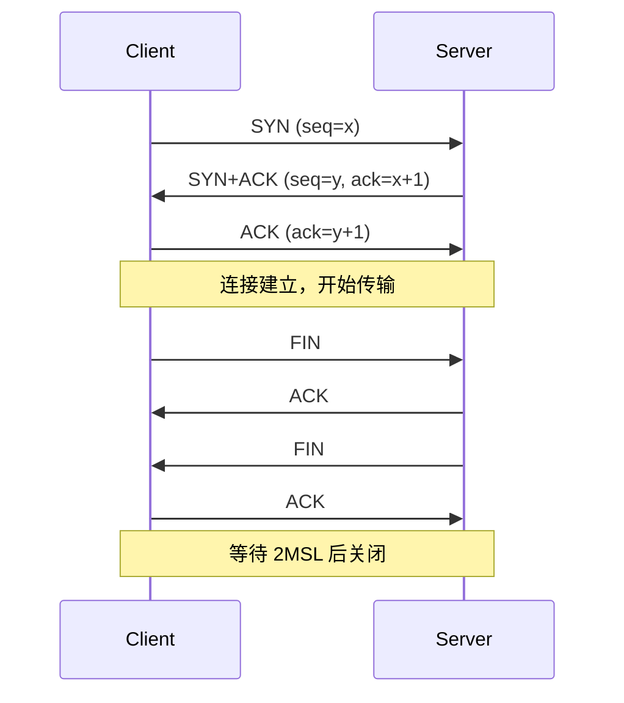
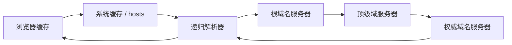

## Table of contents

> 本文属于 Mimas 个人技术博客（Astro 7 + TypeScript + Tailwind CSS 4，中英双语站点）的博客文章，项目语境见 `.trae/rules/doc-gen/00-context.md`。

首屏时间里有相当一部分花在「还没有开始传内容」上：DNS 查询、TCP 握手、TLS 协商，每个环节都至少一个 RTT。前端无法直接控制这些协议，但可以通过域名设计、预连接、协议升级和 CDN 策略影响它们。

## 一、传输层与连接

### 1.1 TCP 与 UDP

| 特性     | TCP                      | UDP                     |
| -------- | ------------------------ | ----------------------- |
| 连接     | 面向连接                 | 无连接                  |
| 可靠性   | 确认、重传、有序         | 不保证送达与顺序        |
| 传输形式 | 字节流                   | 数据报                  |
| 拥塞控制 | 有                       | 无（由应用自行处理）    |
| 头部开销 | 20 字节起                | 8 字节                  |
| 典型用途 | HTTP/1.1、HTTP/2、数据库 | DNS、音视频、游戏、QUIC |

- TCP 提供可靠有序的字节流，代价是握手、确认与重传。
- UDP 不保证可靠，换来低延迟与灵活的应用层控制。
- QUIC 在 UDP 之上实现可靠传输、拥塞控制与多路复用，是 HTTP/3 的传输基础。

### 1.2 三次握手与四次挥手



- 三次握手确认双方收发能力，并同步初始序列号，避免历史连接干扰。
- 握手需要 1 个 RTT，数据要等握手完成后才能发送，这是首屏延迟的固定成本。
- 四次挥手因为 TCP 是全双工，两个方向需要分别关闭。
- 主动关闭方进入 `TIME_WAIT` 并等待 2MSL，保证最后一个 ACK 能到达并让旧报文失效。
- 服务端半连接队列与全连接队列溢出会导致连接超时，SYN Flood 常用 SYN Cookie 缓解。

### 1.3 可靠传输与流量控制

- 每个字节都有序号，接收方通过 ACK 确认，超时或重复 ACK 触发重传。
- 快速重传在收到三个重复 ACK 后立即重发，不必等待超时。
- 滑动窗口允许发送方在未收到确认时连续发送多个报文，提高吞吐。

```ts
class SlidingWindowSender {
  private base = 0;
  private nextSeq = 0;

  constructor(
    private windowSize: number,
    private transmit: (seq: number) => void
  ) {}

  fill(): void {
    while (this.nextSeq < this.base + this.windowSize) {
      this.transmit(this.nextSeq++);
    }
  }

  onAck(seq: number): void {
    if (seq < this.base) return; // 过期确认
    this.base = seq + 1; // 累计确认
    this.fill();
  }

  onTimeout(): void {
    this.nextSeq = this.base; // 回退到窗口起点重传
    this.fill();
  }
}
```

- 流量控制由接收方窗口决定，防止发送过快压垮接收端缓冲。
- 拥塞控制由发送方根据网络状况调整，慢启动指数增长，拥塞避免线性增长。
- 丢包时拥塞窗口下降，快速恢复减少吞吐损失。
- Linux 默认拥塞控制算法为 CUBIC，BBR 依据带宽与延迟建模，弱网与长肥管道表现不同。

### 1.4 Nagle 与延迟 ACK

- Nagle 算法会合并小包，等待前一个包的 ACK 后再发送，减少网络中小包数量。
- 延迟 ACK 会等待一段时间再确认，期望捎带数据，常见延迟为 40ms 量级。
- 两者叠加会造成明显的交互延迟，实时性要求高的连接会开启 `TCP_NODELAY` 关闭 Nagle。
- 前端无法直接设置 TCP 选项，浏览器与服务器各自决定，排查时可关注小请求是否出现固定延迟。

## 二、QUIC 与 HTTP/3

- QUIC 基于 UDP，在用户态实现可靠传输、拥塞控制与加密。
- 流级别多路复用，单个流丢包不会阻塞其他流，消除了 TCP 层队头阻塞。
- 连接建立与 TLS 1.3 合并，首次 1-RTT，会话恢复可 0-RTT。
- 使用连接 ID 而非四元组标识连接，网络切换（如 Wi-Fi 转蜂窝）时连接可迁移。
- 0-RTT 数据存在重放风险，只应对幂等请求启用。
- 浏览器与 CDN 支持程度不一，通常按可用性自动回退到 HTTP/2。

## 三、TLS 与 HTTPS

### 3.1 加密与证书

- 非对称加密用于密钥交换与身份验证，对称加密用于批量数据，兼顾安全与性能。
- 证书由 CA 签发，包含公钥、域名、有效期与签名，浏览器沿证书链校验到受信任根证书。
- 证书要覆盖实际访问的域名，通配符证书只覆盖一级子域。
- 证书过期、域名不匹配、链不完整都会导致浏览器拦截。
- 吊销状态通过 CRL 或 OCSP 查询，OCSP Stapling 由服务器代取并随握手下发，减少客户端请求。

### 3.2 握手差异

| 版本    | 完整握手 | 会话恢复 | 特点                             |
| ------- | -------- | -------- | -------------------------------- |
| TLS 1.2 | 2-RTT    | 1-RTT    | 支持 RSA 密钥交换，配置复杂      |
| TLS 1.3 | 1-RTT    | 0-RTT    | 强制前向安全，精简套件，握手加密 |

- TLS 1.3 删除了静态 RSA 密钥交换与大量弱算法，默认提供前向安全。
- 1-RTT 指客户端在第一个往返后即可发送加密应用数据。
- 0-RTT 复用会话票据，提前发送数据，但可能被重放。
- 握手期间 `ClientHello` 携带 SNI，早期明文传输，ECH 可加密该字段。
- ALPN 在握手中协商应用协议，`h2` 与 `h3` 由此确定。

```ts
// 本地验证 HTTPS 与证书链的最小服务
import { createServer } from "node:https";
import { readFileSync } from "node:fs";

createServer(
  {
    key: readFileSync("key.pem"),
    cert: readFileSync("cert.pem"),
  },
  (_req, res) => res.end("ok")
).listen(8443);
```

### 3.3 安全上下文

- Service Worker、剪贴板、地理位置、部分存储能力要求安全上下文，HTTPS 或 localhost。
- HTTPS 页面加载 HTTP 主动内容（脚本、样式、XHR）会被直接拦截，被动内容会给出警告。
- HSTS 通过 `Strict-Transport-Security` 强制后续请求使用 HTTPS，可申请加入浏览器预加载列表。
- 混合内容与证书问题应在上线前用真实域名验证，而不是只在本地开发环境测试。

## 四、DNS

### 4.1 解析流程



- 递归解析器代替客户端逐级查询，并把结果按 TTL 缓存。
- 常见记录类型：A（IPv4）、AAAA（IPv6）、CNAME（别名）、MX（邮件）、TXT（校验与声明）、NS（权威服务器）。
- TTL 决定缓存时长，过短增加查询压力，过长导致切换不灵活。
- 解析失败也会被负缓存，排查时要考虑缓存未过期的情况。
- DNS 查询通常基于 UDP 53 端口，响应过大时回退 TCP。

### 4.2 DoH 与 DoT

- DNS over HTTPS 把查询封装在 HTTPS 中，复用 443 端口，难以被中间设备识别与篡改。
- DNS over TLS 使用 853 端口，提供加密但不改变 DNS 语义。
- 加密 DNS 提升了隐私，也让企业内网的分流与审计更复杂。
- 前端可通过 `dns-prefetch` 提前解析域名，降低后续请求的等待。

## 五、CDN

### 5.1 边缘缓存与回源

- CDN 把内容缓存到离用户更近的边缘节点，缩短 RTT 并分担源站压力。
- 未命中时边缘节点回源，回源链路与缓存键设计决定命中率。
- 缓存键通常包含 URL、查询参数与 `Vary` 指定的头部，键设计过细会降低命中率。
- 动态内容可通过动态加速、边缘计算或 `stale-while-revalidate` 改善。
- 清除缓存（purge）要覆盖所有边缘节点，发版时应配合文件名哈希而非依赖清除。

### 5.2 调度与协议

- CDN 通过 DNS 调度或 Anycast 把用户导向就近节点。
- 边缘节点与源站之间可使用长连接、HTTP/2 或 HTTP/3，减少重复握手。
- 静态资源与动态接口通常分域名，便于分别设置缓存与协议策略。
- 边缘缓存命中率、回源率、首字节时间是评估 CDN 效果的核心指标。

## 六、前端关注点

- 用 `<link rel="preconnect">` 提前完成 DNS、TCP、TLS，减少首屏关键请求的等待。
- HTTP/1.1 下浏览器对单域名并发连接有限制，HTTP/2 多路复用后域名收敛更有利。
- 通过 Resource Timing 的 `nextHopProtocol` 确认实际使用的是 `h2` 还是 `h3`。
- 大文件上传下载使用分片与 Range，避免单连接长时间占用与小包延迟。
- 证书过期、HSTS 配置错误、CDN 回源失败都会表现为全站不可用，应纳入监控。
- 弱网下握手与重传成本被放大，减少请求数、复用连接、使用缓存比压缩几 KB 代码更有效。
