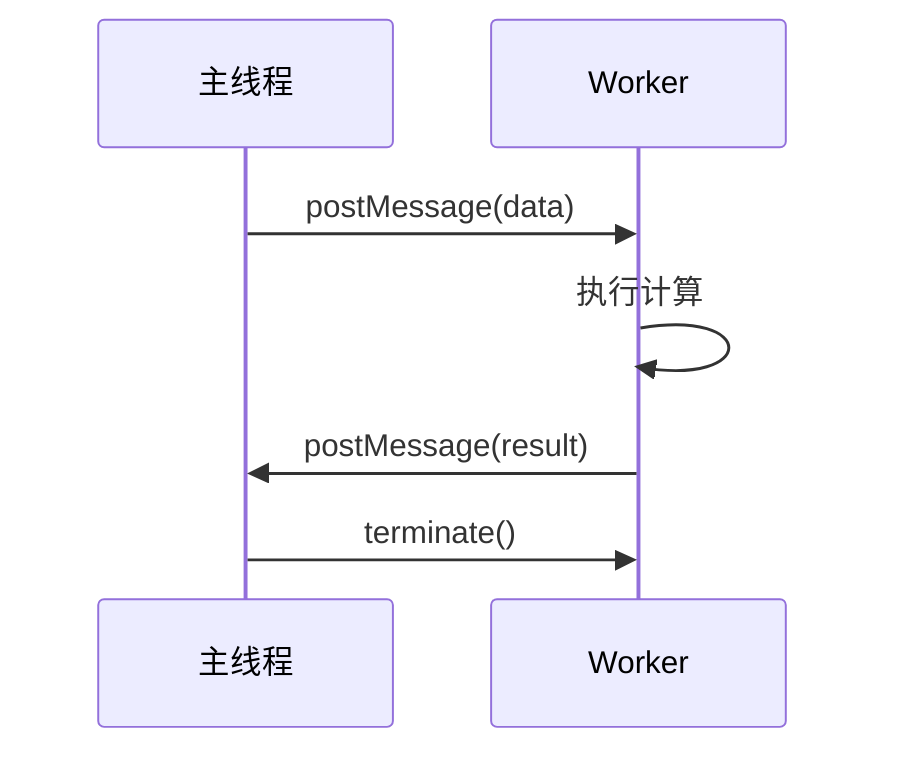

## Table of contents

## Worker与最佳实践

本篇覆盖 Worker 的三种形态及其工程约束：专用 Worker 的消息模型与可转移对象、共享 Worker 的端口路由、Service Worker 的生命周期与缓存策略，以及围绕可维护性、性能与部署的落地做法。

### 1. Worker 概述

#### 1.1 与主线程的关系

Worker 是独立于主线程的并行执行环境，拥有自己的事件循环，不共享 DOM，也不共享主线程的 JavaScript 堆。

- 数据通过结构化克隆传递，每次 `postMessage` 都是一次深拷贝。
- 主线程被阻塞时 Worker 仍可运行，反之亦然，两侧互不阻塞各自的渲染与计算。
- 通信是异步的，消息按发送顺序进入对方的事件队列。

#### 1.2 类型与全局作用域

| 类型 | 作用范围 | 全局对象 | 典型用途 |
| --- | --- | --- | --- |
| Dedicated Worker | 单个页面 | `self`（`DedicatedWorkerGlobalScope`） | 密集计算、数据处理 |
| Shared Worker | 同源多页面 | `self`（`SharedWorkerGlobalScope`） | 多标签页共享连接 |
| Service Worker | 源下所有页面 | `self`（`ServiceWorkerGlobalScope`） | 请求拦截、离线缓存 |

- 三者的全局作用域都没有 `window`、`document`，也无法访问 `localStorage`。
- 可用能力包括 `fetch`、`WebSocket`、`IndexedDB`、`Cache`、`setTimeout` 与 `importScripts`。

#### 1.3 限制

- 不能操作 DOM，所有界面更新必须回传主线程执行。
- 不能使用 `alert`、`confirm` 等阻塞式对话框。
- Service Worker 必须运行在 HTTPS 或 `localhost` 下，且受作用域路径约束。
- Worker 的启动有额外内存与线程开销，短任务直接在主线程执行更快。

### 2. 专用 Worker

#### 2.1 创建与消息

```js
const worker = new Worker("./worker.js", { type: "module" });
worker.postMessage({ type: "sum", data: [1, 2, 3] });
worker.onmessage = (event) => console.log(event.data);
```

```js
// worker.js
self.onmessage = (event) => {
  const { data } = event;
  self.postMessage({ result: data.reduce((a, b) => a + b, 0) });
};
```

通信关系如下，主线程与 Worker 各自持有对方的消息入口：



- `type: "module"` 让 Worker 支持静态导入，默认值为 `classic`。
- 消息可以是任意结构化克隆支持的值，函数、类实例与 DOM 节点无法传递。
- 建议约定 `{ type, payload, id }` 协议，便于在单一入口上做分发与请求响应配对。

#### 2.2 生命周期与可转移对象

- Worker 在 `new Worker` 时启动，`terminate()` 立即结束线程，页面卸载时浏览器自动回收。
- Worker 内部调用 `close()` 会结束自身，此后 `postMessage` 不再送达。
- 没有自动的重启机制，崩溃后需要重新创建实例。

```js
const buffer = new ArrayBuffer(1024 * 1024);
worker.postMessage(buffer, [buffer]);
console.log(buffer.byteLength); // 0，所有权已转移
```

- 可转移对象包括 `ArrayBuffer`、`MessagePort`、`ImageBitmap`、`OffscreenCanvas`。
- 转移是零拷贝，原线程失去访问权，适合传递大块二进制数据。
- 未列入转移列表的对象仍走结构化克隆，大对象会产生明显的内存复制开销。

#### 2.3 错误处理

```js
worker.onerror = (event) => {
  console.error(event.message, event.filename, event.lineno);
  event.preventDefault(); // 阻止默认的控制台输出
};
```

- `error` 事件携带消息、文件、行号与列号，但 `event.error` 在跨源脚本中可能为空。
- Worker 内部未捕获的异常会同步到主线程的 `error` 事件，不会冒泡到页面的 `try/catch`。
- 业务语义上的失败应通过消息协议返回，而不是依赖 `error` 事件区分。

### 3. 共享 Worker

```js
const shared = new SharedWorker("./shared.js");
shared.port.start();
shared.port.postMessage({ type: "subscribe" });
shared.port.onmessage = (event) => console.log(event.data);
```

```js
// shared.js
const ports = new Set();

self.onconnect = (event) => {
  const port = event.ports[0];
  ports.add(port);

  port.onmessage = (msg) => {
    ports.forEach((p) => p.postMessage(msg.data)); // 广播
  };
};
```

- 同源的多个页面连接同一个 Shared Worker 实例，进程内只存在一份线程。
- 通信走 `MessagePort`，赋值 `port.onmessage` 会隐式启动端口，用 `addEventListener` 监听则必须先调用 `port.start()`。
- 多页面场景需要自行设计消息路由，按 `type` 或连接标识分发，避免广播风暴。
- 页面全部关闭后 Worker 仍可能存活一段时间，资源清理需要显式处理。

### 4. Service Worker

#### 4.1 注册与生命周期

```js
navigator.serviceWorker.register("/sw.js", { scope: "/" }).then((registration) => {
  console.log(registration.scope);
});
```

- 生命周期依次为 `install`、`waiting`、`activate`，新版本默认处于 `waiting`，直到所有受控页面关闭。
- `install` 阶段适合 `cache.addAll` 预缓存，失败会导致安装中止。
- `activate` 阶段清理旧版本缓存，`clients.claim()` 可让新版本立即接管已有页面。
- `skipWaiting()` 跳过等待，但可能与正在使用旧资源的页面冲突，需配合刷新策略。

#### 4.2 缓存策略与页面通信

| 策略 | 行为 | 适用资源 |
| --- | --- | --- |
| cache-first | 命中缓存即返回，否则请求并写入 | 静态资源、字体 |
| network-first | 优先请求，失败回退缓存 | 接口数据、HTML |
| stale-while-revalidate | 先返回旧缓存，后台更新 | 列表数据、图片 |

```js
self.addEventListener("fetch", (event) => {
  event.respondWith(
    caches.match(event.request).then((cached) => cached || fetch(event.request))
  );
});
```

- 页面发消息给 Service Worker 用 `registration.active.postMessage`，反向通过 `clients.matchAll` 逐个 `postMessage`。
- 缓存键默认是完整 URL，带查询参数的请求需要自行归一化，否则命中率会下降。
- 只应拦截同源请求，跨域资源加入缓存需谨慎，避免返回过期的第三方内容。

#### 4.3 更新机制

- 浏览器在导航请求时检查 `sw.js`，按字节比较，任意改动都会触发更新流程。
- 未改动的脚本可能被浏览器缓存最多 24 小时，因此需要对 `sw.js` 设置 `Cache-Control: no-cache`。
- `updatefound` 事件配合 `installing.state` 可监听新版本安装进度。
- 更新提示 UI 由业务决定，常见做法是提示刷新，而不是静默 `skipWaiting`。

### 5. 可维护性

#### 5.1 代码规范与松耦合

- 一个 Worker 只承担一类职责，计算型与网络型分开，避免消息协议膨胀。
- 消息协议集中定义在共享模块中，主线程与 Worker 共同导入，避免字符串常量重复。
- Worker 不直接接触业务状态，输入输出都通过消息传递，便于单独测试。

```js
// protocol.js
export const MSG = {
  SUM: "sum",
  RESULT: "result",
};
```

#### 5.2 编码惯例与全局污染

- Worker 顶层避免声明与全局 API 同名的变量，如 `name`、`onmessage`、`close`。
- 用模块作用域或 IIFE 包裹内部实现，只暴露必要的消息入口。
- 不在 Worker 内使用 `importScripts` 与 ES 模块混用，两者在同一 Worker 中互斥。
- 状态尽量保存在消息作用域内，避免跨消息累积隐式全局状态导致测试困难。

### 6. 性能与部署

#### 6.1 作用域意识与批量更新

- 把 CPU 密集型计算、大数组排序、解析与加解密移入 Worker，主线程只保留渲染与事件响应。
- DOM 操作在主线程完成，回传前先在 Worker 内完成数据加工，减少主线程的计算量。
- 批量更新优于逐条更新：使用 `DocumentFragment` 或 `requestAnimationFrame` 合并多次修改，避免强制同步布局。

```js
const fragment = document.createDocumentFragment();
items.forEach((item) => fragment.appendChild(createRow(item)));
list.appendChild(fragment);
```

- 高频消息要做节流或合并，逐条 `postMessage` 会让主线程事件队列持续积压。
- 避免在 Worker 与主线程之间往返传递大对象，优先转移 `ArrayBuffer` 而不是克隆。

#### 6.2 压缩与构建产物校验

- Worker 入口需要独立打包，文件名带内容哈希，并在 `new Worker` 处传入构建后的路径。
- 构建后校验产物：确认 Worker chunk 已生成、MIME 为 JavaScript、路径与部署基础路径一致。
- Service Worker 的 `scope` 受文件路径限制，部署在子路径时应放在对应目录并显式指定 `scope`。
- 生产环境应校验缓存版本号，避免旧缓存与新资源混用导致资源加载失败。
