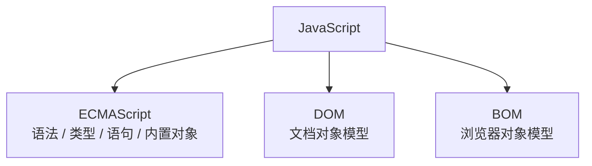

## Table of contents

## JS基础

本篇覆盖 JavaScript 的组成、在 HTML 中的引入方式、语法约束、变量声明、数据类型、操作符与语句。这些内容构成后续变量与内存、引用类型、函数等篇章的公共前提。

### 1. JavaScript 的组成

JavaScript 由三部分组成，其中只有 ECMAScript 是语言本身，DOM 和 BOM 由宿主环境提供。



- ECMAScript 定义语法、类型、语句、关键字、操作符和内置对象。
- DOM 把 HTML 文档映射为节点树，提供操作页面结构的 API。
- BOM 提供与浏览器窗口交互的能力，如 `window`、`location`、`history`、`navigator`。
- Node.js 等非浏览器宿主不提供 DOM 和 BOM，改为提供 `fs`、`process` 等 API。

版本演进：1995 年 Netscape 的 Brendan Eich 实现第一版；1997 年提交 ECMA 标准化为 ECMA-262；ES5 于 2009 年发布；ES6（ES2015）引入 `let`、`const`、类、模块、`Promise` 等特性，此后转为年度发布。

### 2. HTML 中的 script

#### 2.1 行内脚本与外部文件

```html
<script>
  console.log("inline");
</script>

<script src="./main.js"></script>
```

- 带 `src` 的 `script` 标签，标签内部的代码会被忽略。
- 外部文件便于缓存和复用，行内脚本适合少量初始化代码。
- 传统写法把 `script` 放在 `body` 末尾，保证 DOM 已解析完成；配合 `defer` 可以放在 `head`。

#### 2.2 加载与执行时序

默认情况下，解析器遇到既没有 `defer` 也没有 `async` 的 `script`，会暂停 HTML 解析，下载并执行脚本后再继续，期间阻塞渲染。

| 属性 | 下载行为 | 执行时机 | 执行顺序 |
| --- | --- | --- | --- |
| 无 | 阻塞解析 | 下载完成后立即执行 | 按文档顺序 |
| `defer` | 并行下载 | 文档解析完成后、`DOMContentLoaded` 之前 | 按文档顺序 |
| `async` | 并行下载 | 下载完成后立即执行 | 不保证顺序 |

```html
<script src="./a.js" defer></script>
<script src="./b.js" defer></script>
```

- `defer` 适合依赖 DOM 或存在先后依赖的脚本。
- `async` 适合统计、广告等相互独立的脚本。
- 两者都只对外部脚本生效，行内脚本会忽略这两个属性。

动态插入的脚本默认相当于 `async`，需要保证顺序时可以显式关闭：

```js
const script = document.createElement("script");
script.src = "./lazy.js";
script.async = false;
document.head.appendChild(script);
```

#### 2.3 noscript 与废弃写法

`<noscript>` 在脚本被禁用或浏览器不支持时显示内容。XHTML 时代的自闭合写法 `<script />`，以及用 HTML 注释包裹脚本内容的写法，均已废弃。

### 3. 语法与严格模式

#### 3.1 基础语法

- 区分大小写：`typeof` 是操作符，`TypeOf` 只是普通标识符。
- 标识符由字母、数字、下划线、美元符号组成，不能以数字开头。
- 注释支持 `//` 单行与 `/* */` 多行。
- 语句以分号结尾，省略时由 ASI（自动分号插入）补齐；推荐显式写分号，避免 `return` 换行等歧义。
- 关键字与保留字不能用作标识符，`let`、`yield`、`await`、`enum` 等在特定上下文保留。

#### 3.2 严格模式

在脚本或函数开头写 `"use strict";` 开启严格模式，主要变化如下：

- 未声明的变量赋值会抛出 `ReferenceError`，不再隐式创建全局变量。
- 禁止 `with` 语句。
- 禁止删除变量、函数和不可配置属性。
- 函数参数不能重名，`arguments` 不再与形参联动。
- 普通函数调用中的 `this` 为 `undefined`，不再指向全局对象。

```js
"use strict";

function f() {
  // undeclared = 1; // ReferenceError
  return this; // undefined
}
```

ES 模块默认处于严格模式，无需显式声明。

### 4. 变量声明

| 声明 | 作用域 | 提升行为 | 重复声明 | 初始化 |
| --- | --- | --- | --- | --- |
| `var` | 函数作用域 | 提升并初始化为 `undefined` | 允许 | 可选 |
| `let` | 块级作用域 | 提升但不初始化，存在暂时性死区 | 不允许 | 可选 |
| `const` | 块级作用域 | 同 `let` | 不允许 | 必须 |

```js
var a = 1;
let b = 2;
const c = 3;

{
  let b = 4; // 块内新变量，不影响外层
}
```

- `var` 在全局作用域声明的变量会成为 `window` 的属性，`let` 和 `const` 不会。
- `const` 约束的是绑定而非值，对象和数组的内部成员仍可修改：

```js
const user = { name: "Mimas" };
user.name = "Other"; // 允许
// user = {}; // TypeError
```

- 声明风格：默认 `const`，需要重新赋值时用 `let`，避免 `var`。
- 提升与暂时性死区的完整行为在「变量与内存」一篇展开。

### 5. 数据类型

JavaScript 有 7 种原始类型和 1 种引用类型。

| 类型 | `typeof` 结果 | 说明 |
| --- | --- | --- |
| Undefined | `"undefined"` | 已声明但未赋值 |
| Null | `"object"` | 空对象指针，历史遗留问题 |
| Boolean | `"boolean"` | `true` / `false` |
| Number | `"number"` | IEEE 754 双精度浮点 |
| BigInt | `"bigint"` | 任意精度整数 |
| String | `"string"` | UTF-16 序列，不可变 |
| Symbol | `"symbol"` | 唯一标识符 |
| Object | `"object"` / `"function"` | 引用类型 |

#### 5.1 Undefined 与 Null

`undefined` 表示变量已声明但未赋值；`null` 表示有意置空。`null == undefined` 为 `true`，`null === undefined` 为 `false`。

#### 5.2 Number

- 所有数字都是双精度浮点，安全整数范围为 -(2⁵³ - 1) 到 2⁵³ - 1。
- `NaN` 表示无效数值，且 `NaN !== NaN`，判断应使用 `Number.isNaN`。
- 浮点运算存在精度误差，`0.1 + 0.2 !== 0.3`。
- `Infinity`、`-Infinity`、`-0` 等特殊值需要单独处理。

#### 5.3 String 与模板字面量

字符串不可变，任何修改都会返回新字符串。模板字面量使用反引号，支持插值和多行：

```js
const name = "Mimas";
const message = `Hello, ${name}`;
```

#### 5.4 Symbol 与 BigInt

`Symbol` 每次调用都产生唯一值，常用作属性键避免命名冲突；`BigInt` 表示超出 Number 安全范围的整数，字面量以 `n` 结尾：

```js
const key = Symbol("id");
const big = 9007199254740993n;
```

#### 5.5 原始值与引用值

原始值按值复制，引用值复制的是地址，两者在赋值、比较和传参时的行为不同，具体在「变量与内存」一篇说明。

### 6. 操作符

按功能分类：

- 一元：`++`、`--`、`+`、`-`、`!`、`~`、`typeof`、`void`、`delete`
- 位：`&`、`|`、`^`、`~`、`<<`、`>>`、`>>>`
- 布尔：`&&`、`||`、`!`
- 乘性：`*`、`/`、`%`
- 指数：`**`
- 加性：`+`、`-`
- 关系：`<`、`>`、`<=`、`>=`、`instanceof`、`in`
- 相等：`==`、`!=`、`===`、`!==`
- 条件：`?:`
- 赋值：`=`、`+=`、`&&=`、`??=` 等
- 逗号：`,`

需要重点区分的几组：

```js
1 == "1"; // true，发生类型转换
1 === "1"; // false

Object.is(NaN, NaN); // true
Object.is(0, -0); // false
```

- `==` 会按规则做类型转换，`===` 不转换，日常比较使用 `===`。
- `Object.is` 与 `===` 的差别仅在 `NaN` 和 `±0`。
- `&&`、`||` 返回操作数本身，而不是布尔值。
- `??` 仅在左侧为 `null` 或 `undefined` 时取右侧，`?.` 在左侧为 `null` 或 `undefined` 时短路，二者属于 ES2020 新增。

### 7. 语句

控制流语句包括 `if`、`do-while`、`while`、`for`、`for-in`、`for-of`、`switch`，以及 `break`、`continue`、`label`。

```js
for (const key in object) {
  // 遍历可枚举属性名，包括原型链上的属性
}

for (const value of iterable) {
  // 遍历可迭代对象的值
}
```

- `for-in` 遍历属性名，`for-of` 遍历可迭代对象的值，数组推荐 `for-of`。
- `for-in` 会访问原型链上的可枚举属性，需要过滤时配合 `Object.hasOwn`。
- `switch` 使用全等比较，所有 `case` 都不匹配时进入 `default`。
- `break` 跳出当前循环或 `switch`，`continue` 跳过本次迭代，`label` 可指定跳出的外层循环。
- `with` 会改变作用域链，性能和可读性都差，严格模式下禁用。

### 8. 函数概览

函数是一等对象，可以赋值给变量、作为参数传递、作为返回值返回。

```js
function add(a, b) {
  return a + b;
}

const add2 = (a, b) => a + b;
```

- 函数声明会提升，函数表达式不会。
- 参数按值传递，传入对象时传递的是引用值。
- 没有重载，同名函数后声明覆盖先声明。
- `this`、闭包、`arguments`、箭头函数的差异在「函数」一篇展开。
