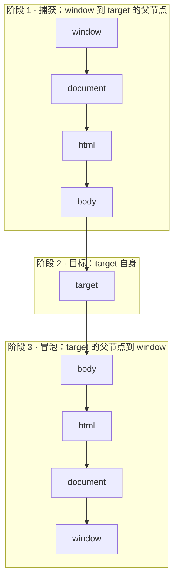

## Table of contents

## 事件

本篇覆盖事件流与传播路径、三种事件处理程序注册方式、事件对象上的关键属性与方法、各类事件类型的代表成员，以及事件委托与处理程序生命周期相关的内存和性能问题。

### 1. 事件流

#### 1.1 捕获与冒泡

事件流描述事件从触发到结束的传播路径。捕获阶段由最外层祖先向目标下行，冒泡阶段由目标向上回溯至 `window`。`addEventListener` 的第三个参数或选项对象中的 `capture` 决定监听器挂在哪个阶段。



IE 早期只支持冒泡的 `attachEvent` 模型，且 `this` 指向 `window`，该模型已在现代浏览器中移除。

#### 1.2 DOM 事件流的三个阶段

规范定义的事件流包含捕获、目标、冒泡三个阶段。在目标节点上，捕获与冒泡监听器都处于目标阶段，按注册顺序依次触发，不区分阶段。

```js
const button = document.querySelector("button");

button.addEventListener(
  "click",
  () => {
    // capture on target, still fires at target phase
  },
  true
);

button.addEventListener("click", () => {
  // bubble on target, fires after the capture listener above
});
```

#### 1.3 阻断传播

`stopPropagation` 阻止事件继续传播到后续节点，`stopImmediatePropagation` 额外阻止当前节点上剩余监听器执行。阻断只影响传播，不影响默认行为。

```js
button.addEventListener("click", event => {
  event.stopPropagation(); // ancestors will not receive the event
});
```

### 2. 事件处理程序

#### 2.1 HTML 属性与 DOM0

HTML 属性写法把代码暴露在标记里，作用域链包含 `document` 与元素自身，可读性差且难以解绑，仅适合极少量演示场景。

```html
<button onclick="handleClick()">submit</button>
```

DOM0 方式把函数赋值给 `onclick` 一类属性，同一事件只能绑定一个处理程序，后赋值覆盖先赋值。赋 `null` 即解绑。

```js
button.onclick = function () {
  // single handler only
};

button.onclick = null;
```

DOM0 处理程序在冒泡阶段触发，作用域为元素自身，`this` 指向元素。

#### 2.2 DOM2 addEventListener

`addEventListener` 支持同一事件绑定多个处理程序，按注册顺序触发，并通过 `removeEventListener` 精确移除。移除时必须传入相同的函数引用、相同的 `capture` 值，匿名函数无法移除。

```js
function onClick() {
  // ...
}

button.addEventListener("click", onClick);
button.removeEventListener("click", onClick);

// arrow function here cannot be removed
button.addEventListener("click", () => {});
```

#### 2.3 选项对象

第三个参数可传布尔值或选项对象：

| 选项      | 作用                                                        |
| --------- | ----------------------------------------------------------- |
| `capture` | 在捕获阶段触发                                              |
| `once`    | 触发一次后自动移除                                          |
| `passive` | 承诺不调用 `preventDefault`，允许浏览器不等监听器返回就滚动 |
| `signal`  | 绑定 `AbortSignal`，调用 `abort()` 批量移除                 |

```js
const controller = new AbortController();

window.addEventListener("scroll", onScroll, {
  passive: true,
  signal: controller.signal,
});
controller.abort(); // removes the listener above
```

### 3. 事件对象

事件对象由浏览器创建并传入处理程序，`target` 是实际触发事件的元素，`currentTarget` 是当前正在执行监听器的元素。在事件委托中两者通常不同。

```js
list.addEventListener("click", event => {
  event.target; // the clicked <li>
  event.currentTarget; // the <ul>
  event.eventPhase; // 3, bubble phase
});
```

`preventDefault` 取消默认行为，`returnValue = false` 是等价的历史写法；默认行为能否取消取决于事件的 `cancelable`。`stopPropagation` 阻断后续节点，`stopImmediatePropagation` 同时阻断同级剩余监听器。

```js
form.addEventListener("submit", event => {
  if (!isValid()) {
    event.preventDefault();
    // native submission is cancelled
  }
});
```

`eventPhase` 取值 `1`、`2`、`3` 分别对应捕获、目标、冒泡，`0` 表示不在传播过程中（如在异步回调里读取）。`isTrusted` 区分用户触发与脚本构造，`dispatchEvent` 派发的事件 `isTrusted` 为 `false`。

### 4. 事件类型

| 类别       | 代表事件                                                                    |
| ---------- | --------------------------------------------------------------------------- |
| UI         | `load`、`unload`、`resize`、`scroll`                                        |
| 焦点       | `focus`、`blur`（不冒泡）、`focusin`、`focusout`（冒泡）                    |
| 鼠标       | `click`、`dblclick`、`mousedown`、`mouseup`、`mousemove`                    |
| 移入移出   | `mouseenter` / `mouseleave`（不冒泡）、`mouseover` / `mouseout`（冒泡）     |
| 滚轮       | `wheel`，`deltaX`、`deltaY`、`deltaMode`                                    |
| 键盘       | `keydown`、`keyup`，`key`、`code`、`repeat`                                 |
| 输入       | `beforeinput`（可取消）、`input`                                            |
| 合成       | `compositionstart`、`compositionupdate`、`compositionend`                   |
| 变化       | `change`，在值提交或失焦时触发                                              |
| HTML5      | `DOMContentLoaded`、`hashchange`、`popstate`、`contextmenu`、`beforeunload` |
| 设备与触摸 | `touchstart`、`touchmove`、`touchend`、`pointerdown`、`deviceorientation`   |

```js
input.addEventListener("compositionstart", () => {
  composing = true; // ignore input events during IME composition
});
input.addEventListener("compositionend", event => {
  composing = false;
  event.data; // committed text
});
input.addEventListener("input", () => {
  if (composing) return;
  // handle the value after composition
});
```

- `keypress` 已废弃，字符输入判断改用 `beforeinput` 或 `input`。
- `mouseenter` 与 `mouseleave` 不冒泡，适合单个容器；需要委托时改用 `mouseover` 与 `mouseout`。
- `touch` 事件与 `pointer` 事件并存时，优先使用 `pointer` 统一鼠标、触摸与手写笔。

### 5. 内存与性能

#### 5.1 事件委托

把监听器挂在共同祖先上，利用冒泡统一处理子元素事件，避免为每个子元素单独绑定。委托的收益随子元素数量增长，动态增删子元素时也无需重新绑定。

```js
list.addEventListener("click", event => {
  const item = event.target.closest("li[data-id]");
  if (!item || !list.contains(item)) return;
  select(item.dataset.id);
});
```

委托的代价是每次冒泡都要执行判断，`closest` 需要限定边界，否则可能匹配到容器之外的祖先。`focus`、`blur` 不冒泡，需要委托时使用 `focusin`、`focusout`。

#### 5.2 及时移除处理程序

处理程序持有元素引用，元素从文档移除后若仍被监听器引用，垃圾回收无法释放。长期存在的宿主对象（`window`、`document`）上注册的监听器尤其需要注意，单页应用的路由切换应显式解绑或使用 `AbortController`。

```js
function mount() {
  const controller = new AbortController();
  window.addEventListener("resize", onResize, { signal: controller.signal });
  return () => controller.abort();
}
```

#### 5.3 passive 与滚动性能

触屏与滚轮监听器默认可能阻塞滚动，浏览器需等待监听器返回才决定是否调用 `preventDefault`。声明 `passive: true` 后浏览器立即滚动，监听器内调用 `preventDefault` 无效并在控制台给出警告。`touchend` 不受此限制，`wheel` 与 `touchstart`、`touchmove` 受影响最大。

```js
document.addEventListener("touchmove", onMove, { passive: true });
```
