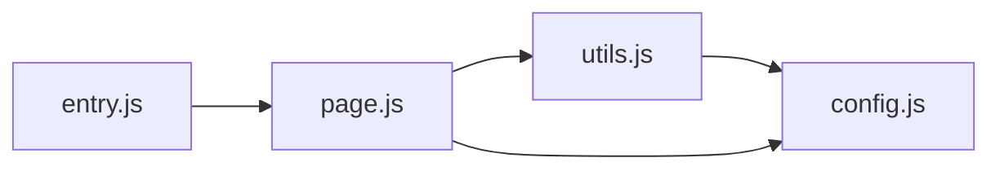

## Table of contents

## 客户端存储与模块

本篇覆盖两条相对独立的线索：浏览器端的数据持久化方案（cookie、Web Storage、IndexedDB）与代码组织方案（从 IIFE 命名空间到 ES6 模块）。二者在 Service Worker 与离线场景中交汇，因此放在同一篇内对照。

### 1. cookie

#### 1.1 构成与限制

cookie 由 `name=value` 与若干属性组成，属性包括 `Domain`、`Path`、`Expires` 或 `Max-Age`、`Secure`、`HttpOnly`、`SameSite`。

- 单个 cookie 约 4KB，单域名数量上限约 50 个，各浏览器略有差异。
- 同一域名下的 cookie 会随每次同源请求自动携带，因此体积直接影响请求头大小。
- `Domain` 设置后对子域生效，`Path` 限定生效路径，二者共同决定发送范围。

#### 1.2 读写、编码与子 cookie

`document.cookie` 是访问器属性，不是普通字符串：写入是追加，读取返回当前域下所有非 `HttpOnly` 的键值对。

```js
document.cookie = `${encodeURIComponent("token")}=${encodeURIComponent("abc")}; path=/; max-age=3600`;

const token = document.cookie
  .split("; ")
  .map((pair) => pair.split("="))
  .find(([key]) => key === "token")?.[1];
```

- 值中不允许出现分号、逗号与空白，必须用 `encodeURIComponent` 编码。
- 设置同名同路径的 cookie 会覆盖旧值，删除通过把 `max-age` 设为 0 或 `expires` 设为过去时间。
- 子 cookie 是在单个 cookie 内用 `a=1&b=2` 压缩多个键值，用于规避数量限制，但需要自行解析与转义。

#### 1.3 安全属性

| 属性 | 作用 |
| --- | --- |
| `HttpOnly` | 脚本不可读，只能由浏览器在请求中携带，可拦截 XSS 窃取 |
| `Secure` | 仅在 HTTPS 下发送 |
| `SameSite=Strict` | 任何跨站请求都不携带 |
| `SameSite=Lax` | 顶级导航的 GET 请求携带，默认值 |
| `SameSite=None` | 跨站携带，必须同时设置 `Secure` |

- `HttpOnly` 与 `Secure` 只能由服务端通过响应头设置，前端脚本无法写入。
- 敏感凭证应走 `HttpOnly` + `SameSite=Lax` 的组合，避免暴露在 `document.cookie` 中。

### 2. Web Storage

#### 2.1 Storage 接口

`localStorage` 与 `sessionStorage` 都实现 `Storage` 接口，提供 `getItem`、`setItem`、`removeItem`、`clear`、`key` 与 `length`。

```js
localStorage.setItem("theme", "dark");
localStorage.getItem("theme"); // "dark"
localStorage.removeItem("theme");
localStorage.length; // 剩余条目数
```

- 只接受字符串，写入对象会被隐式转为 `"[object Object]"`，必须先 `JSON.stringify`。
- 读取不存在的键返回 `null`，与 `undefined` 不同，判断时应区分。
- 属性式写法 `localStorage.theme` 与 `getItem("theme")` 等价，但键名与内置成员冲突时会出错。

#### 2.2 sessionStorage 与 localStorage

- `sessionStorage` 按标签页隔离，同一标签页内的同源 iframe 共享，关闭标签页后清空。
- `localStorage` 同源共享，无过期时间，需显式删除或由用户清理。
- 两者都是同步 API，读写会阻塞主线程，大量数据应改用 IndexedDB。
- 容量约 5MB 每源，超限时 `setItem` 抛出 `QuotaExceededError`。

#### 2.3 storage 事件与容量限制

```js
window.addEventListener("storage", (event) => {
  if (event.key === "theme") syncTheme(event.newValue);
});
```

- 事件只在同源的其他文档中触发，触发方自身不会收到。
- 事件对象包含 `key`、`oldValue`、`newValue`、`url`、`storageArea`。
- `clear()` 触发时 `key` 为 `null`，需要单独处理。
- 该事件可用于多标签页状态同步，但存在延迟，不适合强一致场景。

### 3. IndexedDB

#### 3.1 数据库与对象存储

IndexedDB 是异步的事务型数据库，数据以对象存储（object store）组织，类似关系库中的表，但不要求固定 schema。

```js
const request = indexedDB.open("blog", 1);

request.onupgradeneeded = (event) => {
  const db = event.target.result;
  const store = db.createObjectStore("posts", { keyPath: "id" });
  store.createIndex("byTag", "tag", { unique: false });
};

request.onsuccess = (event) => {
  const db = event.target.result;
  // ...
};
```

- 版本号只在 `open` 时递增，`onupgradeneeded` 是唯一可以修改对象存储与索引的时机。
- 数据直接存结构化对象，无需手动序列化，支持 `Blob`、`File`、`ArrayBuffer`。
- 一次 `open` 得到的 `IDBDatabase` 连接可复用，页面卸载时应 `close()`。

#### 3.2 事务与索引

```js
const tx = db.transaction("posts", "readwrite");
const store = tx.objectStore("posts");
store.put({ id: 1, title: "post", tag: "js" });
tx.oncomplete = () => { /* 已提交 */ };
tx.onerror = (event) => { /* 已回滚 */ };
```

- 事务模式为 `readonly` 或 `readwrite`，跨存储的事务需在创建时一并声明。
- 事务在微任务队列空闲后自动提交，期间不能再发起新的请求，因此要避免在回调中穿插异步操作。
- 索引通过 `index(name).getAll(query)` 查询，`unique` 索引保证键值唯一。

#### 3.3 游标与异步请求模型

```js
const index = store.index("byTag");
const cursorReq = index.openCursor(IDBKeyRange.only("js"));

cursorReq.onsuccess = (event) => {
  const cursor = event.target.result;
  if (!cursor) return;
  console.log(cursor.value);
  cursor.continue();
};
```

- 游标按索引顺序逐条读取，适合大数据量分页，避免一次性 `getAll` 撑爆内存。
- `cursor.advance(n)` 可跳过若干条，`direction` 支持 `prev` 与 `nextunique`。
- 所有操作都是事件回调式的 `IDBRequest`，可用 `Promise` 包一层获得 `await` 语义，但包装层不应跨事务边界。

### 4. 存储选型

| 方案 | 容量 | 同步性 | 随请求发送 | 适用场景 |
| --- | --- | --- | --- | --- |
| cookie | 约 4KB | 同步 | 是 | 会话凭证、服务端可读的小状态 |
| Web Storage | 约 5MB | 同步 | 否 | 简单键值、主题偏好、草稿 |
| IndexedDB | 按配额，通常数百 MB | 异步 | 否 | 结构化大数据、离线数据副本 |
| Cache Storage | 按配额 | 异步 | 否 | HTTP 响应缓存、配合 Service Worker |

- 凭证放 cookie 并加 `HttpOnly`，界面状态放 Web Storage，业务数据与离线数据放 IndexedDB。
- Cache Storage 缓存的是 `Request`/`Response` 对，适合静态资源与接口响应，不用于业务实体存储。
- 容量整体受浏览器配额与用户清理策略约束，写入前应捕获 `QuotaExceededError` 并降级。

### 5. 模块模式演进

#### 5.1 IIFE 命名空间

ES6 模块之前，浏览器端通过立即执行函数创建私有作用域，只把必要接口挂到全局命名空间上。

```js
var App = App || {};

App.utils = (function () {
  var count = 0;
  function increment() {
    count += 1;
    return count;
  }
  return { increment: increment };
})();
```

- 闭包保证内部变量不可外部访问，暴露面由返回对象决定。
- 命名空间集中在单个全局变量上，减少全局污染，但依赖关系仍靠脚本顺序维护。
- 这种写法没有依赖声明，压缩与静态分析的收益有限。

#### 5.2 CommonJS 与 AMD

- CommonJS 使用 `require` 与 `module.exports`，模块同步加载，适合 Node 的文件系统场景。
- CommonJS 导出的是值的拷贝，导出后再修改模块内部变量不会反映到已引入的绑定上。
- AMD 使用 `define` 与 `require`，异步加载并显式声明依赖，曾用于浏览器端，现基本被 ES 模块取代。
- UMD 是两者加全局变量的兼容包装，只在维护老库时才会遇到。

### 6. ES6 模块

#### 6.1 导入导出语法

```js
// utils.js
export const VERSION = "1.0";
export default function format(value) {
  return String(value).trim();
}

// main.js
import format, { VERSION } from "./utils.js";
import * as utils from "./utils.js";
```

- 命名导出必须与导入名一致，可用 `as` 重命名；默认导出在导入时可任意命名。
- 导入语句会提升到模块顶部，与书写位置无关。
- 导入的绑定是只读的，重新赋值会抛 `TypeError`，但对象内部的属性仍可修改。

#### 6.2 静态分析与循环依赖



- 导入导出在解析阶段确定，属于静态结构，构建工具可据此做 tree shaking。
- 只有被实际引用的命名导出才会进入产物，默认导出的副作用较难剔除。
- 循环依赖时，模块先执行到一半就被对方引用，未初始化的绑定处于暂时性死区，访问会抛 `ReferenceError`。

#### 6.3 动态 import

```js
const { renderChart } = await import("./chart.js");
```

- 返回 `Promise`，用于路由级分包、按需加载与条件加载。
- 动态导入的路径可以是表达式，但过于动态的路径会让打包工具无法预判分块。
- 与静态导入不同，动态导入的模块在首次调用时才求值。

### 7. 模块加载行为

#### 7.1 defer 语义与模块脚本

`<script type="module">` 默认具有 `defer` 语义：并行下载，文档解析完成后按顺序执行，且在 `DOMContentLoaded` 之前。

```html
<script type="module" src="./main.js"></script>
<script type="module" src="./legacy.js" async></script>
```

- 模块脚本天然延迟执行，无需显式写 `defer`；写 `async` 则退化为下载完立即执行。
- 模块内部的 `import` 会触发依赖树的递归获取，父模块在全部依赖求值后才执行。
- 模块脚本按文档顺序执行，但依赖的下载顺序不保证。

#### 7.2 模块作用域与严格模式

- 每个模块有独立作用域，顶层声明的变量不会挂到 `window` 上。
- 模块默认处于严格模式，无需 `"use strict"`，顶层 `this` 为 `undefined`。
- `import.meta.url` 提供当前模块的绝对地址，可用于解析相对资源路径。
- 内联模块脚本同样拥有独立作用域，与外部模块共享同一套语义。
