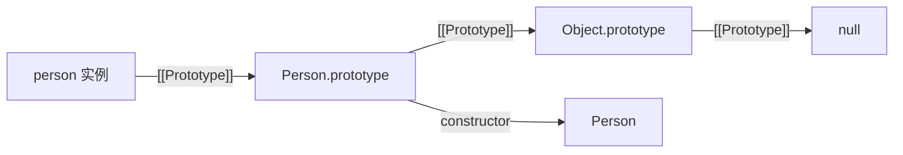

## Table of contents

## 对象与类

本篇整理对象的结构与创建方式，以及基于原型的继承和 ES6 的类语法。对象的属性由特性描述符约束，原型决定属性查找的路径，继承方案在引用共享、参数传递和重复调用之间反复权衡；`class` 是对原型机制的封装，但保留了原型链的运行时语义。

### 1. 对象属性

对象的属性分两类：数据属性保存值，访问器属性由 getter 和 setter 组成。每个属性都有一组内部特性，描述它的可写、可枚举、可配置状态以及取值方式。

#### 1.1 数据属性

数据属性包含 `[[Value]]`、`[[Writable]]`、`[[Enumerable]]`、`[[Configurable]]` 四个特性。通过字面量或赋值创建的属性，四个特性默认为 `true`；通过 `Object.defineProperty` 创建时，未指定的特性默认为 `false`，这是常见的意外只读来源。

```js
const user = { name: "Mimas" };
Object.defineProperty(user, "id", {
  value: 1,
  writable: false,
  enumerable: false,
});

user.id = 2; // 静默失败（严格模式抛 TypeError）
Object.keys(user); // ["name"]，id 不可枚举
```

#### 1.2 访问器属性与特性读取

访问器属性不包含 `[[Value]]` 和 `[[Writable]]`，由 `get` 和 `set` 函数构成，读取和赋值时被调用。访问器常用于校验赋值、派生值和拦截对内部字段的访问，setter 内部不要递归调用自身属性。`Object.getOwnPropertyDescriptor` 读取单个属性的描述符，`getOwnPropertyDescriptors` 返回全部自有属性的描述符，可配合 `defineProperties` 完整复制属性特性。

```js
const book = { _year: 2026 };
Object.defineProperty(book, "year", {
  get() {
    return this._year;
  },
  set(value) {
    if (value > 0) this._year = value;
  },
});

book.year = 2027;
book.year; // 2027，enumerable 与 configurable 默认为 false
Object.getOwnPropertyDescriptor(book, "year").set !== undefined; // true
```

### 2. 对象操作

日常代码中大量操作围绕合并、比较和解构展开。这些操作多为浅层语义，对象内部嵌套的引用不会被递归复制。

#### 2.1 合并与相等判定

对象展开与 `Object.assign` 都是浅复制，只处理自有可枚举属性，后者会触发源对象的 getter，前者不会。`structuredClone` 支持循环引用和多种内置类型，可完成深复制，但函数、DOM 节点等不可克隆。相等判定方面，`Object.is` 与 `===` 的差别只在 `NaN` 和 `±0`，对象之间始终比较引用。

```js
const base = { a: 1, nested: { b: 2 } };
const merged = { ...base, c: 3 };

merged.nested === base.nested; // true，浅复制
Object.is(NaN, NaN); // true
Object.is({}, {}); // false
```

#### 2.2 增强语法与解构

对象字面量支持属性简写、计算属性名和方法简写：属性简写要求变量名与属性名一致，计算属性名在方括号中求值，方法简写省略 `function` 关键字。字面量中的 `__proto__` 可以指定原型，但属于历史遗留写法，推荐 `Object.create`。解构按属性名取值，支持默认值、重命名和剩余属性，默认值只在属性为 `undefined` 时生效；数组解构按位置取值，可用空位跳过元素。

```js
const name = "Mimas";
const key = "age";
const user = { name, [key]: 26, greet() { return this.name; } };

const { name: username, age = 0, ...rest } = user;
const [first, , third] = [1, 2, 3]; // 1 和 3
```

### 3. 创建对象

创建对象的方式经历了从工厂函数到构造函数、再到原型的演进，每一步都在解决前一种方式的缺陷：类型识别、方法复用和内存占用。

#### 3.1 工厂模式与构造函数模式

工厂函数把创建逻辑封装在函数内部，返回新对象，但返回的对象都来自 `Object`，`instanceof` 无法识别具体类型。构造函数通过 `new` 调用，`this` 指向新实例，类型可以识别；若把方法写在构造函数内部，每个实例都会创建一份函数副本，方法无法复用。

```js
function createPerson(name) {
  return { name, greet() { return this.name; } }; // 工厂
}

function Person(name) {
  this.name = name;
  this.greet = function () {
    return this.name;
  }; // 构造函数：方法随实例重复创建
}
```

#### 3.2 原型模式

把共享的属性和方法放到构造函数的 `prototype` 上，实例只保存自身数据，方法在所有实例间共享。原型上的引用类型属性同样被共享，修改会影响全部实例，因此可变状态应放在构造函数内。`Object.create(proto)` 跳过构造函数，直接以指定对象为原型创建实例。

```js
function Person(name) {
  this.name = name;
}

Person.prototype.greet = function () {
  return this.name;
};

const person = new Person("Mimas");
person.greet(); // "Mimas"
```

### 4. 原型与原型链

每个函数都有 `prototype` 属性，指向原型对象；原型对象默认有 `constructor` 指回构造函数。每个对象都有内部槽 `[[Prototype]]`，通过 `Object.getPrototypeOf` 读取，指向创建它的构造函数的 `prototype`。属性查找沿这条链逐级向上，直到 `Object.prototype`，其原型为 `null`。



```js
function Person() {}
const person = new Person();

Object.getPrototypeOf(person) === Person.prototype; // true
person instanceof Person; // true
Object.getPrototypeOf(Object.prototype); // null
```

`for...in` 会遍历原型链上的可枚举属性，`Object.keys` 只返回自有可枚举属性，`Object.hasOwn` 判断属性是否属于对象自身。修改原型会影响所有已创建实例的属性查找结果，运行期改写内置原型（如 `Array.prototype`）会污染全局环境。

### 5. 继承

ES6 之前，继承通过操作原型和构造函数实现，各种方案在「是否共享引用属性」「能否向父构造函数传参」「父构造函数调用次数」上各有取舍。

#### 5.1 原型链继承

把子构造函数的 `prototype` 指向父类的实例，子类实例即可沿原型链访问父类的方法和属性。问题有二：父类实例上的引用属性被所有子类实例共享；创建子类实例时无法向父构造函数传参。

```js
function Super() {
  this.colors = ["red"];
}
function Sub() {}
Sub.prototype = new Super();
const s1 = new Sub();
const s2 = new Sub();
s1.colors.push("blue");
s2.colors; // ["red", "blue"]，引用被共享
```

#### 5.2 盗用构造函数

在子构造函数内部调用 `Super.call(this)`，把父类属性复制到子类实例上，从而让每个实例拥有独立的属性，同时支持传参。缺点是方法只能定义在构造函数内，无法复用；父类原型上的方法也不会被子类继承。

```js
function Super(name) {
  this.name = name;
  this.colors = ["red"];
}
function Sub(name) {
  Super.call(this, name);
}
const s1 = new Sub("A");
const s2 = new Sub("B");
s1.colors.push("blue");
s2.colors; // ["red"]，各自独立
```

#### 5.3 组合继承

组合继承把原型链继承与盗用构造函数结合：用 `Super.call(this)` 继承实例属性，用 `Sub.prototype = new Super()` 继承原型方法。这是 ES6 之前最常用的方案，但父构造函数被调用两次，子类原型上多出一套无用的父类实例属性。

```js
function Sub(name, age) {
  Super.call(this, name); // 第一次调用
  this.age = age;
}
Sub.prototype = new Super(); // 第二次调用
Sub.prototype.constructor = Sub;
```

#### 5.4 原型式与寄生式继承

原型式继承不定义构造函数，直接以现有对象为原型创建新对象，适合在不关心类型的情况下复用行为，引用属性仍被共享。寄生式继承在原型式的基础上增强对象后返回，每创建一个对象都会新建一份方法，无法复用。

```js
const base = { greet() { return "hi"; } };
const derived = Object.create(base);
function createEnhanced(original) {
  const clone = Object.create(original);
  clone.extra = () => "extra"; // 寄生式：增强后返回
  return clone;
}
```

#### 5.5 寄生式组合继承与取舍

寄生式组合继承用 `Object.create(Super.prototype)` 设置子类原型，避免了 `new Super()` 的第二次调用，再把原型上的 `constructor` 修正回子类。它兼顾实例属性独立、方法复用和单次父构造调用，是 `class extends` 之前的最终方案。

```js
function inherit(Sub, Super) {
  Sub.prototype = Object.create(Super.prototype);
  Object.defineProperty(Sub.prototype, "constructor", {
    value: Sub,
    enumerable: false,
    configurable: true,
  });
}
```

方案取舍：仅需复用少量行为时用 `Object.create` 或对象组合；需要类型识别、传参和私有状态时用 `class`；需要多重能力复用时用 mixin 组合，而不是叠加原型链。

### 6. 类

`class` 是构造函数的语法糖，运行时仍基于原型：类方法挂在 `prototype` 上，静态方法挂在类本身。与函数声明不同，类声明不会被提升，存在暂时性死区；类只能通过 `new` 调用，内部默认处于严格模式，方法不可枚举。

#### 6.1 class 定义与成员分类

`constructor` 是构造函数的入口，省略时默认创建空对象或调用父类构造函数。在 `constructor` 中赋值的是实例成员，每个实例各有一份；类中定义的方法是原型成员，所有实例共享；`static` 修饰的是静态成员，挂载在类上，静态方法内的 `this` 指向类本身。

```js
class Person {
  constructor(name) {
    this.name = name; // 实例成员
  }
  greet() {
    return this.name; // 原型成员
  }
  static create(name) {
    return new this(name); // 静态成员
  }
}
Person.create("Mimas").greet(); // "Mimas"
```

#### 6.2 继承与 super

`extends` 同时建立两条链路：子类原型的 `[[Prototype]]` 指向父类原型，子类本身的 `[[Prototype]]` 指向父类，因此静态成员也会被继承。子类构造函数中必须先调用 `super()` 才能访问 `this`，否则抛 `ReferenceError`；`super.method()` 在方法中调用父类原型上的同名方法，`super` 只能出现在类的方法和构造函数中。

```js
class Student extends Person { // 承接 6.1 中的 Person
  constructor(name, grade) {
    super(name);
    this.grade = grade;
  }

  greet() {
    return `${super.greet()} (${this.grade})`;
  }
}

new Student("Mimas", "A").greet(); // "Mimas (A)"
```

子类构造函数可以省略，此时默认把全部参数转发给父类。`extends` 右侧可以是任意表达式，只要结果为构造函数或 `null`，mixin 模式据此把多个能力组合到类上。

### 7. 现代类特性

私有字段和静态初始化块补足了类在封装和初始化上的短板。私有字段以 `#` 开头，只有类内部可访问；静态块在类定义时执行一次，适合处理需要多步初始化的静态成员。

#### 7.1 私有字段

私有字段在类体内用 `#name` 声明，访问必须带 `#`，类外部访问会抛 `SyntaxError`，绕过常规的属性访问和反射。私有方法同样以 `#` 声明，可以被实例方法调用但不能被外部引用。私有字段不参与 `Object.keys` 和 `JSON.stringify`，也不与同名公有属性冲突。

```js
class Counter {
  #count = 0;
  #step;
  constructor(step = 1) {
    this.#step = step;
  }
  increment() {
    this.#count += this.#step;
    return this.#count;
  }
}
new Counter(2).increment(); // 2
```

#### 7.2 static 块

静态初始化块用 `static { ... }` 声明，在类定义阶段执行一次，可访问私有静态成员，适合需要在多个语句中完成初始化的场景。块内不能使用 `return`，`this` 指向类本身；多个静态块按出现顺序执行。

```js
class Config {
  static #values;
  static {
    Config.#values = ["a", "b"].map((value) => value.toUpperCase());
  }

  static get values() {
    return Config.#values;
  }
}

Config.values; // ["A", "B"]
```
