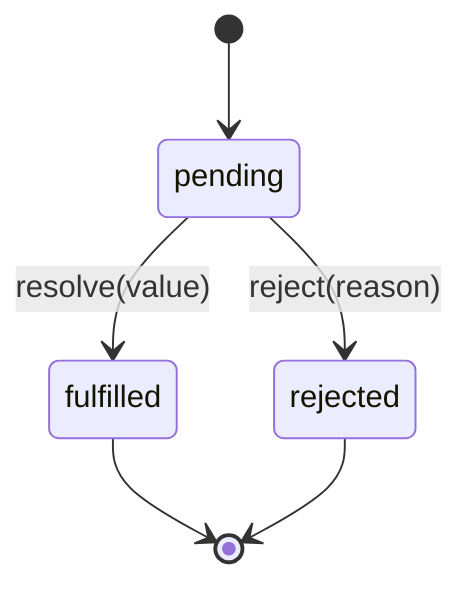

## Table of contents

## 异步编程

本篇覆盖事件循环的调度顺序、Promise 的状态模型与组合方法、`async`/`await` 的转换语义，以及工程中反复出现的超时、并发控制与重试写法。单线程模型下的异步能力来自宿主环境，语言层面只负责描述「将来完成的值」。

### 1. 异步模型

#### 1.1 同步与异步

同步代码按调用顺序占用执行栈，异步操作把完成通知交给宿主环境，回调在未来的任务中执行。

```js
function sync() {
  return 1 + 1;
}

function asyncRead(callback) {
  setTimeout(() => callback("data"), 0);
  // ...
}
```

- 同步调用返回前不会让出执行权，长任务会阻塞渲染与输入响应。
- 异步操作把等待转移到宿主（定时器、I/O、网络），JavaScript 主线程继续执行后续同步代码。

#### 1.2 事件循环与任务队列

```js
console.log("1");
setTimeout(() => console.log("4"), 0);
Promise.resolve().then(() => console.log("3"));
console.log("2");
// 1 2 3 4
```

- 同步代码构成当前宏任务，结束后清空全部微任务（Promise 回调、`queueMicrotask`、`MutationObserver`）。
- 宏任务（定时器、I/O、事件回调）在下一轮循环依次执行，`setTimeout(fn, 0)` 实际受最小延迟约束。
- 微任务持续入队会推迟宏任务与渲染，递归 `Promise.then` 可能造成页面无响应。

#### 1.3 回调与嵌套

```js
readFile("a.txt", (err, a) => {
  if (err) return handle(err);
  readFile("b.txt", (err, b) => {
    if (err) return handle(err);
    // 继续嵌套
  });
});
```

- 回调把续体交给被调用方，错误处理分散在每一层，流程难以组合与复用。
- 回调只表达「完成后做什么」，无法表达「等待多个结果」「取最先完成者」这类组合需求。
- Promise 把续体变成可返回的值，使串行、并行与错误传播都能用统一接口描述。

### 2. Promise 基础

#### 2.1 三种状态



- 状态只能从 `pending` 迁移到 `fulfilled` 或 `rejected`，且只发生一次。
- 状态确定后不可逆，后续 `resolve`/`reject` 调用被忽略，已注册的回调也不会重复执行。
- 状态机保证回调只拿到最终结果，不会出现中间态。

#### 2.2 executor 与 resolve

```js
const p = new Promise((resolve, reject) => {
  setTimeout(() => resolve(1), 100);
});

p.then((value) => {
  console.log(value); // 1
});
```

- executor 在构造时同步执行，内部抛出的异常等价于调用 `reject(error)`。
- `resolve` 传入 thenable 会递归展开，传入 Promise 会等待其敲定后再决定状态。
- `resolve` 之后继续执行 executor 的剩余代码不会改变状态，但错误仍会抛出。

#### 2.3 then、catch 与 finally

```js
fetchData()
  .then((data) => transform(data))
  .catch((err) => fallback(err))
  .finally(() => cleanup());
```

- `then` 总是返回新 Promise，回调的返回值成为下游的 fulfillment 值，抛出异常则转为 rejection。
- `catch(onRejected)` 等价于 `then(undefined, onRejected)`，只处理上游的 rejection。
- `finally` 不改变值也不吞掉错误，但会等待回调返回的 Promise 完成后再继续。

### 3. Promise 链与合成

#### 3.1 链式调用与错误冒泡

```js
Promise.resolve(1)
  .then((v) => v + 1)
  .then(() => {
    throw new Error("stop");
  })
  .then(() => "skipped")
  .catch((err) => err.message)
  .then((msg) => console.log(msg)); // stop
```

- rejection 会跳过后续 `then` 的成功回调，直到遇到 `catch` 或 `then` 的第二个参数。
- 回调中 `return promise` 会等待其敲定，返回值被摊平，因此不需要手动嵌套。
- `catch` 之后链恢复为 fulfillment，后续 `then` 正常执行。

#### 3.2 合成方法对比

| 方法 | 成功条件 | 失败条件 | 结果形态 |
| --- | --- | --- | --- |
| `Promise.all` | 全部成功 | 任一失败即失败 | 按输入顺序的值数组 |
| `Promise.allSettled` | 全部敲定 | 不会失败 | `{ status, value/reason }` 数组 |
| `Promise.race` | 第一个敲定为 fulfillment | 第一个敲定为 rejection | 第一个敲定值 |
| `Promise.any` | 任一成功 | 全部失败 | 第一个成功值 |

```js
Promise.all([fetchA(), fetchB()]);
Promise.allSettled([fetchA(), fetchB()]);
Promise.race([fetchA(), timeout(3000)]);
Promise.any([mirrorA(), mirrorB()]);
// ...
```

- `all` 适合缺一不可的依赖集合，任一失败时其余结果被丢弃。
- `allSettled` 适合批量任务需要完整报告的场景，不会因单个失败中断。
- `any` 用于多源容灾，全部失败时抛 `AggregateError`，可通过 `errors` 读取原因。

### 4. async/await

#### 4.1 语法与返回值

```js
async function load() {
  const res = await fetch("/api/posts");
  const data = await res.json();
  return data;
}

load().then((data) => {
  // ...
});
```

- `async` 函数总是返回 Promise，`return` 的值被包装为 fulfillment，抛错则为 rejection。
- `await` 暂停当前函数，把后续代码注册为微任务，不阻塞主线程。
- `await` 可接受任意值，非 thenable 会直接放行，因此不影响同步代码的返回值语义。

#### 4.2 错误处理

```js
async function load() {
  try {
    const res = await fetch("/api/posts");
    return await res.json();
  } catch (err) {
    // handle
    throw err;
  } finally {
    // cleanup
  }
}
```

- `await` 的 rejection 在 `async` 函数内按普通异常抛出，可以用 `try/catch/finally` 捕获。
- 未捕获时成为返回 Promise 的 rejection，交给调用方或全局处理器。
- 只 `await` 不检查 `res.ok` 会漏掉 HTTP 错误状态，网络层错误与业务错误需要分别处理。

#### 4.3 串行与并行

```js
// serial: 总耗时是两者之和
const a = await fetchA();
const b = await fetchB();

// parallel: 总耗时取较长者
const [x, y] = await Promise.all([fetchA(), fetchB()]);
```

- 互不依赖的请求先发起再统一 `await`，避免把并行能力退化为串行。
- 循环中的 `await` 天然串行，需要并发时先映射为 Promise 数组再交给 `Promise.all`。

```js
const results = await Promise.all(items.map((item) => fetchItem(item)));
```

- 一次性发起全部请求可能压垮下游，数量大时应配合并发上限。

### 5. 常见模式

#### 5.1 超时控制

```js
function withTimeout(promise, ms) {
  const timeout = new Promise((_, reject) => {
    setTimeout(() => reject(new Error("timeout")), ms);
  });
  return Promise.race([promise, timeout]);
}

withTimeout(fetch("/api/posts"), 3000).catch((err) => {
  // ...
});
```

- `race` 只决定「谁先敲定」，被超时的原 Promise 仍在执行，其结果需要单独处理。
- 需要真正取消时应使用 `AbortController`，把信号传给 `fetch` 等支持取消的 API。

#### 5.2 并发限流

```js
async function runWithLimit(tasks, limit) {
  const results = [];
  const queue = tasks.map((task, index) => ({ task, index }));

  async function worker() {
    while (queue.length) {
      const { task, index } = queue.shift();
      results[index] = await task();
    }
  }

  await Promise.all(Array.from({ length: limit }, worker));
  return results;
}
// ...
```

- 固定数量的 worker 共享队列，保证同时运行的任务数不超过上限。
- 结果按原始下标写回，避免完成顺序打乱输出顺序。
- 单个任务失败会终止对应 worker，必要时在任务内部捕获并转为结果值。

#### 5.3 重试

```js
async function retry(fn, times = 3) {
  for (let i = 0; i < times; i++) {
    try {
      return await fn();
    } catch (err) {
      if (i === times - 1) throw err;
      // 可在此加入退避等待
    }
  }
}
```

- 只对幂等操作重试，写操作重试可能产生重复副作用。
- 配合指数退避与随机抖动，避免故障期间集中重试放大压力。
- 重试次数与总超时同时设置，防止整体耗时不可控。

#### 5.4 未处理的 rejection

```js
window.addEventListener("unhandledrejection", (event) => {
  // report error
  event.preventDefault();
});

window.addEventListener("rejectionhandled", () => {
  // ...
});
```

- 未处理的 rejection 不会中断同步代码，容易被静默丢弃，全局监听用于兜底上报。
- 全局监听不能替代局部 `catch`，它拿不到业务上下文，只能记录与告警。
- Node.js 中未处理的 rejection 默认终止进程，与浏览器行为不同，需要单独配置。
