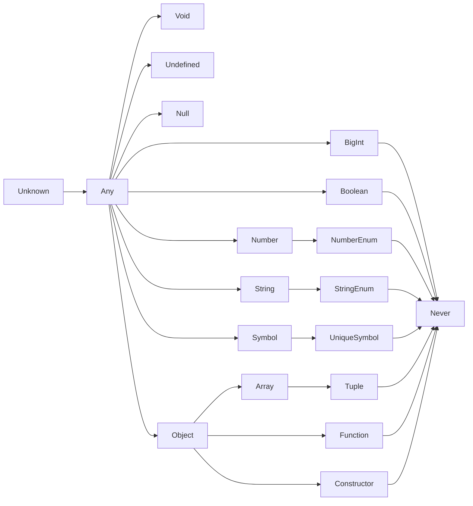

## Table of contents

## 类型

> 类型是一系列值，及可以对其的操作。

`TypeScript`中类型的结构如下：



### 类型术语

#### 可赋值性（Assignability）

决定一个类型的值是否可以安全地赋值给另一个类型的变量。

- 核心逻辑：`TypeScript` 的类型检查本质上并不是简单地判断“类型是否完全相等”，而是判断“某个值（类型）能否被赋值给另一个类型”。
- 结构化类型系统 (`Structural Typing`)：`TypeScript` 基于结构而非名称来判断可赋值性。只要一个类型包含了另一个类型所要求的所有属性，且这些属性的类型也是兼容的，那么它就具备可赋值性。例如，一个包含 `name` 和 `age` 属性的对象，可以赋值给一个只要求 `name` 属性的类型，因为前者满足了后者的所有要求。
- 子类型与父类型：在可赋值性中，更具体、约束更多的类型被称为子类型，而更宽泛的类型被称为父类型。子类型可以安全地赋值给父类型，但反过来通常不行。

#### 界限（Bounds）

通常与泛型约束紧密相关，它定义了泛型类型参数允许取值的范围或边界。

- 上界 (Upper Bound)：这是最常见的界限形式。当我们写 `<T extends SomeType>` 时，`SomeType` 就是 T 的上界。这意味着 `T` 可以是 `SomeType` 本身，也可以是它的任何子类型，但绝不能是比 `SomeType` 更宽泛的类型。
- 条件类型中的界限：在高级类型（如条件类型 `T extends U ? X : Y`）中，`extends` 关键字实际上充当了一个类型层面的判断条件：“如果 `T` 可以被赋值给 `U`（即 `T` 在 `U` 的界限内），则返回 `X`，否则返回 `Y`”。
- 字面量类型的界限：除了泛型，联合类型（如 `type Size = 'Small' | 'Medium' | 'Large'`）也可以看作是一种界限，它将变量的取值严格限制在指定的几个字面量范围内，超出这个边界就会触发类型错误。

#### 约束（Constraints）

主要用于泛型编程中，用来限制泛型参数必须满足的特定条件，从而保证泛型代码的类型安全。

- 使用场景：当你编写一个泛型函数或泛型类时，如果代码内部需要访问该泛型参数的特定属性或方法，你就必须对该泛型进行约束。
- 语法表现：通常使用 `extends` 关键字来实现。例如 `<T extends { length: number }>` 表示泛型 `T` 必须拥有 `length` 属性（如字符串或数组），否则在调用该泛型时会报错。
- 作用：约束让 `TypeScript` 知道泛型 `T` 并不是一个完全未知的类型，而是具备了某些已知特征的“受限类型”，从而允许你在函数内部安全地调用 `T.length` 等成员。

### 各种类型解析

#### any 类型

表示任意类型的值，是 TypeScript 类型系统的**逃逸口**。对 `any` 做任何操作，类型检查器都会放行——既不做类型校验，也不补全属性 / 方法，相当于把这段代码退化回原生 JavaScript。

`any` 只能由开发者**显式注解**产生。TypeScript 不会自动把变量推导为 `any`，唯一的例外是**隐式 any**：未加类型注解的函数参数，在 tsconfig 的 `noImplicitAny` 关闭时会隐式获得 `any` 类型。

```ts
// 显式 any：TS 完全放行，c 也传播为 any
const a: any = "hello";
const b: any = ["ddd"];
const c = a + b; // c: any

// 隐式 any（noImplicitAny: false 时）：未注解的函数参数
function foo(x) {
  return x * 2;
} // x: any
```

- `noImplicitAny: true`：拦截隐式 any，要求所有函数参数必须有显式类型
- `strict: true`：组合开关，自动开启 `noImplicitAny` 等全部严格检查
- **注意**：`noImplicitAny` 只拦截**隐式** any，对显式写的 `any` 无效

#### unknown 类型

表示未知类型的值，是 TypeScript 类型系统的**安全门**。跟 `any` 相反，`unknown` 要求你在使用前必须先"收窄"——要么用 `typeof` / `instanceof` 做类型守卫，要么用类型断言 `as` 强行指定。

`unknown` 只能由开发者**显式注解**产生，没有隐式 unknown。常见场景：不确定外部输入类型（如 JSON 解析、网络请求返回值）时用 `unknown` 替代 `any`，强制后续代码必须做类型收窄。

```ts
// unknown 不允许直接做操作，会报错
const a: unknown = "hello";
const b: unknown = 123;
a.toUpperCase(); // ✗ 不能在 unknown 上调用方法
const c = a + b; // ✗ 不能对 unknown 做加法

// 必须先收窄
if (typeof a === "string") {
  a.toUpperCase(); // ✓ a 已被收窄为 string
}
const d = (a as string).toUpperCase(); // ✓ 断言为 string
```

#### boolean 类型

表示布尔值，只有 `true` 和 `false` 两个可能的取值。

```ts
let a = true; // a: boolean ; 类型拓宽
var b = false; // b: boolean ; 同let
const c = true; // c: true ; const 不可重赋值，保留字面量类型 true
let d: boolean = false; // d: boolean
let e: true = true; // e: true
let f: true = false; // error
```

> 字面量类型：仅表示一个值的类型

#### number 类型

包括所有数字：整数，浮点数，正数，负数，Infinity，NaN等

```ts
let a = 123; // a: number
var b = Infinity * 0.1; // b: number
const c = 123.456; // c:123.456
let d = a < b; // d: boolean ;
let e: number = 100; // e: number
let f: 11.11 = 11.11; //f:11.11
let g: 11.11 = 10; //error
```

> [!NOTE]
> 数字表示可由分隔符（`_`）分隔，例如 `const a: 1_000_234 = 1_000_234;`。

> [!TIP] 补充1：
> number类型的边界

1. 安全整数边界

- 上限: `Number.MAX_SAFE_INTEGER` = 9,007,199,254,740,991 （2<sup>53</sup> - 1）
- 下限: `Number.MIN_SAFE_INTEGER` = -9,007,199,254,740,991 （-(2<sup>53</sup> - 1））
- 成因: `IEEE 754` 双精度浮点数使用 64 位存储，其中 52 位用于尾数（`significand/mantissa`）。由于采用“隐含前导 1”机制，实际有效精度为 53 位。这意味着它最多只能精确表示 2<sup>53</sup> 个连续整数。一旦超出此范围，相邻可表示整数的间隔将大于 1，导致如 `9007199254740992` === `9007199254740993` 返回 true 的精度丢失现象。

2. 浮点数极值边界

- 最大值: `Number.MAX_VALUE` ≈ 1.7976931348623157e+308
- 最小正数: `Number.MIN_VALUE` ≈ 5e-324 (最接近 0 的正数)
- 成因: 剩余的 11 位用于指数（`exponent`），这决定了数字的表示范围约为±10<sup>±308</sup>。超过 `MAX_VALUE` 会变为 Infinity，小于 `MIN_VALUE` 会下溢（underflow）为 0。

3. 小数运算精度丢失

- 现象: 0.1 + 0.2 === 0.30000000000000004
- 成因: 十进制的有限小数（如 0.1、0.2）在转换为二进制时是无限循环小数。由于双精度浮点数只有 52 位尾数，必须截断并按 `IEEE 754` 的舍入规则（默认 roundTiesToEven）进行近似存储，从而产生舍入误差。

> [!TIP] 补充2：
> 业务中number类型的使用

- 普通计数/循环：使用原生 `number`。
- 超大整数 `ID`：使用原生 `BigInt` 或字符串。
- 金额/财务/高精度比例：`decimal.js`（或 `bignumber.js`），并始终使用字符串进行初始化。

#### bigint 类型

bigint 类型的范围：任意精度整数，仅受内存限制，可表示远超 2<sup>53</sup> - 1 的整数。

```ts
let a = 123n; // a: bigint
const b = 456n; // b: 456n
var c = a + b; // c: bigint
let d = a < 125n; // d: boolean
let e = 88.5n; // error
let f: bigint = 100n; // f: bigint
let g: 100n = 100n; // g: 100n
let h: bigint = 100; // error
```

- `bigint` 字面量与运算符属于语法级特性，无法用运行时 polyfill 补齐。

- 构建期虽有降级方案（`babel-plugin-transform-bigint` 借助 JSBI 模拟基础运算），但只覆盖算术与比较，缺少 `BigInt64Array`、`typeof`、跨模块互操作等支持，属于模拟而非完整 polyfill。

- `TypeScript` 本身不做降级：`target` 低于 `ES2020` 时直接报错（TS2737）。

#### string 类型

```ts
let a = "hello"; // a: string
var b = "billy"; // b: string
const c = "?"; // c: '?'
let d = a + " " + b + c; // d: string
let e: string = "zoom"; // e: string
let f: "john" = "john"; // f: 'john'
let g: "john" = "zoe"; // error
```

#### symbol 类型

```ts
let a = Symbol("a"); // a: symbol
let b: symbol = Symbol("a"); // b: symbol
var c = a === b; //c:boolean
let d = a + "x"; // error

const e = Symbol("e"); // e: unique symbol（TS 4.4+ 对 const 声明的 symbol 自动推导为 unique symbol）
// unique symbol 是 symbol 的单例类型，类似于字面量类型但专用于 symbol。
// 在类型位置引用需使用 typeof 语法（如 const f: typeof e = e;）

const f: unique symbol = Symbol("f"); // 显式标注，合法

let g: unique symbol = Symbol("g"); // error: unique symbol 类型仅允许用于 const 声明和 readonly static 属性，不能用于 let 变量注解
```

#### 对象类型

`TypeScript` 中对于对象只关注对象的结构，通过对象类型是无法区分简单对象和`new blah`对象(new关键字创建的实例对象)。

> [!NOTE]
> 结构化类型（Structural Typing）：一种编译时设计风格，赋值兼容性只看**结构是否匹配**（目标是否具备所需属性），不关心具体类型名。与鸭子类型不同：鸭子类型（"如果它像鸭子..."）关注**运行时行为**（调用方法），结构化类型关注**编译时结构**（拥有属性）。

`TypeScript` 中描述对象类型主要有四种方式：

1. **对象字面量类型注解（Inline Object Type）**

在变量声明中直接写结构。

```ts
// object 类型：只能访问 JS 内置方法，不能访问自定义属性
let a: object = { name: "mimas" };
a.toString(); // ✓
a.name; // error: Property 'name' does not exist on type 'object'

// 对象字面量类型注解：精确描述结构
let b: { name: string } = { name: "mimas" };
b.name; // string

// const 声明对象：类型不会缩窄到字面量级别
const c: { age: number } = { age: 18 };
c.age; // number，不是字面量类型 18
// 对比基础类型 const：const x = 1 → x: 1（字面量缩窄）
// 对象类型始终保持结构类型 { age: number }

// 结构化类型：对象描述的是结构，类实例只要结构匹配就可以赋值
class Person {
  // public 修饰符简写（Parameter Properties）：等价于在构造体内写 this.name = name
  constructor(
    public name: string,
    public age: number
  ) {}
}
let p1: { name: string; age: number } = new Person("mimas", 18); // ✓ 结构匹配即可
```

##### 可选属性 `?`

```ts
let d: { name?: string } = { name: "mimas" };
d.name; // string | undefined
```

##### 索引签名

当对象的属性名不完全固定，但值类型一致时使用。语法：`[key: T]: U`，T 为键类型、U 为值类型。

```ts
// 只支持 string 键和 number 键（也可混合）
let scores: { [name: string]: number };
scores["mimas"] = 100;
scores["alice"] = 95;

// 索引签名 + 显式属性：显式属性的值类型必须是索引签名值类型的子类型
// 正确
let data: { id: number; [key: string]: number } = { id: 1, name: 2 };
// 错误：显式属性 id: number 不是索引签名 string 的子类型
// let data2: { id: string; [key: string]: number };  // TS2374
```

> [!NOTE] 索引签名规则
>
> 1. `[key: T]: U` 句法称为索引签名，意为：键类型为 T 的属性，值类型统一为 U。
> 2. 键类型 T 只能是 `string`、`number`（TS 4.4 起支持 `symbol`），值类型 U 无限制。
> 3. 索引签名可以与显式属性共存，**但显式属性的值类型必须是 U 的子类型**，否则 TS2374。
> 4. 一个对象类型中最多有一个字符串索引签名和一个数字索引签名（两者可以同时存在）。

2. **空对象字面量 `{}` 类型**

表示"必须是对象，但对具体属性无要求"。

```ts
let empty: {} = { a: 1, b: 2 };
empty.a; // error: Property 'a' does not exist on type '{}'
// {} 只允许调用 Object 原型上的方法（toString、hasOwnProperty 等）
```

注意：`{}` 不等于 `object`，也不等于 `any`。它仍会做属性检查，只是没有声明任何属性。

3. **`object` 类型**（小写）

表示"任何非原始类型"（即不是 `string` / `number` / `boolean` / `symbol` / `null` / `undefined` / `bigint`）。比 `{}` 更严格：

```ts
let obj: object = {};
obj = []; // ✓ 数组是 object
obj = new Date(); // ✓
obj = "hello"; // ✗ 字符串是原始类型
obj.a; // ✗ object 类型不能访问任意属性
```

4. **`Object` 类型**（大写，极少使用）

JS 全局构造器，对应 JS 运行时的 `Object.prototype`。能访问 `toString` / `valueOf` / `hasOwnProperty` 等原型方法，但同样不能访问自定义属性。TS 官方建议优先使用小写 `object` 或更精确的结构类型。

##### 对象类型判断表格

| 具体的值          | `{}`  | `object` | `Object` |
| :---------------- | :---: | :------: | :------: |
| `{}`              | ✅ 是 |  ✅ 是   |  ✅ 是   |
| `['a']`           | ✅ 是 |  ✅ 是   |  ✅ 是   |
| `function(){}`    | ✅ 是 |  ✅ 是   |  ✅ 是   |
| `new String('a')` | ✅ 是 |  ✅ 是   |  ✅ 是   |
| `'a'`             | ✅ 是 |  ❌ 否   |  ✅ 是   |
| `1`               | ✅ 是 |  ❌ 否   |  ✅ 是   |
| `Symbol('a')`     | ✅ 是 |  ❌ 否   |  ✅ 是   |
| `null`            | ❌ 否 |  ❌ 否   |  ❌ 否   |
| `undefined`       | ❌ 否 |  ❌ 否   |  ❌ 否   |

> [!NOTE]
> `{}` 的语义是"非 `null` / `undefined` 的任何值"，因此原始类型也能通过检查，这与直觉中的"空对象"不同；`object` 才排除了所有原始类型。三者都无法访问自定义属性。

#### 明确赋值断言 `!`

当变量声明和初始化分开时，TS 会检查变量在使用前是否已初始化。如果开发者能确保在某处会被赋值，可使用明确赋值断言绕过检查：

```ts
let input!: string; // 明确告诉 TS：这个变量一定会被赋值，不用检查
initialize(); // 某个函数会给 input 赋值
console.log(input.toUpperCase()); // ✓ 无报错
function initialize() {
  input = "hello";
}
```

#### 类型别名、并集与交集

##### 类型别名

`type` 为已有类型起别名，不产生新类型，只是命名替换。

```ts
type Age = number;

class Person {
  constructor(public age: Age) {}
}

// 同一作用域内类型别名不可重复声明（与 const 规则一致）
type Test = number;
type Test = string; // error TS2300: Duplicate identifier 'Test'
```

- 主要用途是简化复杂类型的书写（DRY），语义化命名可提升可读性。
- 类型别名不能被 `extends` 扩展，也不参与声明合并；需要扩展或合并时使用 `interface`。

##### 并集（Union）

`A | B` 表示"是 A 或 B"，值满足其一即可。

```ts
type ID = number | string;
let id: ID = 1; // ✓
id = "abc"; // ✓
// id = true; // ✗ boolean 不在联合类型中
```

联合类型在访问成员前必须先收窄，未收窄时只能访问所有成员共有的属性。

```ts
type Shape =
  { kind: "circle"; radius: number } | { kind: "square"; side: number };

function area(s: Shape) {
  if (s.kind === "circle") return Math.PI * s.radius ** 2; // 收窄后可访问 radius
  return s.side ** 2; // 剩余分支已收窄为 square
}
```

##### 交集（Intersection）

`A & B` 表示"同时是 A 和 B"，值必须满足全部成员。

```ts
type Named = { name: string };
type Aged = { age: number };
type Person = Named & Aged;

const p: Person = { name: "mimas", age: 18 }; // 两个属性缺一不可
```

#### 数组类型

数组表示有序的同质元素集合。显式注解有 `T[]` 与 `Array<T>` 两种等价写法：前者更简洁，后者是传统泛型写法，选定一种并保持一致即可。

##### 元素类型的推导

```ts
let a = [1, 2, 3]; // a: number[]
var b = ["a", "b", "c"]; // b: string[]
let c: string[] = ["a", "b", "c"]; // c: string[]
let d = [1, "a"]; // d: (number | string)[]，取全部元素类型的并集
const e = [2, "b"]; // e: (number | string)[]
```

- 元素类型由所有元素的类型取并集得到，因此数组应尽量保持同质。
- `const` 只约束绑定不可重新赋值，不约束数组内容，元素不会收窄为字面量类型。

##### 同质数组的写入检查

推导为 `T[]` 后，`push` 等写入操作只接受 `T`，写入不会反过来改变元素类型。

```ts
let f = ["a"]; // f: string[]
f.push("b"); // ✓
f.push(true); // error: boolean 不能赋给 string

let h: number[] = []; // h: number[]
h.push(1); // ✓
h.push("a"); // error
```

##### 演进数组（evolving array）

未显式注解、且初始为空的数组在声明时处于演进状态，类型为 `any[]`；此后每次写入都会把实参类型并入元素类型。

```ts
let g = []; // g: any[]（演进状态）
g.push(1); // g: number[]
g.push("a"); // g: (number | string)[]
```

演进只发生在定义它的作用域内。变量被赋值给外部变量或作为返回值离开作用域时，类型取当时的并集并定格；作用域内的读取得到的只是当时的类型，不会阻止变量自身继续演进。

```ts
let g = [];
g.push(1);
let snapshot = g; // snapshot: number[]
g.push("a"); // g: (number | string)[]，snapshot 仍为 number[]

let test: string[] = g; // error: g 已推导为 (number | string)[]
```

函数内部同理，返回值离开作用域时类型定格：

```ts
function buildArray() {
  let arr = [];
  arr.push(1);
  arr.push("a");
  return arr; // 返回类型定格为 (number | string)[]
}

let arr = buildArray(); // arr: (number | string)[]
arr.push(true); // error: 元素类型已定格，无法继续扩张
```

> [!NOTE]
> 演进数组在没有任何写入时，若被用于需要完整类型的场景（如赋值给带类型注解的变量），`strict` 下会触发 TS7034 / TS7005（隐式 `any[]`）。该机制只服务于"先收集、后使用"的写法，不能替代显式注解。

##### 非同质数组的使用

元素类型为并集时，访问成员前必须先收窄，否则只能使用各成员共有的成员。

```ts
let mixed = [1, "a"]; // mixed: (number | string)[]

mixed.map(item => {
  if (typeof item === "number") {
    return item * 2; // 收窄为 number
  }
  return item.toUpperCase(); // 收窄为 string
});
```

#### 元组类型

元组是**带固定长度与位置类型约束**的数组类型，运行时仍是 JS 数组。声明方式是把元素类型写在方括号里，对应每个位置：

```ts
let array: number[] = [1, 2, 3]; // 长度任意，所有元素同类型
let tuple: [number, string, boolean] = [1, "a", true]; // 长度固定为 3，各位置类型固定
```

元组比普通数组更安全——编译期已知长度，`tuple.length` 推导为字面量类型（此处为 `3`），越界索引会报错。

##### 可选元素

位置上的元素可以用 `?` 标记为可选，可选元素之后的所有位置也必须可选：

```ts
let optional1: [number, string, boolean?] = [1, "a"];
let optional2: [number, string, boolean?] = [1, "a", true];
```

##### 剩余元素（rest elements）

rest 元素表示"这个位置可以是任意多个指定类型的元素"。**一个元组中最多只能有一个 rest 元素**，它可以出现在首部、尾部或两者之间，但**不能出现多个**：

```ts
// 尾部 rest：一个 number，后面跟任意多个 number
let tail: [number, ...number[]] = [1, 2, 3, 4, 5];

// 尾部 rest：一个 number、一个 string，后面跟任意多个 boolean
let tailMixed: [number, string, ...boolean[]] = [1, "a", true, false];

// 首尾搭配 rest（TS 4.7+）
let headTail: [number, ...string[], boolean] = [1, "a", "b", true];
```

##### 元素为元组的数组

数组的元素类型可以是元组，此时数组的写法是"元组类型 `T`" 套进数组语法 `T[]`（或 `Array<T>`）：

```ts
// 每个子数组都是 [number, number?] 这一种元组
let trainFares1: [number, number?][] = [[1, 2], [1, 3], [1]];

// 等价写法：显式写出两种固定长度的元组构成并集
let trainFares2: ([number] | [number, number])[] = [[1, 2], [1, 3], [1]];

// Array<T> 语法糖展开
let trainFares3: Array<[number, number?]> = [[1, 2], [1, 3], [1]];
let trainFares4: Array<[number] | [number, number]> = [[1, 2], [1, 3], [1]];
```

##### 只读数组与元组

常规数组是可变的。当希望维护数据的不可变性时，可以用 `readonly` 修饰符或 `ReadonlyArray<T>` 泛型；元组同样可以加上 `readonly`：

```ts
// 只读数组
type A = readonly number[]; // readonly number[]
type B = ReadonlyArray<number>; // readonly number[]，与 A 等价

// 只读元组
type C = readonly [number, string, boolean]; // readonly [number, string, boolean]
type D = Readonly<[number, string, boolean]>; // readonly [number, string, boolean]，与 C 等价
```

声明只读类型**必须显式注解**，`readonly` 不是 JS 语法，仅由类型系统强制执行。它会屏蔽 `push`、`splice`、下标赋值等写入方法，但底层仍是同一个可变 JS 数组——TypeScript 不做运行时拷贝。真正不可变的数据结构（结构共享，不是复制）由 `immer`、`immutable.js` 等库在运行时实现。

#### null、undefined、void 和 never

这四个类型常被混淆，是因为它们在"没有值"这一语义上有重叠，但来源和用途完全不同。

##### null / undefined

两者都是单值类型，各自只包含 `null` 或 `undefined` 这一个值。

- **JS 运行时**：`null` 表示"值为空"（显式置空），`undefined` 表示"值未初始化"（变量声明后未赋值、对象属性不存在、函数无 return）。两者在运行时判断上 `null == undefined` 为真（宽松相等），但严格相等和 `typeof` 能区分。
- **TypeScript 类型关系**（关键前提：`strictNullChecks`）：
  - `strictNullChecks=true`（`strict: true` 默认）：`null` 和 `undefined` 不再是其他类型的子类型。必须显式写出联合类型才能表示"可以为空"。
  - `strictNullChecks=false`：`null` / `undefined` 是除 `never` 外所有类型的子类型，可以隐式混入任何位置——这是早期 TS 的默认行为，现在已不推荐。

```ts
// strictNullChecks=true 时
let a: number = null; // error TS2322
let b: number | null = null; // ✓ 需要显式联合

function greet(name: string) {
  return name.toUpperCase();
}
greet(null); // error TS2345：不能把 null 赋给 string
```

##### void

`void` 用于描述"函数没有返回值"这一语义，不是真正的值类型。它告诉调用方：**不要依赖这个函数的返回值**。

- JS 运行时：没有显式 `return` 的函数，JS 引擎会自动在末尾补一条隐式 `return undefined;`，所以实际返回的永远是 `undefined`。
- TypeScript 编译期：**没有显式 `return` 的函数，推断的返回类型是 `void`，不是 `undefined`**。只有当你**显式标注**返回类型为 `undefined` 时，才会强制要求 `return undefined;`（TS 5.1 起放宽：显式标注 `undefined` 也允许无 return，但默认推断依旧是 `void`）。

```ts
// 没有显式 return → 推断 void
function log(x: number) {
  console.log(x);
}

// 显式标注 void
function doNothing(): void {
  const _unused = 1;
}

// 显式标注 undefined（TS 5.1+ 允许无 return）
function explicitUndef(): undefined {
  // 可以不写 return undefined;
}

// 显式标注 undefined，传统写法依然合法
function explicitUndefOld(): undefined {
  return undefined;
}
```

##### never

`never` 表示"永远不会有这个类型的值"——没有任何值属于 `never`。它是所有类型的**子类型**，同时自身不能被赋值（除了 `never` 本身）。

常见来源：

- 函数**根本无法正常返回**：始终 `throw`、始终 `while (true)` 循环
- 类型收窄后**不可能达到的分支**

```ts
// 抛出异常 → 返回 never
function panic(): never {
  throw new Error("fatal");
}

// 永不返回的循环 → 返回 never
function spin(): never {
  while (true) {
    // CPU 空转或阻塞
  }
}
```

与其他空值类型的关系：

```
unknown ─── 所有类型的父类型（任何类型可赋给它）
  │
  ├── ... number / string / ...
  │
  ├── null / void / undefined   ← 各自有唯一值或语义标记
  │
  └── never                     ← 所有类型的子类型，没有任何值
```

`never` 能赋给任何类型，但任何类型（除 `never`）不能赋给 `never`。它充当类型系统的"下限"：编译器在不可能到达的分支会自动把类型收窄为 `never`。

#### 枚举

枚举（`enum`）列举一组固定的命名常量，编译时会生成一个**键值映射对象**。枚举的成员值可以是数字或字符串，行为差异很大，分开理解。

##### 数字枚举

成员值为数字时，TypeScript 会自动推导：**上一个成员值 + 1**，首个成员默认是 `0`。推导链可以从显式赋值的成员开始。

```ts
// 默认：首个成员从 0 开始递增
enum Direction {
  Up, // 0
  Down, // 1
  Left, // 2
  Right, // 3
}

// 显式赋值：从该值继续递增
enum Test {
  English = 100,
  Chinese = 200 + 300, // 计算值，结果 500
  Japanese, // 自动推导为 501
}
```

数字枚举编译后会生成一个**双向查找表**：既能通过键取值，也能通过值反向查键。

```ts
enum Color {
  Red = 0,
  Green = 1,
}

Color.Red; // 0，通过键取值
Color["Red"]; // 0，同上
Color[0]; // "Red"，反向查找：通过值查键
Color["0"]; // "Red"，同上
```

但也正是这个特性导致了一个类型安全漏洞：**任何 `number` 都能赋给数字枚举类型**，编译器不会拦截。

```ts
enum Direction {
  Up,
  Down,
}

declare const someNumber: number;
const bad: Direction = someNumber; // ✓ 编译器放行 — 这个 number 可能是 999
Direction[999]; // 运行时 undefined，不会报错
```

##### 字符串枚举

所有成员值都是字符串字面量时，不会生成双向查找表，只能通过键取值，且 **`number` 不能赋给字符串枚举**——类型安全漏洞自动消失。

```ts
enum Status {
  Open = "open",
  Closed = "closed",
}

Status.Open; // "open"
Status["Open"]; // "open"
Status["open"]; // error TS7053 — 不能通过值反向查键

declare const someNumber: number;
const bad: Status = someNumber; // error TS2322 — number 不能赋给字符串枚举
```

##### 异构枚举

允许数字枚举和字符串枚举混合在一个声明中。TypeScript 从最后一个数字成员继续递增，但**混合到字符串后，后续成员就不能再自动推导**了。

```ts
enum Mix {
  A, // 0（自动推导）
  B, // 1
  C = "c", // 显式字符串后，D 必须显式赋值
  D = 42, // 显式赋值后可以重新开始自动推导
  E, // 43
}
```

实际项目中异构枚举很少用，推荐单一类型。

##### 声明合并

同名 `enum` 可以多次声明，TypeScript 会**自动合并**成一个完整的枚举。分片声明里，后续分片的首个成员需要显式赋值，避免与前一分片推导值冲突。

```ts
enum Role {
  Admin = 0,
  User = 1,
}
enum Role {
  Guest = 2,
}

// 合并后 Role 有三个成员：Admin=0, User=1, Guest=2
```

##### const enum

`const enum` 是编译期内联的优化形式——成员值会被直接替换到使用处，不生成运行时枚举对象。

```ts
declare const enum Size {
  Small, // 0
  Medium, // 1
  Large, // 2
}

// 编译后：Size.Medium → 直接变成字面量 1
const selected = Size.Medium;

Size[1]; // error TS2476 — const enum 不支持通过数字索引访问
Size["Medium"]; // ✓ 字符串字面量索引仍然可以
```

##### 使用建议

| 枚举类型   | 能 number→枚举 | 能反向 by value | 编译产物               | 推荐度             |
| ---------- | -------------- | --------------- | ---------------------- | ------------------ |
| 数字枚举   | ✓ 不安全       | ✓ 双向查找      | 生成运行时对象         | 中                 |
| 字符串枚举 | ✗ 安全         | ✗ 单向          | 生成运行时对象         | 高                 |
| const enum | ✗ 安全         | ✗ 单向          | 完全内联，无运行时开销 | 最高（纯常量场景） |

现代项目里，**字符串枚举或 `const enum` 优先**。普通数字枚举的 number 隐式混入漏洞只有确实需要数字值做数据库/API 编码时才值得保留。
