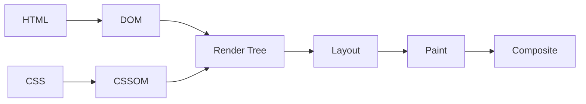

## Table of contents

> 本文属于 Mimas 个人技术博客（Astro 7 + TypeScript + Tailwind CSS 4，中英双语站点）的博客文章，项目语境见 `.trae/rules/doc-gen/00-context.md`。

资源下载完成不等于用户看到内容。渲染阶段决定从「字节到达」到「像素出现」的延迟，也决定内容出现后是否稳定。本文按关键渲染路径、渲染模式、首屏专项、布局与绘制四部分展开。

## 一、关键渲染路径



### 1.1 阻塞资源

- CSS 是渲染阻塞资源：CSSOM 未就绪时浏览器不会绘制，避免出现无样式内容闪烁。
- 同步脚本阻塞 HTML 解析，脚本执行前若依赖 DOM，还需等待其之前的 CSS 加载完成。
- `defer` 脚本在解析完成后按文档顺序执行，`async` 脚本下载完立即执行，`type="module"` 默认等同于 defer。
- `@import` 会形成串行加载链，应合并到构建产物中，避免运行时的二次请求。
- 首屏关键 CSS 内联可消除一次往返，但会增加 HTML 体积，需要按页面评估。

### 1.2 首帧与 LCP

- first paint 表示浏览器首次绘制像素，可能是背景色；FCP 表示首次绘制文本或图片等内容。
- LCP 是视口内最大内容元素的绘制时间，通常比 FCP 晚，两者的差值反映主要内容出现得有多迟。
- 背景图由 CSS 加载时，资源发现时间晚于 ``，且无法用 `srcset` 做响应式选择。
- 文本型 LCP 的瓶颈常在字体与阻塞脚本，图片型 LCP 的瓶颈常在网络与优先级。

## 二、渲染模式选择

### 2.1 CSR、SSR、SSG 与 ISR

| 模式 | 首屏内容到达 | 服务器成本 | 可缓存性 | 适用场景 |
| ---- | ------------ | ---------- | -------- | -------- |
| CSR | 需等 JS 下载执行后再渲染 | 低 | 静态资源可缓存 | 交互重、SEO 要求低的后台 |
| SSR | HTML 到达即有内容 | 高，每次请求需渲染 | 可配合边缘缓存 | 首屏敏感、内容个性化 |
| SSG | 构建期直出 | 低 | 可长期缓存 | 内容稳定、更新频率低 |
| ISR | 静态为主，按需再生成 | 中 | 可长期缓存并增量更新 | 内容较多且需定期更新 |

- CSR 的白屏时间等于「JS 加载 + 执行 + 数据请求」的串行之和，首屏指标最差。
- SSR 解决的是首屏内容到达时间，不解决注水后的交互延迟。
- SSG 的首屏成本最低，代价是内容更新需要重新构建或增量再生成。
- 模式选择取决于内容变化频率与个性化程度，而不是「哪个更先进」。

### 2.2 流式渲染与岛屿架构

- 流式 SSR 先发送页面壳与已就绪部分，剩余部分分块到达，FCP 提前，LCP 不必等全部数据。
- Suspense 边界决定了流式分块的位置，边界划分不合理会让关键内容排在慢数据之后。
- 岛屿架构只对交互区域注水，静态内容不加载对应 JS，显著降低首屏脚本体积。
- 局部注水的代价是组件边界与状态共享变复杂，需要在架构层面提前设计。

### 2.3 注水成本

- 注水需要重新执行组件逻辑、绑定事件、恢复状态，主线程在此期间无法及时响应输入。
- 注水越晚，用户越可能遇到「页面看得见但点不动」的状态。
- 可用选择性注水或交互触发注水，把非关键区域的成本推迟。
- 注水耗时属于运行时成本，应纳入 INP 的归因范围，而不是只看加载指标。

## 三、首屏专项

### 3.1 LCP 元素定位与优化

```ts
new PerformanceObserver((list) => {
  const entries = list.getEntries();
  const last = entries[entries.length - 1] as PerformanceEntry & { element?: Element };
  console.log(last.element);
}).observe({ type: "largest-contentful-paint", buffered: true });
```

- 先确认 LCP 元素是什么，再讨论优化；图片、文本、视频封面的手段完全不同。
- 图片型：压缩与响应式尺寸、`preload`、`fetchpriority="high"`、避免 JS 插入后才开始加载。
- 文本型：减少阻塞脚本、字体子集化与 `preload`、避免大面积文本被客户端渲染逻辑推迟。
- 避免用 CSS 背景图承载 LCP 元素，资源发现晚且无法享受图片元素的优先级提示。
- 不要把 LCP 元素放进懒加载或虚拟列表，首屏内容必须立即渲染。

### 3.2 骨架屏与占位

- 骨架屏的价值是让等待可解释，前提是与真实内容布局一致。
- 骨架与真实内容尺寸差异过大会在切换时产生 CLS，反而降低体验。
- 骨架屏持续时间不宜过长，超过实际加载时间的骨架会被感知为「假内容」。
- 流式渲染下，骨架应与分块内容衔接，避免出现骨架闪一下就消失的抖动。

### 3.3 字体

```css
@font-face {
  font-family: "Brand";
  src: url("/fonts/brand-subset.woff2") format("woff2");
  font-display: swap;
  size-adjust: 96%;
}
```

- `font-display: swap` 先展示回退字体，避免文本长时间不可见。
- 回退字体与目标字体的度量差异会造成换字抖动，`size-adjust`、`ascent-override` 可减小偏移。
- 字体子集化按实际字符集生成，中文字体体积大，全量加载代价明显。
- 首屏字体可 `preload`，但字体文件较大时会与关键图片争抢带宽，需要实测。

## 四、减少布局与绘制开销

### 4.1 控制 CLS

- 为图片、视频、iframe、广告位声明尺寸或 `aspect-ratio`。
- 动态插入内容时预留空间，或把插入位置放在视口之外。
- 动画使用 `transform` 与 `opacity`，避免改变 `top`、`left`、`width`、`height`。
- 字体加载策略与回退度量要一起配置，否则文本换行变化同样会产生偏移。

### 4.2 渲染隔离

```css
.offscreen-section {
  content-visibility: auto;
  contain-intrinsic-size: 600px;
}
```

- `contain` 限制布局、绘制与样式计算的影响范围，适合卡片、列表项等独立区域。
- `content-visibility: auto` 跳过离屏内容的渲染，需配合 `contain-intrinsic-size` 提供占位，避免滚动条跳动。
- `will-change` 会提前提升合成层，滥用会消耗显存并增加合成开销，只用于确定会变化的元素。
- 合成层数量需要控制，过多会导致内存上升与移动端掉帧。

### 4.3 动画

- 只对 `transform` 与 `opacity` 做动画，这两类属性可以只走合成，不触发布局与绘制。
- 动画时长与缓动影响感知流畅度，过长的入场动画会延迟用户看到信息。
- 响应 `prefers-reduced-motion`，为对动效敏感的用户提供静态替代。
- 动画期间避免同步读取布局属性，强制同步布局会直接造成掉帧。

## 五、验证与误区

- **SSR 一定更快**：服务端渲染慢、注水重、缓存缺失时，SSR 的端到端体验可能不如 SSG。
- **骨架屏万能**：骨架屏只改变感知，不减少真实等待，且自身也有渲染成本。
- **只优化首屏图片**：首屏文本、字体、阻塞脚本同样可能主导 LCP。
- **忽略注水**：首屏内容出现早但点不动，用户仍会认为页面慢。
- **用 CSS 隐藏内容规避指标**：隐藏元素不会进入 LCP 候选，但也没有改善真实体验。

验证顺序建议：TTFB → 资源发现 → 关键 CSS → LCP 资源 → 字体 → 注水。每一步都对应一至两个可观测指标，避免凭感觉调优。
