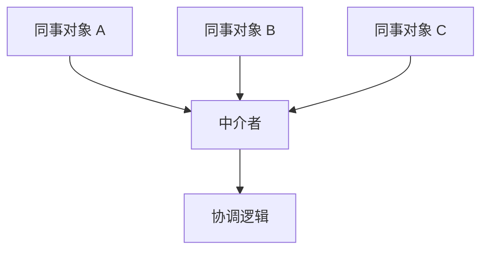

## Table of contents

## 中介者模式

多个对象需要互相感知时，最直接的写法是让它们彼此持有引用。对象数量增加一倍，引用关系增加四倍。中介者模式在中间插入一个协调对象，把网状依赖改成星形依赖：同事对象只与中介者通信，协调逻辑集中在一处。

### 1. 现实中的中介者

租房、二手房交易、招聘都存在同一种结构：买方与卖方数量都很多，逐一两两联系的成本是双方数量的乘积。中介机构承担信息汇集与撮合，买卖双方只需要面对中介，不需要认识对方。



图中的结构对应两条规则：

- 同事对象之间不存在直接引用，所有交互经由中介者转发。
- 协调规则只存在于中介者内部，同事对象不包含「对方会怎么反应」的知识。

判断是否需要中介者，看依赖关系是否呈网状。两个对象互相调用时直接引用即可，引入中介者只会增加一层转发；三个以上的对象两两相关时，中介者的收益才开始显现。

### 2. 泡泡堂的初版实现

以组队对战游戏为例。每个玩家需要知道自己队伍还有几个人存活、对手还剩几个人，一旦某队全灭，需要通知所有玩家结束。

初版让玩家互相持有引用：

```js
class Player {
  constructor(name, teamColor) {
    this.name = name;
    this.teamColor = teamColor;
    this.state = "alive";
    this.partners = []; // same team
    this.enemies = []; // other team
  }

  win() {
    console.log(`${this.name} win`);
  }

  lose() {
    this.state = "dead";
    console.log(`${this.name} lose`);
  }

  die() {
    this.lose();
    const allDead = this.partners.every((p) => p.state === "dead");
    if (!allDead) {
      return;
    }
    for (const partner of this.partners) {
      partner.lose();
    }
    for (const enemy of this.enemies) {
      enemy.win();
    }
  }
}
```

创建玩家时需要把新玩家与所有已有玩家建立双向关系：

```js
function createPlayer(name, teamColor, players) {
  const player = new Player(name, teamColor);
  for (const other of players) {
    if (other.teamColor === teamColor) {
      player.partners.push(other);
      other.partners.push(player);
    } else {
      player.enemies.push(other);
      other.enemies.push(player);
    }
  }
  players.push(player);
  return player;
}
```

玩家数量为 n 时，`partners` 与 `enemies` 数组的总长度约为 n²。八个玩家时关系数量尚可接受，五十个玩家时每个实例都持有近一百个引用，且这些引用在玩家退出后必须同步清理。

### 3. 玩家互引带来的问题

引用关系本身不是最大问题，真正的成本在变更上：

- 新增关系类型（观战者、临时结盟、中途换队）需要修改 `Player` 的字段与 `createPlayer` 的配对逻辑。
- 胜负判定写在 `die` 里，规则一变（例如三局两胜、按击杀数判定）就要改 `Player`。
- 每个玩家都保存了队友与对手的完整列表，内存占用随人数平方增长，且容易因漏删产生悬挂引用。
- `Player` 的单测必须构造一整支队伍，无法孤立验证一个玩家的行为。
- 谁先调用 `die`、谁负责广播结果，责任边界模糊，重复通知与漏通知都难以排查。

问题的本质是：玩家对象同时承担了「角色行为」与「战局协调」两类职责，而战局协调天然需要全局视角，不适合放在每个玩家内部。

### 4. 引入中介者

把战局协调抽到一个导演对象中，玩家只保留自己的行为与状态：

```js
class PlayerDirector {
  constructor() {
    this.players = new Map();
  }

  addPlayer(player) {
    player.director = this;
    const team = this.players.get(player.teamColor) ?? [];
    team.push(player);
    this.players.set(player.teamColor, team);
  }

  removePlayer(player) {
    const team = this.players.get(player.teamColor) ?? [];
    this.players.set(
      player.teamColor,
      team.filter((member) => member !== player),
    );
  }

  playerDead(player) {
    player.lose();
    const team = this.players.get(player.teamColor) ?? [];
    const teamLost = team.every((member) => member.state === "dead");
    if (!teamLost) {
      return;
    }
    for (const member of team) {
      member.lose();
    }
    for (const [color, members] of this.players) {
      if (color === player.teamColor) {
        continue;
      }
      for (const member of members) {
        member.win();
      }
    }
  }
}
```

玩家侧只剩一行转发：

```js
class Player {
  constructor(name, teamColor) {
    this.name = name;
    this.teamColor = teamColor;
    this.state = "alive";
    this.director = null;
  }

  win() {
    console.log(`${this.name} win`);
  }

  lose() {
    this.state = "dead";
    console.log(`${this.name} lose`);
  }

  die() {
    this.director.playerDead(this);
  }
}
```

```js
const director = new PlayerDirector();
const a = new Player("a", "red");
const b = new Player("b", "red");
const c = new Player("c", "blue");

[a, b, c].forEach((player) => director.addPlayer(player));

a.die(); // red team still alive
b.die(); // red team lost, blue team won
```

结构变化可以直接对比：

| 维度 | 玩家互引 | 引入中介者 |
| --- | --- | --- |
| 依赖关系 | 玩家之间两两引用 | 玩家只引用 director |
| 引用数量 | 约 n² | n |
| 判定逻辑位置 | `Player.die` | `PlayerDirector.playerDead` |
| 新增玩家 | 与所有已有玩家配对 | `director.addPlayer` |
| 新增规则 | 修改 `Player` | 修改 `PlayerDirector` |

### 5. 玩家死亡的处理

以玩家死亡为例，处理顺序如下：

1. 玩家把死亡事件上报给 director，自身不修改队友或对手。
2. director 更新该玩家的状态，并检查所属队伍是否全部阵亡。
3. 若队伍全灭，director 通知本队所有成员失败、对方所有成员获胜。
4. 若队伍未全灭，director 不做额外广播，等待下一次死亡事件。

实现上应固定的一个细节是：`playerDead` 内部调用 `player.lose()`，而不是直接写 `player.state = "dead"`。前者保留了玩家对象对自身状态的封装，后者让 director 越过对象边界修改内部字段，一旦 `lose` 中还有动画、音效或埋点，就会被静默跳过。

同一套结构也能容纳后续需求：

- 复活：director 提供 `playerRevive`，重置状态并重新判定是否有人获胜。
- 中途加入：`addPlayer` 即可，无需与其他玩家配对。
- 掉线：`removePlayer` 清理引用，`playerDead` 的判定自然不再包含该玩家。
- 换队：从原队伍移除、加入新队伍，两处都在 director 内完成。

这些变更都不触碰 `Player`，这正是中介者把「变化方向」集中后的效果。

### 6. 购买商品示例

手机购买页是另一个多控件联动的场景：颜色选择决定可选的内存规格，内存规格与数量决定总价，库存状态决定购买按钮是否可用。若控件互相监听，每个控件都要知道其他控件的 id 与更新方法，依赖关系随控件数量平方增长。

用中介者收敛后，控件只上报事件：

```js
class PurchaseMediator {
  constructor() {
    this.parts = {};
  }

  register(name, part) {
    this.parts[name] = part;
    part.mediator = this;
  }

  notify(source, payload) {
    if (source === "color") {
      this.onColorChange(payload.value);
    } else if (source === "memory") {
      this.refreshSummary();
    } else if (source === "quantity") {
      this.onQuantityChange(payload.value);
    }
  }

  onColorChange(color) {
    const memories = color === "black" ? ["128G", "256G"] : ["256G", "512G"];
    this.parts.memory.setOptions(memories);
    this.refreshSummary();
  }

  onQuantityChange(quantity) {
    if (quantity > this.parts.stock.value) {
      this.parts.quantity.setHint("out of stock");
    }
    this.refreshSummary();
  }

  refreshSummary() {
    const { color, memory, quantity } = this.parts;
    this.parts.summary.render({
      color: color.value,
      memory: memory.value,
      total: quantity.value * 999,
    });
  }
}
```

控件侧只需在值变化时调用 `mediator.notify`，自身不引用其他控件。

联动关系可以整理成一张表，规则集中后业务方能直接核对：

| 变化源 | 受影响控件 | 处理方式 |
| --- | --- | --- |
| 颜色 | 内存下拉 | 重建可选项，必要时重置为第一项 |
| 内存 | 价格摘要 | 重新计算总价 |
| 数量 | 数量提示、价格摘要 | 超出库存给出提示，更新总价 |
| 库存 | 购买按钮 | 库存为零时禁用 |

### 7. 与发布-订阅的区别

中介者与发布-订阅都引入了一个中间层，容易混用。两者的差别在「中间层是否理解业务」：

| 维度 | 中介者 | 发布-订阅 |
| --- | --- | --- |
| 中间层的角色 | 协调者，知道各同事的语义 | 通道，只负责按事件名分发 |
| 依赖方向 | 同事依赖中介者 | 发布者与订阅者互不依赖 |
| 业务规则位置 | 中介者内部 | 分散在各订阅者 |
| 耦合程度 | 同事与中介者强耦合 | 全局松耦合 |
| 调试成本 | 集中，规则可读 | 分散，需追踪事件流向 |
| 典型场景 | 控件联动、战局判定、流程编排 | 跨模块通知、埋点、插件系统 |

中介者的方法名通常带业务含义（`playerDead`、`onColorChange`），它知道「玩家死了要判胜负」这类规则。发布-订阅的中间层只有 `emit` 与 `on`，不知道 `playerDead` 之后应该发生什么，那部分逻辑写在各订阅者的回调里。

实现上中介者可以内部使用事件机制：`notify` 分发到按名字索引的处理函数，效果相同。区别在接口设计：若中间层对外暴露的是业务方法，就是中介者；若只暴露通用的订阅接口，就是发布-订阅。选择取决于协调规则是否需要被集中阅读与集中修改。

### 8. 优缺点与中介者膨胀

中介者的收益：

- 依赖关系从 n² 收敛到 n，新增同事对象不影响已有对象。
- 协调规则集中，修改规则只改一处，排查时不需要跨多个类。

代价与边界：

- 中介者会持续吸收逻辑。每次「这个联动放哪里」的选择都倾向中介者，最终它会变成几百行、几十个分支的上帝对象，比原来的网状依赖更难读。

抑制膨胀的做法有三条。其一是按业务域拆分中介者，例如把「战局判定」与「房间管理」拆成两个对象，各自持有需要的数据。其二是把中介者内部的条件分支改为规则表，让新增联动变成新增一行配置而不是新增一个 `if`。其三是明确边界：中介者只做协调与判定，不做渲染、不做请求，副作用交给同事对象执行。
