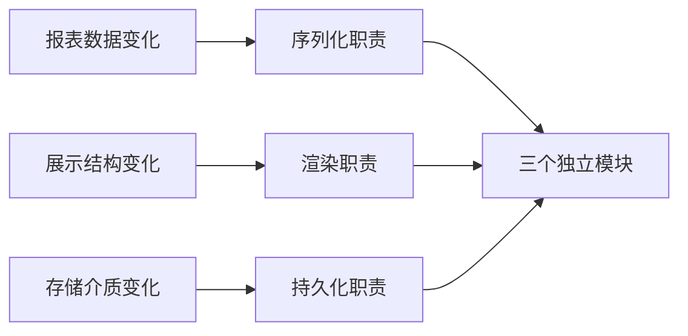

## Table of contents

## 单一职责原则

单一职责原则（Single Responsibility Principle，SRP）的常见表述是「一个类只做一件事」，这个说法无法落地：事情的大小没有标准，拆到多细也没有边界。可操作的版本是「一个模块只有一个引起它变化的原因」。判断单位从「做了几件事」转成「会被几种需求改动」，拆分才有依据。

### 1. 职责的定义与变化原因

#### 1.1 职责是变化的原因

职责在本文语境中指「被修改的理由」。一个类被两类互不相关的需求修改，就承担了两个职责。职责数量不等于代码行数：十个小方法可以同属一个职责，两个方法也可能分属两个职责。

```ts
class Report {
  constructor(private rows: Row[]) {}

  toJSON() {
    return { rows: this.rows };
  }

  toHTML() {
    return `<table>${this.rows.map((row) => `<tr><td>${row.name}</td></tr>`).join("")}</table>`;
  }

  save(path: string) {
    fs.writeFileSync(path, JSON.stringify(this.toJSON()));
  }
}
```

`Report` 有三个变化方向：数据结构调整影响 `toJSON`，页面结构调整影响 `toHTML`，存储介质换成对象存储影响 `save`。三类需求由不同人提出、在不同时间进入，修改任何一处都要重新阅读并回归另外两处。

#### 1.2 变化原因的判断

判断依据是需求侧而不是代码侧。同一个需求如果只引起某几个方法变化，这几个方法就属于同一职责。

| 变更需求 | 受影响成员 | 归属职责 |
| --- | --- | --- |
| 报表增加汇总行字段 | `toJSON`、`Report` 构造参数 | 数据序列化 |
| 表格改为卡片布局 | `toHTML` | 展示渲染 |
| 输出改为写入对象存储 | `save` | 持久化 |



上图按变化来源而非方法数量切分：三类需求各自落到一个模块，任一需求进入时只改动对应的那一个。若两类需求总是同时出现、由同一人同时修改，则不必拆分，合并反而减少跳转成本。

### 2. 设计模式中的 SRP

设计模式大量依赖职责分离：一个对象只承担单一变化原因，其余协作交给组合。

#### 2.1 单例

单例模式（Singleton）的职责只有一个：保证全局唯一实例并提供访问点。把业务初始化塞进构造函数，会让单例同时承担「唯一性管理」与「业务装配」两类变化。

```js
// Violation: creation is coupled with data loading
class Config {
  static instance;
  constructor() {
    this.data = JSON.parse(fs.readFileSync("./config.json", "utf8"));
  }
  static getInstance() {
    return Config.instance ?? (Config.instance = new Config());
  }
}

// Separation: the singleton only owns uniqueness
class ConfigStore {
  static #instance;
  #data = null;

  static getInstance() {
    return ConfigStore.#instance ?? (ConfigStore.#instance = new ConfigStore());
  }

  load(source) {
    this.#data = source;
    return this;
  }
}
```

拆分后，唯一性逻辑与配置加载逻辑分别演进：加载源改为远程接口时，`getInstance` 不需要任何改动。

#### 2.2 代理

代理模式（Proxy）把访问控制从真实业务中剥离。虚拟代理负责占位与预加载，真实节点只负责展示。

```js
// Real subject: only renders the final image
const imgNode = (function () {
  const node = document.createElement("img");
  document.body.appendChild(node);
  return { setSrc: (src) => (node.src = src) };
})();

// Proxy: only owns lazy loading
const proxyImage = (function () {
  const cache = new Image();
  cache.onload = function () {
    imgNode.setSrc(this.src);
  };
  return {
    setSrc(src) {
      imgNode.setSrc("./assets/loading.gif");
      cache.src = src;
    },
  };
})();
```

图片节点不需要知道加载状态，代理不需要知道节点挂载细节。新增缓存策略时只改代理，新增展示样式时只改节点。

#### 2.3 迭代器

迭代器只负责按序访问，不负责聚合结构的维护，也不负责对每个元素做什么。

```js
function each(target, callback) {
  if (Array.isArray(target)) {
    for (let i = 0; i < target.length; i++) callback.call(target[i], target[i], i);
    return;
  }
  for (const key in target) {
    if (Object.prototype.hasOwnProperty.call(target, key)) {
      callback.call(target[key], target[key], key);
    }
  }
}
```

遍历策略与业务回调分离后，两者可以独立替换：数组换成 `Map` 只需替换遍历实现，回调换成异步版本不影响遍历。若把取数、格式化、渲染都写进调用处，遍历逻辑就与业务逻辑绑死。

### 3. 何时应该分离职责

#### 3.1 变化方向不一致时分离

分离的判据是两个职责的变化频率与触发条件是否一致。

指向拆分的信号：

- 修改 A 时经常需要顺带改动 B，且两者由不同需求驱动。
- 同一个类被多个场景以不同理由引用，每次只用其中一小部分成员。
- 测试某个方法时必须构造另一职责所需的全部依赖。

指向保留的信号：

- 两个职责的代码总是成对修改，提交记录中从未单独出现。
- 拆分后某一部分只剩转发调用，没有独立语义。
- 拆分需要跨模块同步状态，间接层的复杂度超过耦合成本。

#### 3.2 分离的代价

| 收益 | 代价 |
| --- | --- |
| 修改范围收敛，回归面小 | 模块数量增加，调用链变长 |
| 单元测试的依赖注入面变窄 | 阅读时需要在多个文件间跳转 |
| 职责可独立替换与复用 | 拆分过细会产生贫血对象与纯转发层 |

职责分离不追求粒度最小，而追求变化原因单一。一个 200 行的函数只要只响应一类需求，就符合原则；一个 30 行的类若同时响应配置与渲染，就不符合。

### 4. 违反 SRP 的典型

#### 4.1 上帝对象

上帝对象（God Object）是职责堆积的典型形态：一个服务类承担参数校验、持久化、消息通知、埋点上报、错误处理。

```js
class OrderService {
  async create(payload) {
    if (!payload.items?.length) throw new Error("empty order");
    const total = payload.items.reduce((sum, item) => sum + item.price, 0);
    await db.insert("orders", { ...payload, total });
    await mailer.send(payload.email, "order created");
    tracker.track("order_create", { total });
    logger.info("order created", payload.id);
  }

  cancel(id) {
    // ... same five concerns again
  }
}
```

识别信号可以直接从仓库里读取：单文件行数持续增长、`import` 数量超过十几个、`git log` 中该文件的提交频率远高于同目录其他文件、修改一处校验逻辑需要重跑全部集成测试。

#### 4.2 重构方向

按变化原因切分，不按技术分层切分。`utils/`、`helpers/` 这类目录把不相关的逻辑堆在一起，没有解决耦合。可行的顺序是先在类内提炼函数，再按依赖方向抽出模块。

```js
class OrderValidator {
  validate(payload) {
    if (!payload.items?.length) throw new Error("empty order");
  }
}

class OrderRepository {
  save(order) {
    return db.insert("orders", order);
  }
}

class OrderNotifier {
  notify(order) {
    return mailer.send(order.email, "order created");
  }
}

class OrderService {
  constructor(validator, repository, notifier) {
    Object.assign(this, { validator, repository, notifier });
  }

  async create(payload) {
    this.validator.validate(payload);
    const order = await this.repository.save(payload);
    await this.notifier.notify(order);
    return order;
  }
}
```

`OrderService` 从「什么都做」变为「编排顺序」，其变化原因只剩流程本身。通知渠道调整只改 `OrderNotifier`，换数据库只改 `OrderRepository`。

### 5. 优缺点

| 角度 | 收益 | 成本 |
| --- | --- | --- |
| 可维护性 | 需求变更时定位范围明确 | 需要提前理解变化方向 |
| 可测试性 | 依赖数量少，替身构造简单 | 需要设计可注入的边界 |
| 复用性 | 职责单一的模块可跨场景复用 | 过度拆分产生碎片化模块 |

SRP 的收益来自「变更影响可预测」，而不是「代码更短」。当拆分只带来文件数量增加而没有降低修改耦合时，拆分是无效的。

### 6. React 与 Vue 中的组件拆分

组件是职责的天然载体，但「一个组件只做一件事」同样无法执行。可行的拆分线是「数据来源变化」与「展示结构变化」是否同频。React 中把取数与渲染混在同一组件，接口字段调整和样式调整会同时落在同一个文件：

```tsx
// Before: fetching, formatting and rendering share one component
function OrderList() {
  const [orders, setOrders] = useState<Order[]>([]);

  useEffect(() => {
    fetch("/api/orders").then((res) => res.json()).then(setOrders);
    tracker.track("order_list_view");
  }, []);

  return <ul>{orders.map((o) => <li key={o.id}>{o.title}</li>)}</ul>;
}
```

拆成 hook 与展示组件后，取数逻辑的演进（缓存、分页、重试）与视图的演进（布局、空态、骨架屏）互不影响：

```tsx
// After: the hook owns data, the component owns presentation
function useOrders() {
  const [orders, setOrders] = useState<Order[]>([]);

  useEffect(() => {
    let cancelled = false;
    fetch("/api/orders")
      .then((res) => res.json())
      .then((data) => !cancelled && setOrders(data));
    return () => {
      cancelled = true;
    };
  }, []);

  return orders;
}

function OrderList({ orders }: { orders: Order[] }) {
  return <ul>{orders.map((o) => <li key={o.id}>{o.title}</li>)}</ul>;
}
```

Vue 3 的对应写法是把取数抽成 composable，组件只消费返回值：

```ts
import { ref, onMounted } from "vue";

export function useOrders() {
  const orders = ref<Order[]>([]);
  onMounted(async () => {
    orders.value = await fetch("/api/orders").then((res) => res.json());
  });
  return { orders };
}
```

拆分的边界仍以变化原因为准：取数逻辑换接口、加缓存时只改 `useOrders`；样式与结构迭代只改展示组件。按行数或按 JSX 层级拆分会得到互相依赖的碎片组件，反而增加改动面积。
