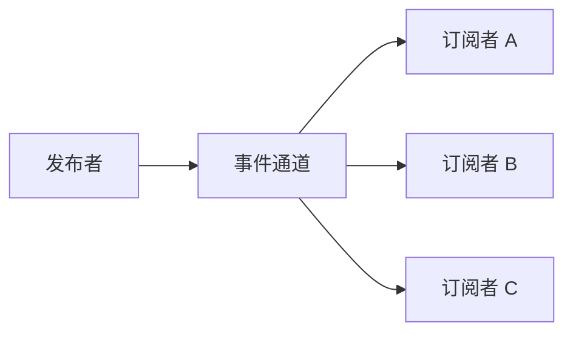

## Table of contents

## 发布-订阅模式

发布-订阅模式定义对象间的一对多依赖：当一个对象状态改变时，所有依赖它的对象都会收到通知。发布者不关心订阅者是谁，订阅者也不持有发布者的引用，两者通过事件通道间接通信。

### 1. 现实类比与作用

日常场景里，订阅报纸、关注公众号、点外卖后的配送通知都是发布-订阅：发送方只负责把消息交给渠道，接收方自行决定是否关注。程序中的事件通道承担同样的角色。



图中的事件通道负责存储订阅表与分发消息，发布者与订阅者之间没有直接引用。这种间接性带来三项收益：

- 时间解耦：发布时不需要订阅者已存在，订阅者可以在任意时刻加入或退出。
- 空间解耦：双方互不引用，模块可以独立加载、替换与测试。
- 一对多：一次发布触发多个订阅回调，新增订阅者无需修改发布逻辑。

与观察者模式的差别在于是否引入通道。观察者模式中主题自己维护观察者列表并直接调用其 `update`，双方仍互相知晓；发布-订阅把列表移到第三方通道，发布者只认事件名。JavaScript 中两者常被混用，因为事件通道往往就是一个普通对象。

### 2. DOM 事件即发布-订阅

浏览器事件是发布-订阅的宿主实现，理解它比手写实现更能说明模式的边界。

```js
const button = document.querySelector("#submit");

button.addEventListener("click", function () {
  console.log("clicked");
});

// programmatic trigger, same path as a real user click
button.click();
```

- `addEventListener` 把回调登记到元素的事件表，用户操作或 `dispatchEvent` 触发时按注册顺序调用。
- 元素不需要知道监听者是谁，监听者也不需要保存除元素引用之外的信息。
- `removeEventListener` 要求传入同一个函数引用，匿名函数无法移除。这条约束在手写实现中同样成立。

事件对象还携带 `target`、`currentTarget` 与冒泡路径，相当于把「谁发布」「谁接收」的上下文一并传出。自定义实现通常只传参，需要额外上下文时得自行附加。

### 3. 自定义事件实现

最小可用版本只需订阅表、订阅、发布、取消订阅四项能力。

```js
const event = {
  clientList: new Map(),

  listen(key, fn) {
    if (!this.clientList.has(key)) {
      this.clientList.set(key, []);
    }
    this.clientList.get(key).push(fn);
  },

  trigger(key, ...args) {
    const fns = this.clientList.get(key);

    if (!fns || fns.length === 0) {
      return false;
    }

    fns.forEach((fn) => fn.apply(this, args));
    return true;
  },

  remove(key, fn) {
    const fns = this.clientList.get(key);

    if (!fns) {
      return;
    }

    if (!fn) {
      this.clientList.delete(key);
      return;
    }

    for (let i = fns.length - 1; i >= 0; i--) {
      if (fns[i] === fn) {
        fns.splice(i, 1);
      }
    }
  },
};
```

- 用 `Map` 而不是对象字面量存订阅表，避免 `__proto__`、`constructor` 这类键名污染原型。
- `remove` 不传回调时清空整个事件，传入回调时只移除匹配项，倒序遍历避免 `splice` 造成的下标错位。
- `trigger` 返回布尔值表示是否有订阅者消费，便于发布方做降级处理。

订阅表也可以按事件名懒创建，`listen` 中先判断再初始化，避免空数组常驻内存。

### 4. 网站登录示例

#### 4.1 强耦合写法

用户登录成功后，页头要刷新头像，购物车要更新数量，消息中心要拉取未读数。直接回调的写法如下：

```js
// login.js
function login(callback) {
  requestLogin()
    .then((user) => callback(user))
    .catch((error) => console.error(error));
}

// header.js
login(function (user) {
  renderAvatar(user);
});

// cart.js
login(function (user) {
  renderCartCount(user);
});
```

问题在于 `login` 只能接受一个回调，多个模块要么层层包装，要么各自发起一次登录请求。退而求其次的写法是把用户信息挂到全局变量，其他模块轮询或延迟读取，于是产生时序依赖：模块加载顺序一变，读到的就是 `undefined`。

#### 4.2 事件解耦

把「登录成功」变成事件，发布方只触发，订阅方各自注册：

```js
// login.js
function login() {
  requestLogin().then((user) => {
    event.trigger("loginSuccess", user);
  });
}

// header.js
event.listen("loginSuccess", function (user) {
  renderAvatar(user);
});

// cart.js
event.listen("loginSuccess", function (user) {
  renderCartCount(user);
});
```

新增一个「积分商城」模块时，只需在自己的文件里调用 `event.listen`，`login` 一行都不用改。发布方不承载下游职责，这正是解耦的落点。

#### 4.3 必须先订阅吗

上面的实现里，`trigger` 发现无人订阅就返回 `false`，消息被丢弃。登录请求可能在 200ms 内完成，而某个模块是按需加载、2s 后才注册监听，它就永远收不到这次通知。

这种「发布早于订阅」的时序问题在单页应用中很常见：路由懒加载、按需引入的弹窗组件、动态注入的第三方脚本都可能错过首屏事件。

#### 4.4 离线消息

两种处理路径。第一种是在事件通道里缓存无人消费的消息，等订阅者出现时补发：

```js
const event = {
  clientList: new Map(),
  offline: new Map(),

  listen(key, fn) {
    if (!this.clientList.has(key)) {
      this.clientList.set(key, []);
    }
    this.clientList.get(key).push(fn);

    const cached = this.offline.get(key);

    if (cached) {
      cached.forEach((args) => fn.apply(this, args));
      this.offline.delete(key);
    }
  },

  trigger(key, ...args) {
    const fns = this.clientList.get(key);

    if (!fns || fns.length === 0) {
      if (!this.offline.has(key)) {
        this.offline.set(key, []);
      }
      this.offline.get(key).push(args);
      return false;
    }

    fns.forEach((fn) => fn.apply(this, args));
    return true;
  },
};
```

第二种路径是把状态与事件分开：用户信息放进 store，事件只承担「已变更」的信号。晚订阅者先读 `store.user` 拿到当前值，再注册监听后续变更。相比缓存消息，这条路径不需要处理「多个订阅者重复消费同一条缓存」的问题，也不会让通道持有业务数据。

缓存的局限在于生命周期与消费语义：全局缓存只应保留最近一次消息，且要在补发后清除，否则新订阅者会收到早已过期的状态。

### 5. 全局事件总线与模块间通信

模块数量上升后，把事件对象做成单例导出，就得到通常所说的事件总线。

```ts
// bus.ts
type Handler = (...args: unknown[]) => void;

class EventBus {
  private handlers = new Map<string, Set<Handler>>();

  on(type: string, handler: Handler) {
    if (!this.handlers.has(type)) {
      this.handlers.set(type, new Set());
    }

    this.handlers.get(type)!.add(handler);

    return () => this.off(type, handler);
  }

  off(type: string, handler: Handler) {
    this.handlers.get(type)?.delete(handler);
  }

  emit(type: string, ...args: unknown[]) {
    this.handlers.get(type)?.forEach((handler) => handler(...args));
  }
}

export const bus = new EventBus();
```

- `Set` 对同一函数的重复注册去重，避免一次发布多次执行。
- `on` 返回取消函数，调用方无需保存原始引用，也降低了 `removeEventListener` 式的遗漏风险。
- `Map` 的键只在首次订阅时创建，未使用的事件名不占内存。

全局单例的代价是隐式依赖：模块之间的调用关系被藏进字符串事件名，静态分析工具无法追踪，改动一处事件名可能导致另一处静默失效。测试时也需要在用例之间清空订阅表，否则状态会跨用例泄漏。

### 6. 事件命名冲突与命名约定

事件名共享一个命名空间，不同模块用同名的 `update`、`refresh` 就会互相干扰。常见治理手段有三类：

- 加模块前缀：`user:login-success`、`cart:update`、`message:unread`。
- 事件名常量化，集中导出，避免手写字符串拼错。

```ts
export const EVENTS = {
  LOGIN_SUCCESS: "user:login-success",
  CART_UPDATE: "cart:update",
} as const;

bus.on(EVENTS.LOGIN_SUCCESS, handler);
```

- 作用域化总线：每个功能模块持有自己的 `EventBus` 实例，通过参数或依赖注入传递，跨模块通信才使用全局实例。

前缀方案改动成本最低，适合既有代码；作用域化从结构上消除冲突，但需要调整模块的依赖传递方式。命名上还应避免用事件名承载数据结构，`{ type: "update", payload }` 这类笼统命名会让订阅方难以判断消息来源。

### 7. 优缺点与现行替代

| 维度 | 表现 |
| --- | --- |
| 解耦 | 发布者与订阅者互不引用，模块可独立替换 |
| 扩展 | 新增订阅者无需改动发布逻辑 |
| 追踪 | 调用链被事件名切断，调试需要额外日志 |
| 内存 | 订阅未释放时，回调与其闭包长期驻留 |
| 约定 | 事件名与参数格式缺乏类型约束时容易漂移 |

内存泄漏是实际项目中最常见的问题：组件卸载时忘记 `off`，回调持有 DOM 引用，页面切换多次后内存持续增长。约定「订阅即返回取消函数，并在卸载钩子中调用」可以把释放动作绑定到生命周期上。

标准库已经提供同类能力，手写实现主要用于理解原理或兼容老环境。浏览器的 `EventTarget` 可以在任意对象上创建事件通道：

```ts
const bus = new EventTarget();

bus.addEventListener("user:login", (event) => {
  const { id } = (event as CustomEvent<{ id: string }>).detail;
  console.log(id);
});

bus.dispatchEvent(new CustomEvent("user:login", { detail: { id: "u1" } }));
```

Node.js 的 `EventEmitter` 提供 `once`、`prependListener`、`removeAllListeners` 与 `error` 事件约定，服务端的进程通信、流处理大量依赖它。框架层面，Vue 3 移除了组件实例上的 `$on`/`$off`，改用 props、emits 与外部 store；React 则倾向状态提升与 context。事件总线在跨模块通知中仍有位置，但不适合承担主要数据流。

判断标准是消息的性质：只需要广播「发生了什么」，用事件；需要随时读取「现在是什么」，用状态容器。两者混用会让同一份数据出现两个来源，同步逻辑随之复杂化。
