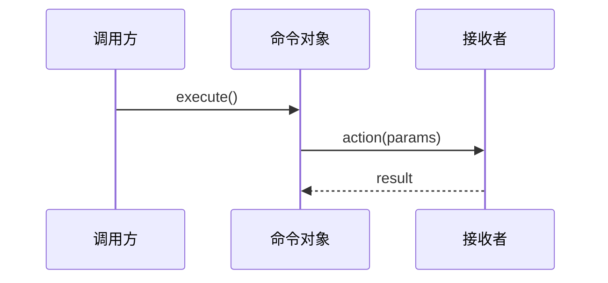

## Table of contents

## 命令模式

命令模式把请求封装成对象，使请求具备参数化、排队、记录与撤销的能力。调用方只持有命令接口，不直接触达接收者，请求的发起与执行因此被解耦。

### 1. 用途：把请求封装成对象

在普通的函数调用中，「发起请求」与「执行请求」发生在同一瞬间，调用方必须知道接收者的方法名与参数。命令模式在两者之间插入命令对象：



调用方只调用 `execute()`，命令对象内部持有接收者与参数，按既定方式转发。过程中产生的收益：

- 请求成为一等对象，可以存入数组、放入队列、写入日志。
- 调用方与接收者之间不再有直接引用，接收者可以替换。
- 同一命令对象可以被重复执行，也可以在需要时执行相反操作实现撤销。

模式的代价是多一层间接：简单场景下，一个函数调用就能完成的事，引入命令对象只会增加代码量。命令对象的价值在需要「记录」「延迟」「回退」时才显现。

### 2. 菜单程序的面向对象实现与命令模式重构

菜单是命令模式的典型载体：点击菜单项触发动作，动作可能被撤销、可能被批量执行。

先看直接绑定回调的写法：

```js
const menuBar = {
  refresh: {
    label: "刷新",
    onClick() {
      window.location.reload();
    },
  },
  undo: {
    label: "撤销",
    onClick() {
      editor.undo();
    },
  },
};
```

每个菜单项自己实现业务，菜单结构无法复用，也无法在执行前后插入统一逻辑（埋点、权限校验、错误上报）。重构为命令对象：

```js
function RefreshCommand(receiver) {
  this.receiver = receiver;
}

RefreshCommand.prototype.execute = function () {
  this.receiver.refresh();
};

function UndoCommand(receiver) {
  this.receiver = receiver;
}

UndoCommand.prototype.execute = function () {
  this.receiver.undo();
};
```

菜单项只保存命令实例：

```js
const menuItem = {
  label: "刷新",
  command: new RefreshCommand(receiver),
  onClick() {
    this.command.execute();
  },
};
```

此时点击流程变为「菜单项 → 命令 → 接收者」，菜单项对业务一无所知。若要加埋点，只需在 `onClick` 或命令基类中包一层，不影响任何具体动作。

### 3. JavaScript 中的命令模式

函数本身就是对象，命令的 `execute` 不必是类方法，闭包可以直接保存接收者与参数。

```js
function makeCommand(receiver, action, ...args) {
  return {
    execute() {
      receiver[action](...args);
    },
  };
}

const command = makeCommand(editor, "insert", "hello");
command.execute();
```

更简的写法是把 `execute` 直接定义为函数，需要附加能力时再升级为对象：

```js
const command = () => editor.insert("hello");
```

- 只需要「延后执行」时，函数或 `setTimeout` 已足够，命令模式并不提供额外价值。
- 需要 `undo`、`name`、`canExecute` 等配套方法时，对象形态才有意义。
- 用闭包保存接收者，避免 `this` 在传递过程中丢失；如果用方法引用 `receiver.insert`，调用时的 `this` 会指向命令对象而非接收者。

命令与接收者的职责划分需要明确：接收者负责「怎么做」，命令负责「做什么、按什么顺序做」。把业务逻辑全部塞进命令，接收者就退化为数据容器，撤销时也无从复用。

### 4. 撤销

撤销要求命令能够回退自身造成的影响。两种实现路径：保存执行前的快照，或提供逆操作。

```js
function AddTextCommand(editor, text) {
  this.editor = editor;
  this.text = text;
  this.prevContent = null;
}

AddTextCommand.prototype.execute = function () {
  this.prevContent = this.editor.getContent();
  this.editor.insert(this.text);
};

AddTextCommand.prototype.undo = function () {
  this.editor.setContent(this.prevContent);
};
```

历史栈负责记录执行过的命令：

```js
const history = [];

function run(command) {
  command.execute();
  history.push(command);
}

function undo() {
  const command = history.pop();

  if (command) {
    command.undo();
  }
}
```

| 方式 | 实现成本 | 内存占用 | 适用场景 |
| --- | --- | --- | --- |
| 快照 | 低，保存整份状态 | 随状态体积线性增长 | 状态小、操作频率低 |
| 逆操作 | 高，每个命令成对实现 | 只记录差异 | 状态大、操作频繁 |

重做需要两个栈：执行新命令时把命令压入 `undoStack` 并清空 `redoStack`；撤销时从 `undoStack` 弹出并压入 `redoStack`；重做则反向操作。

```js
const undoStack = [];
const redoStack = [];

function execute(command) {
  command.execute();
  undoStack.push(command);
  redoStack.length = 0;
}

function undo() {
  const command = undoStack.pop();

  if (command) {
    command.undo();
    redoStack.push(command);
  }
}

function redo() {
  const command = redoStack.pop();

  if (command) {
    command.execute();
    undoStack.push(command);
  }
}
```

并非所有操作都能撤销。发送邮件、提交订单这类有外部副作用的命令，逆操作在语义上不成立，通常直接禁止入栈，或在界面层隐藏撤销入口。

### 5. 命令队列与宏命令

队列把命令的「加入」与「执行」拆开，用于串行化一组操作：

```js
const queue = [];

function enqueue(command) {
  queue.push(command);
}

function flush() {
  while (queue.length) {
    queue.shift().execute();
  }
}
```

- 动画序列、批量上传、表单多步提交都适合队列，避免并发写同一份状态。
- 队列执行中可以插入暂停与恢复，只需在循环条件里加一个标志位。
- 异常处理需要明确策略：单条命令失败时是中断后续，还是记录后继续执行。

宏命令把一组命令打包成单个命令，`execute` 时依次调用子命令：

```js
function MacroCommand() {
  return {
    commands: [],
    add(command) {
      this.commands.push(command);
    },
    execute() {
      this.commands.forEach((command) => command.execute());
    },
  };
}

const macro = MacroCommand();
macro.add(new RefreshCommand(receiver));
macro.add(new UndoCommand(receiver));
macro.execute();
```

宏命令的撤销需要逆序执行子命令的 `undo`，否则先执行的命令会在后执行的命令回退之前恢复状态，导致中间状态错乱。如果子命令中还有宏命令，结构就从线性列表变成树，这部分由组合模式处理。

### 6. 智能命令与傻瓜命令

按命令对象是否包含业务逻辑，可以分成两类：

- 傻瓜命令：只转发请求，不含判断与计算，全部实现放在接收者。职责边界清晰，命令可在不同接收者之间复用，测试时替换接收者即可。
- 智能命令：直接实现业务逻辑，省略接收者。代码量少，但命令接口退化为函数调用的包装，撤销与复用能力被削弱。

```js
// smart command: logic lives inside
const smartCommand = {
  execute() {
    if (editor.isEmpty()) {
      editor.focus();
      return;
    }
    editor.clear();
  },
};
```

选择依据是变化频率与复用需求：

| 条件 | 倾向 |
| --- | --- |
| 需要撤销、排队、日志 | 傻瓜命令，保留接收者 |
| 多个命令共享同一接收者 | 傻瓜命令 |
| 一次性动作、无历史需求 | 直接调用函数，不引入命令对象 |
| 逻辑简单且只在一处使用 | 智能命令可接受 |

命令模式的结构不应成为默认选项。判断是否引入的关键在于请求是否需要被「保存」或「重放」，不需要时函数调用就是最合适的抽象。
