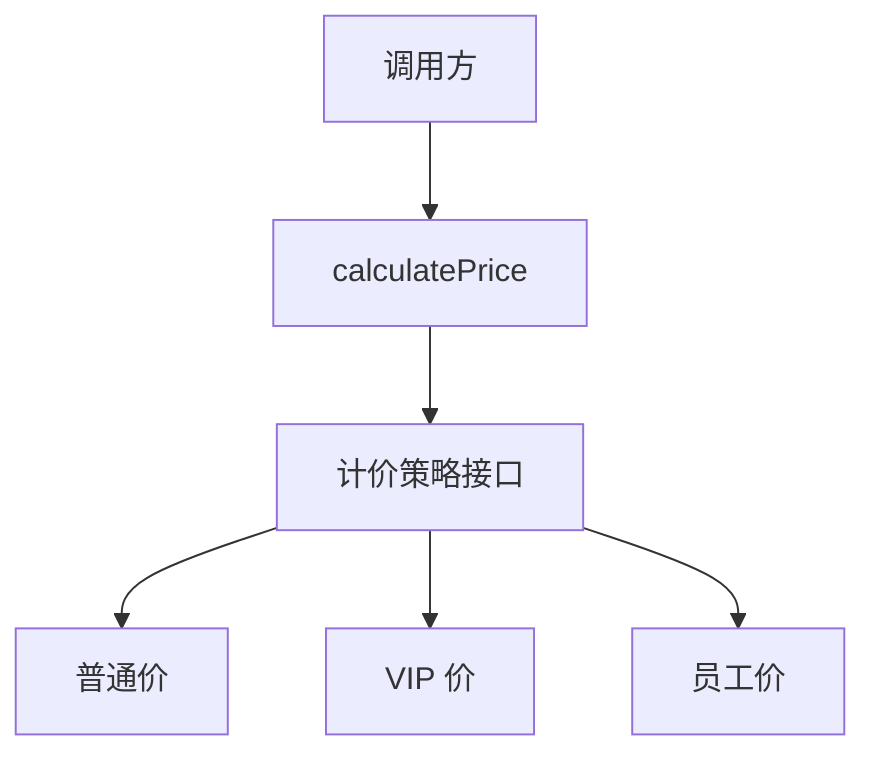

## Table of contents

## 开放-封闭原则

开放-封闭原则（Open-Closed Principle，OCP）的表述是：软件实体应当对扩展开放、对修改关闭。新增行为通过添加代码完成，已有代码不改动。这条原则无法被完全满足，任何抽象都有边界，新需求迟早会突破边界。它的实际价值在于把「改动集中到新增文件」变成一个可以逐步逼近的方向，而不是一次性达成的状态。

### 1. 定义的两层含义

- 对扩展开放：需求变化时，可以通过新增模块、新增实现来响应，不必改动调用方。
- 对修改关闭：已发布的模块在新增能力时不修改源码，因此不需要重新回归它原有的全部场景。

两条同时成立才构成封闭。只做到「不改老代码」而新增代码必须改动配置开关，或者只做到「容易加功能」但每次都要回到核心函数里加分支，都不满足原则。

封闭的载体是抽象。调用方依赖抽象，新增实现只需实现抽象，调用方不需要知道实现数量。

### 2. 扩展 window.onload

#### 2.1 直接覆盖的问题

```js
window.onload = function () {
  initHeader();
};

// Later script overwrites the previous handler
window.onload = function () {
  initFooter();
};
```

`onload` 是单一槽位属性，后赋值者覆盖先赋值者，`initHeader` 不再执行。多个脚本协作时，执行顺序依赖加载顺序，且没有任何提示。这类问题的本质是扩展点被设计成「赋值」而不是「注册」。

#### 2.2 保存原函数

不改动既有写法的最小修复是取出原函数再串联：

```js
const originalOnload = window.onload;

window.onload = function (event) {
  if (typeof originalOnload === "function") {
    originalOnload.call(this, event);
  }
  initFooter();
};
```

这段代码满足 OCP：新增逻辑不修改原函数体。但它只是调用点的局部约定，第三个脚本若不知道这个模式，仍会直接覆盖。

#### 2.3 通用事件注册

把「保存原函数」封装成注册函数，扩展点才真正稳定：

```js
function addEvent(target, type, handler) {
  const key = `on${type}`;
  const previous = target[key];

  target[key] = function (event) {
    if (typeof previous === "function") {
      previous.call(this, event);
    }
    handler.call(this, event);
  };
}
```

```js
addEvent(window, "load", initHeader);
addEvent(window, "load", initFooter);
```

调用方按需注册，新增行为不需要接触已注册的处理器。后续若把 `addEvent` 换成 `addEventListener`，也只是替换注册函数内部实现：`addEventListener` 本身支持多处理器，串联逻辑由浏览器负责，`once`、`passive` 等选项可以直接透传。

```js
function addEvent(target, type, handler, options) {
  if (typeof target.addEventListener === "function") {
    target.addEventListener(type, handler, options);
    return;
  }
  // ... legacy fallback
}
```

封装的收益是扩展点从「每个调用点的自觉」变成「基础设施的保证」。新增模块只依赖 `addEvent`，不依赖其他模块是否遵守约定。

### 3. 开放与封闭的边界

#### 3.1 抽象选择决定封闭范围

抽象一旦选错，封闭就是假象。以支付为例，若抽象是「支付宝支付」：

```ts
interface AlipayGateway {
  payByAlipay(amount: number): Promise<void>;
}
```

接入微信支付时只能新增一个不实现该接口的类，然后回到调用方加分支。若抽象是「支付能力」：

```ts
interface PaymentGateway {
  pay(amount: number, orderId: string): Promise<PaymentResult>;
}
```

新增渠道只需实现接口并注册。抽象粒度决定未来哪一类变化可以零修改接入。

#### 3.2 边界由已知变化决定

不存在覆盖所有未来的抽象。合理的做法是只对已经出现或高概率出现的变化方向做封闭，其余保持简单。

| 变化方向 | 出现次数 | 处理 |
| --- | --- | --- |
| 支付渠道增加 | 已出现 3 次 | 抽象为接口 |
| 汇率来源切换 | 已出现 1 次 | 保持直接调用 |
| 主题配色调整 | 频繁 | 抽为 token |

过早为「可能出现的多语言」设计整套文案抽象，通常会在真正需要时发现抽象维度不对。封闭范围应随变化信号扩大，而不是凭预测设定。

### 4. 用多态消除条件分支

条件分支是 OCP 最直接的反例：每新增一种类型都要回到原函数增加一个 `if`，原函数的测试范围随之扩大。

#### 4.1 条件分支版本

```ts
function calculatePrice(type: string, price: number): number {
  if (type === "normal") {
    return price;
  }
  if (type === "vip") {
    return price * 0.9;
  }
  if (type === "svip") {
    return price * 0.8;
  }
  if (type === "employee") {
    return price * 0.7;
  }
  throw new Error(`unknown type: ${type}`);
}
```

新增会员等级时函数体继续增长，四个分支共享一个函数作用域，任意分支的修改都需要重新验证全部类型。

#### 4.2 策略模式重构

```ts
interface PriceStrategy {
  calculate(price: number): number;
}

const strategies: Record<string, PriceStrategy> = {
  normal: { calculate: (price) => price },
  vip: { calculate: (price) => price * 0.9 },
  svip: { calculate: (price) => price * 0.8 },
};

function calculatePrice(type: string, price: number): number {
  const strategy = strategies[type];
  if (!strategy) throw new Error(`unknown type: ${type}`);
  return strategy.calculate(price);
}
```

新增等级只添加一个键值对，`calculatePrice` 不改动。策略之间没有共享状态，可以单独测试。



上图表示调用方只依赖接口与查找表，新增实现挂在接口之下，主流程不变。若把 `if` 直接改为 `switch` 再抽成对象映射，行为等价但扩展成本不同：映射表新增条目即可，`switch` 仍需修改函数体。

#### 4.3 状态与命令

状态模式把「当前状态下允许的行为」分散到各个状态类，状态迁移由状态对象发起：

```ts
interface UploadState {
  start(ctx: UploadContext): void;
  pause(ctx: UploadContext): void;
  resume(ctx: UploadContext): void;
}

class IdleState implements UploadState {
  start(ctx: UploadContext) {
    ctx.transition(new UploadingState());
  }
  pause() {}
  resume() {}
}

class UploadingState implements UploadState {
  start() {}
  pause(ctx: UploadContext) {
    ctx.transition(new PausedState());
  }
  resume() {}
}
```

命令模式则把操作封装成对象，撤销栈只依赖统一的 `execute` / `undo`，新增命令不需要改动栈的实现。

两者的共同点是把「分支判断」换成「对象查找」。调用方持有的引用类型不变，行为随对象替换而改变。

### 5. 找出变化的地方

#### 5.1 变化点识别信号

- 同一个函数中出现按类型、按渠道、按版本划分的分支链。
- 每次需求变更都落到同一个文件的同一段代码。
- 代码注释中出现「新增 XX 时在这里加一行」。
- 两段代码结构相同，仅常量或字段名不同。

#### 5.2 变化点与稳定点分离

识别出变化点后，把它移到独立模块，主流程保留不变的编排逻辑。

```js
// Stable: the flow never changes
async function publish(post) {
  const prepared = await formatter.format(post);
  await storage.save(prepared);
  await notifier.send(prepared);
  return prepared;
}
```

格式化规则、存储介质、通知渠道分别由注入的实现承担。主流程的测试只需验证调用顺序，变化点的测试针对具体实现。两者分离后，新增存储介质不会让主流程的测试重新失败。

### 6. 设计模式中的体现

| 模式 | 封闭的变化方向 | 扩展方式 |
| --- | --- | --- |
| 策略 | 算法 / 计价规则 | 新增策略对象 |
| 状态 | 状态迁移规则 | 新增状态类 |
| 命令 | 操作类型与撤销 | 新增命令类 |
| 装饰器 | 功能叠加 | 新增装饰层 |
| 观察者 | 事件订阅者 | 新增订阅者 |
| 模板方法 | 流程步骤实现 | 覆写钩子 |
| 工厂 | 对象创建细节 | 新增产品类 |

这些模式的共同结构是「调用方依赖抽象，实现可替换」。模式本身不产生封闭性，是抽象边界的划分产生了封闭性。

### 7. 相对性与「接受第一次愚弄」

#### 7.1 没有绝对封闭

任何模块都会遇到抽象之外的需求。一个为「按金额折扣」设计的策略接口，遇到「满减叠加」时可能仍要调整接口签名，进而修改所有实现。OCP 的收益是概率性的：抽象正确的方向上，改动次数显著减少；抽象错误的方向上，抽象本身成为负担。

#### 7.2 接受第一次愚弄

Kent Beck 的表述是「先让它工作，再让它正确，最后让它快」，对应到 OCP 是：第一次遇到变化时按最直接的方式实现，第二次出现同类变化时再抽象。

```js
// First time: a direct branch is enough
function exportReport(format) {
  if (format === "csv") return toCsv(rows);
  throw new Error("unsupported");
}

// Second time: the second format appears, extract the variation
const exporters = {
  csv: toCsv,
  xlsx: toXlsx,
};
```

第一次就抽象的风险是抽象维度来自想象，第二次抽象的依据是两处真实差异。两次实现之后再提取公共接口，接口签名通常更贴近实际。

#### 7.3 节奏判断

- 单一实现且无第二种预期时，直接实现。
- 第二种实现出现时，提取接口并把调用方改为依赖接口。
- 第三种实现出现时，检查接口是否需要拆分，而不是继续堆分支。
- 接口长期只有一个实现且无替换需求，可以评估回退为直接调用。

OCP 是重构的方向，不是设计阶段的前置任务。先写出可工作的实现，在变化真实出现后收敛扩展点，比在需求稳定前铺设抽象更可靠。
