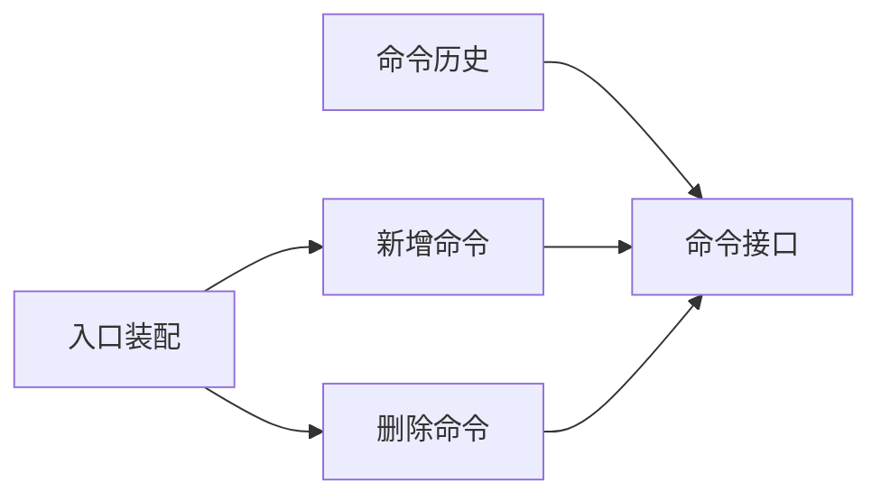

## Table of contents

## 接口和面向接口编程

接口有两种含义：语言提供的 `interface` 关键字，以及对象对外暴露的方法集合。前者是语法设施，后者是契约。JavaScript 只支持后者，TypeScript 补上了前者但只在编译期生效。面向接口编程的实质是让调用方依赖契约而不是具体实现，与语言是否提供关键字无关。

### 1. 接口的含义

#### 1.1 契约而非实现

接口描述「能做什么」，不描述「怎么做」。调用方持有一个接口类型的引用，就可以调用接口声明的方法，不需要知道实现类的构造参数、内部字段与依赖。

```ts
interface Logger {
  info(message: string, meta?: Record<string, unknown>): void;
  error(message: string, error?: Error): void;
}
```

任何一个对象，只要具备签名兼容的 `info` 与 `error`，就可以作为 `Logger` 使用。实现可以是控制台输出、写文件、上报远端，调用方代码不变。

#### 1.2 接口的三个作用

- 约束实现：实现类必须提供接口声明的方法，缺失或签名不符在类型检查阶段暴露。
- 隔离变化：调用方不引用实现类，替换实现不影响调用方。
- 支撑测试：测试中可以传入只实现接口的最小替身，不需要构造真实依赖。

### 2. Java 中的抽象类与 interface

Java 把抽象分为两种设施，二者的差别决定了使用场景。

| 维度 | 抽象类 `abstract class` | 接口 `interface` |
| --- | --- | --- |
| 方法实现 | 可包含具体方法与抽象方法 | 传统上只有声明，Java 8 起可有 `default` 方法 |
| 状态 | 可有实例字段与构造器 | 字段隐式为 `public static final` |
| 继承 | 单继承 | 一个类可实现多个接口 |
| 语义 | 表达 is-a，复用部分实现 | 表达 can-do，声明能力契约 |
| 演进 | 增加抽象方法会破坏子类 | 增加 `default` 方法可向后兼容 |

选择上，需要共享实现与状态时用抽象类，需要声明能力并允许多重组合时用接口。Java 集合框架中的 `AbstractList` 提供通用实现，`List`、`RandomAccess`、`Serializable` 分别声明不同的能力，是两类设施配合的典型结构。

这套设施依赖编译期的类型系统与单一继承模型。JavaScript 两者都不具备，直接照搬会得到没有约束力的空壳。

### 3. JavaScript 是否需要抽象类与 interface

#### 3.1 语言特性缺失的原因

JavaScript 是动态类型语言，对象在运行时通过属性查找决定行为，类型由值的结构决定而非声明决定。语言层面没有 `interface` 关键字，也没有编译期检查，声明一个接口不会阻止任何对象被传入。

ES6 的 `class` 提供了 `extends`，但不支持 `abstract` 修饰，也无法阻止直接实例化基类。用运行时抛错模拟抽象方法属于约定，不是语言保证。

#### 3.2 注释与文档约定

早期项目用注释声明契约，靠代码评审维持一致性：

```js
/**
 * @typedef {Object} Command
 * @property {() => void} execute
 * @property {() => void} [undo]
 */

/** @param {Command} command */
function run(command) {
  command.execute();
}
```

```js
// The simplest convention: state the contract above the implementation
// interface Command { execute(): void; undo?(): void }
class AddItemCommand {
  execute() {
    // ...
  }
}
```

注释能表达意图，但不参与校验。实现漏写方法时错误发生在调用处，堆栈指向使用者而不是实现者。团队规模扩大后，约定会被稀释。

#### 3.3 TypeScript 的编译期契约

TypeScript 的 `interface` 提供结构化类型检查：只要对象的成员满足声明，就视为实现该接口，不需要显式 `implements`。

```ts
interface Command {
  execute(): void;
  undo?(): void;
}

// Structural typing: no implements clause required
const logCommand: Command = {
  execute() {
    console.log("run");
  },
};
```

`implements` 的作用是显式声明意图，并在类定义处提前报错：

```ts
class SaveCommand implements Command {
  execute() {
    // ...
  }
}
```

类型检查发生在编译期，产物中不存在 `Command` 的任何痕迹：

```ts
// Source
interface Command {
  execute(): void;
}

// Output after compilation: the interface is erased entirely
```

因此 TypeScript 的接口无法阻止运行时的错误调用，例如从 `JSON.parse` 得到的对象、跨包传递的插件对象、`any` 断言后的值。编译期契约覆盖的是代码内部，边界处仍需运行时判断。

### 4. 用鸭子类型做运行时检查

鸭子类型的判断标准是行为：具备所需方法的对象即可使用，不关心其类型来源。运行时检查是这一思路的显式写法。

```js
function assertCommand(value) {
  if (value == null) {
    throw new TypeError("command is required");
  }
  if (typeof value.execute !== "function") {
    throw new TypeError("command must implement execute()");
  }
}

function run(command) {
  assertCommand(command);
  command.execute();
}
```

检查放在边界入口，内部调用不再重复。若同一个对象会被多次调用，可以在注册阶段检查一次，之后按可信对象处理。

#### 4.1 局限

- 只校验成员存在与类型，不校验参数个数、返回结构、异常行为。
- 通过检查的空实现会在调用后静默失败，错误延后暴露。
- 属性为 getter 时，读取行为可能带副作用；`Proxy` 可以伪造 `typeof` 结果。
- 无法区分「实现了方法」与「实现了语义」，例如 `execute` 存在但抛 `NotImplemented`。
- 每个边界都要写一遍检查代码，容易遗漏或与实现不同步。

#### 4.2 适用场景

| 场景 | 是否检查 | 理由 |
| --- | --- | --- |
| 内部模块之间的调用 | 否 | 编译期类型已覆盖 |
| 第三方插件注册 | 是 | 实现不受本项目控制 |
| 配置文件驱动的动态加载 | 是 | 输入不可信 |
| 跨 iframe / Worker 传递的对象 | 是 | 类型信息不跨界 |

检查的目的不是替代类型系统，而是让错误在边界处以明确信息失败，而不是在深层调用中抛出难以定位的 `undefined is not a function`。

### 5. 用 TypeScript 编写基于 interface 的命令模式

#### 5.1 定义接口

命令模式把操作封装为对象，调用方只依赖统一的执行入口。

```ts
interface Item {
  id: string;
  price: number;
}

interface Cart {
  add(item: Item): void;
  remove(id: string): void;
}

interface Command {
  execute(): void;
  undo?(): void;
}
```

`Cart` 与 `Command` 都是契约。调用方不需要知道购物车是内存数组还是远端同步实现，也不需要知道有多少种命令。

#### 5.2 实现类

```ts
class AddItemCommand implements Command {
  #cart: Cart;
  #item: Item;

  constructor(cart: Cart, item: Item) {
    this.#cart = cart;
    this.#item = item;
  }

  execute() {
    this.#cart.add(this.#item);
  }

  undo() {
    this.#cart.remove(this.#item.id);
  }
}

class RemoveItemCommand implements Command {
  #cart: Cart;
  #item: Item;

  constructor(cart: Cart, item: Item) {
    this.#cart = cart;
    this.#item = item;
  }

  execute() {
    this.#cart.remove(this.#item.id);
  }

  undo() {
    this.#cart.add(this.#item);
  }
}
```

每个命令只关心自己的参数与对 `Cart` 的一次操作。新增「修改数量」命令时，只需实现 `Command`，已有命令与调用方不改动。

#### 5.3 调用方只依赖接口

```ts
class CommandHistory {
  #stack: Command[] = [];

  run(command: Command) {
    command.execute();
    this.#stack.push(command);
  }

  undo() {
    const command = this.#stack.pop();
    command?.undo?.();
  }
}
```

`CommandHistory` 的 `import` 列表中没有 `AddItemCommand` 或 `RemoveItemCommand`，它依赖的只有 `Command`。具体命令由入口装配：

```ts
const cart: Cart = new InMemoryCart();
const history = new CommandHistory();

history.run(new AddItemCommand(cart, { id: "a1", price: 99 }));
history.run(new RemoveItemCommand(cart, { id: "a1", price: 99 }));
history.undo();
```



上图是依赖方向：高层模块 `CommandHistory` 与低层实现都指向 `Command`，二者互不引用，新增实现不修改高层。这就是依赖倒置在代码结构上的形态。

#### 5.4 编译期与运行时的分工

| 阶段 | 保障 | 缺口 |
| --- | --- | --- |
| 编译期 | 接口成员、参数类型、返回值类型 | 被擦除，运行时不生效 |
| 装配期 | 构造函数注入、`implements` 检查 | 动态加载的对象绕过 |
| 运行时 | 鸭子类型检查、可选方法调用 | 只覆盖名称与类型 |

`undo?: void` 声明为可选，调用处使用 `?.()` 显式处理缺失，比在接口中强制所有命令实现撤销更贴近实际：部分操作本身不可撤销。接口设计的粒度同样影响封闭性，把十几个方法塞进一个 `Command`，实现者会被迫提供空实现，此时应按调用方的实际需要拆成多个接口。
