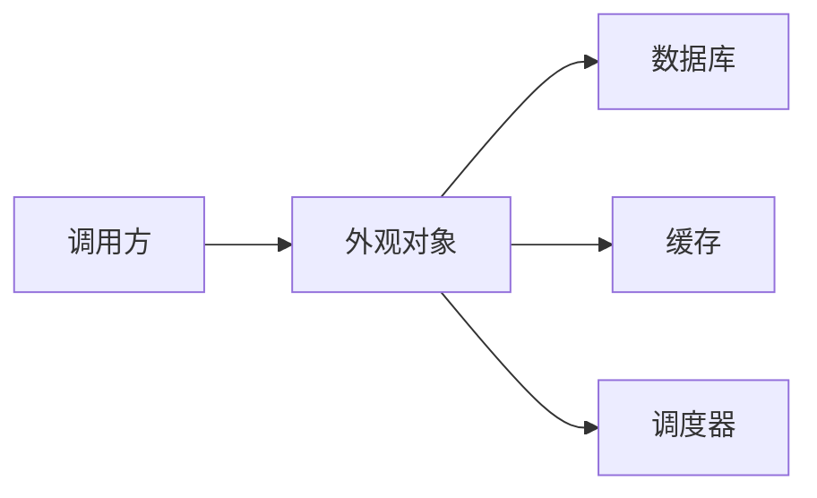

## Table of contents

## 最少知识原则

最少知识原则（Least Knowledge Principle，LKP）又称迪米特法则（Law of Demeter），表述为：一个对象应当对其他对象保持最少的了解，只与直接朋友通信。直接朋友包括对象自身、方法的参数、对象的成员属性，以及方法内部创建的对象。除此之外的对象属于「陌生人」，通过陌生人取数据即违反原则。

原则约束的不是「知道多少类名」，而是「依赖了多少内部结构」。类名可以出现在类型声明中，结构细节不应出现在调用链中。

### 1. 只与直接朋友通信

#### 1.1 违反形态：链式导航

```js
class Wallet {
  constructor(balance) {
    this.balance = balance;
  }
}

class User {
  constructor(wallet) {
    this.wallet = wallet;
  }
}

// The caller reaches through two levels of internal structure
function checkout(user) {
  if (user.wallet.balance < 100) {
    throw new Error("insufficient balance");
  }
}
```

`checkout` 只持有 `User`，却依赖 `User` 内部存在 `wallet`、`wallet` 内部存在 `balance`。`Wallet` 的字段改名、`User` 改为持有多个钱包、余额改为延迟计算，都要回到调用方修改。这条链路也绕过了 `User` 对自身状态的任何约束，外部可以直接读取任意中间层。

#### 1.2 修正方式：把知识内化

```js
class Wallet {
  constructor(balance) {
    this.#balance = balance;
  }

  get balance() {
    return this.#balance;
  }

  hasEnough(amount) {
    return this.#balance >= amount;
  }

  debit(amount) {
    this.#balance -= amount;
  }
}

class User {
  constructor(wallet) {
    this.#wallet = wallet;
  }

  #wallet;

  canAfford(amount) {
    return this.#wallet.hasEnough(amount);
  }

  pay(amount) {
    if (!this.canAfford(amount)) throw new Error("insufficient balance");
    this.#wallet.debit(amount);
  }
}
```

调用方只与 `User` 通信，`pay` 是唯一的入口。钱包结构、余额存储方式、校验规则的调整都被限制在 `User` 与 `Wallet` 内部。

#### 1.3 判断是否属于直接朋友

| 关系 | 是否直接朋友 | 说明 |
| --- | --- | --- |
| 对象自身的方法与字段 | 是 | `this.x` 不引入新依赖 |
| 方法参数对象 | 是 | 可调用其公开方法 |
| 成员属性对象 | 是 | 可调用其公开方法 |
| 方法内新建的对象 | 是 | 生命周期限于方法内部 |
| 成员属性的属性 | 否 | `this.a.b` 已穿透一层 |
| 方法返回值的属性 | 否 | `fn().a` 依赖返回结构 |

表格的核心是「调用链深度」。`this.a.b()` 若 `a` 是 `this` 的成员，则 `a` 是朋友，`a.b()` 属于与朋友通信；再往下的 `this.a.b.c()` 就穿到了陌生人。工程上很难做到零穿透，判断标准是穿透后是否依赖了对方本可隐藏的实现细节。

### 2. 减少对象间的联系

#### 2.1 直接引用与中间层的对比

```js
// Direct: the client knows every subsystem and its invocation order
function startApp() {
  const db = new Database();
  db.connect("postgres://...");
  const cache = new Cache();
  cache.warmup();
  const scheduler = new Scheduler();
  scheduler.start();
}

// Through a facade: the client knows one entry point
function startApp(app) {
  app.start();
}
```

直接引用把子系统的初始化顺序、构造参数、依赖关系全部暴露给调用方。子系统从两个变为五个、预热步骤增加时，每个调用点都要同步。中间层把「怎么启动」收敛到一个位置，调用方只需要知道「能启动」。



上图对比的是依赖数量：直接引用时调用方与三个子系统都有联系，引入外观对象后联系集中为一条。外观对象承担的职责是编排，不是业务实现，它不替代子系统，只隐藏子系统的组合方式。

#### 2.2 中间层的边界

中间层减少联系，同时引入新的依赖：调用方依赖外观，外观依赖全部子系统。以下情况不宜再加中间层：

- 只有一个调用点，且子系统数量不超过两个。
- 中间层只是逐字转发参数，没有聚合或编排语义。
- 调用方确实需要精细控制子系统，中间层反而需要暴露全部能力。

### 3. 设计模式中的 LKP

#### 3.1 外观模式

外观模式（Facade）是最直接的应用：为一组子系统提供统一入口，调用方不接触子系统内部。

```js
class UploadFacade {
  #compressor = new Compressor();
  #uploader = new Uploader();
  #tracker = new Tracker();

  async upload(file) {
    const compressed = await this.#compressor.run(file);
    const result = await this.#uploader.send(compressed);
    this.#tracker.report("upload", { size: compressed.size });
    return result;
  }
}
```

调用方只依赖 `upload(file)`。压缩算法更换、上报渠道调整、上传改为分片，都在外观内部完成。

#### 3.2 中介者模式

中介者（Mediator）处理的是多对多联系。多个模块互相持有引用时，联系数随模块数平方增长；引入中介者后降为线性。

```js
const mediator = (function () {
  const modules = new Map();

  return {
    register(name, module) {
      modules.set(name, module);
    },
    notify(source, event) {
      for (const [name, module] of modules) {
        if (name !== source && typeof module.onEvent === "function") {
          module.onEvent(event);
        }
      }
    },
  };
})();

// Modules never import each other, only the mediator
class CartPanel {
  constructor(bus) {
    this.bus = bus;
  }

  addItem(item) {
    this.bus.notify("cart", { type: "item:add", item });
  }

  onEvent(event) {
    // react to other panels
  }
}
```

`CartPanel` 不认识 `OrderPanel`，只认识 `notify` 这一个方法。新增面板时注册即可，已有面板不需要修改。代价是中介者会随业务扩张而膨胀，需要继续按事件域拆分，否则它自身会变成上帝对象。

#### 3.3 迭代器与封装

迭代器把「如何遍历」从调用方移除。调用方只使用 `next()` 或 `for...of`，不需要知道底层是数组、链表还是生成器。

```js
function createIterator(list) {
  let index = 0;
  return {
    next() {
      return index < list.length
        ? { value: list[index++], done: false }
        : { value: undefined, done: true };
    },
    [Symbol.iterator]() {
      return this;
    },
  };
}
```

若调用方直接按下标访问 `list.items[i]`，内部结构换成 `Map` 时全部调用点失效。迭代器把结构知识留在实现内部。

### 4. 封装如何体现 LKP

封装是 LKP 的实现手段：隐藏字段、只暴露方法，天然减少外部对内部结构的了解。

```js
// Leaks internal structure: the caller can mutate the array
class TodoList {
  items = [];

  getItems() {
    return this.items;
  }
}

// Encapsulated: expose behavior and a copy
class TodoList {
  #items = [];

  add(item) {
    this.#items.push(item);
  }

  remove(id) {
    this.#items = this.#items.filter((item) => item.id !== id);
  }

  get count() {
    return this.#items.length;
  }

  toArray() {
    return [...this.#items];
  }
}
```

前一版把数组引用交出去，调用方可以 `push`、`splice`、重排，所有依赖该数组的下游都要承担不稳定状态。后一版只暴露 `add`、`remove`、`count`，内部从数组改为 `Map` 时外部无感知。

`toArray` 返回副本而不是原引用，是封装中容易被忽略的一环：返回 `#items` 等于把私有字段重新暴露，之前的私有化只挡住了赋值，没挡住修改。

封装的另一面是访问粒度。Getter 只读、方法只做一件事、返回值不可变，这些约定共同压缩了外部需要知道的信息量。外部知道得越少，内部重构的自由度越大。

### 5. 代价与边界

#### 5.1 转发方法膨胀

每次阻止穿透都要新增一个转发方法。层数增加后，一次调用可能要穿过四五个同名方法，调试栈变深，阅读时需要连续跳转。

| 做法 | 耦合 | 成本 |
| --- | --- | --- |
| 直接链式访问 | 高，依赖内部结构 | 无额外代码 |
| 目标对象增加行为方法 | 低 | 目标对象职责增多 |
| 新增中间包装对象 | 最低 | 层数增加，可能纯转发 |

判断标准是「被穿透的结构是否稳定」。稳定的配置对象、一次性读取的 DTO，直接访问的维护成本低于包装；会独立演进的领域对象，穿透的代价会在后续需求中体现。

#### 5.2 数据结构与对象的区别

《重构》对两者的区分可以直接借用：数据结构暴露数据、不含行为，外部按字段读取是正常用法；对象隐藏数据、暴露行为，外部按方法调用才是正常用法。把对象当数据结构用，LKP 的约束就被绕过。

```js
// Data structure: field access is expected
const point = { x: 10, y: 20 };

// Object: behavior is expected
class Account {
  #balance;
  withdraw(amount) {
    // ...
  }
}
```

混合形态是最难维护的：字段公开、方法也存在，外部既可以读字段也可以调方法，两种访问路径产生不同的状态假设。

#### 5.3 与性能的权衡

链式访问本身没有性能问题，包装方法在引擎优化后开销可以忽略。真正影响性能的是为了满足原则而引入的深拷贝与大对象转发：每次 `toArray` 复制上千条记录、每个请求都构造一层包装对象，这类成本可以用压测识别。

工程上的处理顺序是先保证封装边界，再对热点路径做例外处理。例外需要在代码中标注原因，否则后续维护者会按原则把优化改回去。

#### 5.4 过度包装

以下形态属于过度包装，收益为负：

- 包装类只包含一个同名字段和一组 getter / setter。
- 中间层不聚合、不编排，仅把参数原样传递；为了隐藏一个不会变化的常量而引入工厂。
- 每一层都有自己的 DTO，字段几乎完全重复，转换代码占据主要篇幅。

LKP 的目标是降低「变更传播」，不是消灭所有跨对象访问。当包装没有减少任何变化传播路径时，它就是纯粹的间接层。
