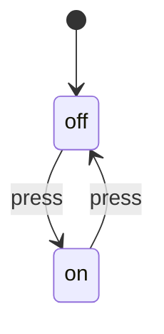

## Table of contents

## 状态模式

对象的行为取决于内部状态时，最直接的写法是把状态判断塞进每个方法。状态数量增加后，方法内部变成多层条件分支，任何一个状态的新增都要横跨所有方法修改。状态模式把每个状态的行为封装成独立对象，上下文只负责持有当前状态并转发请求。

### 1. 初识状态模式

电灯的开关是最小的状态机：关与开两个状态，按下开关在两个状态之间切换。

```js
class Light {
  constructor() {
    this.state = "off";
  }

  press() {
    if (this.state === "off") {
      this.state = "on";
      console.log("light on");
    } else if (this.state === "on") {
      this.state = "off";
      console.log("light off");
    }
  }
}
```

两个状态、一个操作时，这段代码没有问题。需求扩展到「弱光」与「闪烁」后，问题逐条出现：

- 每个操作（短按、长按、双击）都要为所有状态写分支，分支数量是状态数与操作数的乘积。
- 某些操作只对特定状态有效（例如长按只在开灯状态进入弱光），判断散落在方法内部，遗漏时表现为静默无响应。
- 状态切换的目标写死在分支里，无法从外部查看「当前允许哪些转换」。
- 状态相关的数据（亮度、闪烁频率）与方法分离，新增状态要同时改多个方法。

### 2. 定义与通用结构

状态模式由三部分组成：

- 上下文（Context）持有当前状态对象，对外提供稳定的操作接口。
- 状态对象（State）实现该状态下的行为。
- 状态切换由状态对象或上下文在合适的时机完成。



上图是最简单的两态机。状态模式的目标是让代码结构与这张图一一对应：图中的每个状态对应一个对象，每条边对应一次 `setState` 调用。

```js
class State {
  setContext(context) {
    this.context = context;
  }

  handle() {
    throw new Error("handle() must be implemented");
  }
}

class OffState extends State {
  handle() {
    console.log("light on");
    this.context.setState(new OnState());
  }
}

class OnState extends State {
  handle() {
    console.log("light off");
    this.context.setState(new OffState());
  }
}

class Light {
  constructor() {
    this.setState(new OffState());
  }

  setState(state) {
    this.state = state;
    this.state.setContext(this);
  }

  press() {
    this.state.handle();
  }
}
```

结构上有三个约束：

- 上下文不包含任何 `if (state === ...)` 判断，所有分支被下沉到状态对象。
- 状态对象持有上下文的引用，通过 `setState` 完成转换；也有的实现让 `handle` 返回下一个状态名，由上下文统一切换，后者更容易做转换校验。
- 新状态只需新增一个类并在某处完成切换，`Light` 的其他方法不需要改动。

### 3. 缺少抽象类的变通写法

JavaScript 没有抽象类与接口的运行时约束，上面用「基类方法抛错」模拟抽象方法：忘记实现 `handle` 时会在调用时立刻失败，而不是静默返回 `undefined`。这个约定只在开发期有效，生产代码仍可能带着未实现的方法上线。

常见的三种变通方式：

```js
// 1. Base class with a throwing method
class State {
  handle() {
    throw new Error("not implemented");
  }
}

// 2. Plain object map, missing keys are naturally rejected
const states = {
  off: { press: (ctx) => ctx.setState("on") },
  on: { press: (ctx) => ctx.setState("off") },
};
```

TypeScript 项目直接用 `interface` 约束状态对象，编译期即可发现漏实现；纯 JavaScript 项目在另外两种方式中选择，取舍在于约束强度与运行成本：

| 方式 | 约束时机 | 运行时代价 | 适用场景 |
| --- | --- | --- | --- |
| 抛错基类 | 调用时 | 一次判断 | 纯 JavaScript 项目 |
| 对象映射 | 访问时 | 无 | 状态行为简单、以数据为主 |
| TS 接口 | 编译时 | 无 | 有类型系统的项目 |

### 4. 文件上传示例

上传控件有四个状态：扫描文件（`sign`）、上传中（`uploading`）、已暂停（`pause`）、已完成（`done`）。每个状态对「点击」「暂停」两个操作的响应不同。

用状态对象组织：

```js
const FSM = {
  sign: {
    click(self) {
      self.setState("uploading");
    },
  },
  uploading: {
    click(self) {
      self.pauseRequest();
      self.setState("pause");
    },
    pause(self) {
      self.pauseRequest();
      self.setState("pause");
    },
  },
  pause: {
    click(self) {
      self.resumeRequest();
      self.setState("uploading");
    },
  },
  done: {
    click(self) {
      self.reset();
      self.setState("sign");
    },
  },
};

class Uploader {
  constructor() {
    this.state = "sign";
    this.progress = 0;
  }

  setState(state) {
    console.log(`${this.state} -> ${state}`);
    this.state = state;
  }

  click() {
    FSM[this.state].click?.(this);
  }

  pause() {
    FSM[this.state].pause?.(this);
  }

  pauseRequest() {
    // suspend the request and keep the uploaded offset
  }

  resumeRequest() {
    // resume from the saved offset
  }

  reset() {
    this.progress = 0;
  }
}
```

各状态对各操作的响应可以整理成表，代码与需求文档一一对应：

| 当前状态 | 点击 | 暂停 | 说明 |
| --- | --- | --- | --- |
| `sign` | 进入上传 | 忽略 | 扫描阶段不支持暂停 |
| `uploading` | 暂停并进入暂停态 | 暂停并进入暂停态 | 两个入口行为一致 |
| `pause` | 继续上传 | 忽略 | 暂停态重复暂停无意义 |
| `done` | 重置并回到扫描 | 忽略 | 完成后只允许重新开始 |

几点实现说明：

- `FSM` 定义在模块层级，状态对象不持有实例数据，所有上传控件共享同一份，避免每次切换都创建新对象。
- 状态对象不直接操作 DOM 或请求，而是调用上下文暴露的方法（`pauseRequest`、`resumeRequest`），使状态逻辑与副作用分离，便于测试。
- 状态名同时是 `FSM` 的键，新增状态只需增加一个条目与对应的切换点，`Uploader` 的调用方法不变。

### 5. 优缺点与性能优化点

收益：

- 状态相关的行为集中在一个对象内，新增状态不影响其他状态。
- 上下文的方法不再包含状态判断，调用路径短且稳定。
- 状态转换显式出现在 `setState` 调用处，可以配合日志画出实际状态图。
- 每个状态对象可以独立测试，构造上下文替身即可。

代价：

- 对象数量增加。四个状态意味着四个对象或四个类，状态多时文件会变长。
- 状态之间的跳转分散在各状态对象里，阅读单个状态无法得知「谁会切到我」，需要全局视角。

性能上的处理集中在两点：

- 状态对象没有实例数据时共享一份常量，避免 `setState(new IdleState())` 反复分配。共享的前提是状态对象不保存实例相关字段。
- `setState` 只做赋值与必要的通知，不在其中执行请求、渲染等重活；频繁切换的场景（如拖拽中的状态）应把重逻辑放到状态进入/退出的钩子里并做去重。

状态对象持有上下文引用时不能简单共享，因为同一个对象会被多个控件复用，`context` 字段相互覆盖。这种情况下应把上下文作为方法参数传入，或者为每个实例创建独立的状态对象。选择哪条路径取决于状态对象是否携带实例相关数据。

### 6. 与策略模式的区别

状态模式与策略模式的类图几乎一致：上下文持有一个对象，把请求委托给它，对象实现同一接口。差别在意图与转换关系：

| 维度 | 状态模式 | 策略模式 |
| --- | --- | --- |
| 目的 | 行为随内部状态变化 | 算法可互换 |
| 谁来选择 | 状态内部或上下文根据事件切换 | 客户端显式选择 |
| 状态之间是否知道彼此 | 通常知道后继状态 | 策略之间互不知道 |
| 转换 | 是模式的核心 | 不存在转换概念 |
| 典型场景 | 上传流程、订单状态、播放器 | 计价规则、排序算法、压缩方式 |

判断依据是「切换由谁发起」：

- 客户端传入一个算法对象，之后不再改变，是策略。例如表单校验选择不同的校验器。
- 对象内部因为事件推进而改变行为，是状态。例如订单从待支付到已支付，可用操作随之变化。

### 7. 表驱动的有限状态机

状态数量与转换关系继续增长后，用对象与 `setState` 表达会变得难以整体校验。把「状态 × 事件 → 下一状态」抽成一张转移表，规则就变成可检查的数据：

```js
const transitions = {
  idle: { START: "running" },
  running: { PAUSE: "paused", FINISH: "done", RESET: "idle" },
  paused: { RESUME: "running", RESET: "idle" },
  done: { RESET: "idle" },
};

function transition(state, event) {
  const next = transitions[state]?.[event];
  if (!next) {
    throw new Error(`invalid transition: ${state} + ${event}`);
  }
  return next;
}
```

上下文只负责查表与执行副作用：

```js
class Uploader {
  constructor() {
    this.state = "idle";
    this.handlers = {
      START: () => this.startRequest(),
      PAUSE: () => this.pauseRequest(),
      RESUME: () => this.resumeRequest(),
      RESET: () => this.reset(),
    };
  }

  dispatch(event) {
    const previous = this.state;
    this.state = transition(previous, event);
    this.handlers[event]?.();
    this.onChange?.(previous, this.state);
  }
}
```

转移表带来几个直接能力：

- 合法性校验：不在表中的组合一律拒绝，非法事件不会静默改状态。
- 可视化：表可以直接渲染成状态图，与产品文档比对。
- 序列化：规则来自配置时，可以直接由 JSON 生成表。
- 测试：遍历表中的每一行即可覆盖全部转换，不需要构造业务场景。

代价是行为与转换分离：表只描述「能不能走」，具体做什么仍在 `handlers` 里，两者需要保持事件名一致。状态与事件都很少时，表驱动是过度设计；状态超过五六个、且转换关系需要被非开发角色确认时，表驱动的收益明显。

前端交互复杂到一定程度后，手写状态机开始吃力。XState 把状态图作为一等对象，支持嵌套状态、并行状态、守卫条件与 actor 模型，适合多步骤表单、播放器、协作编辑这类流程。它与表驱动状态机解决的是同一类问题，只是把转换表升级为可组合的图结构。
