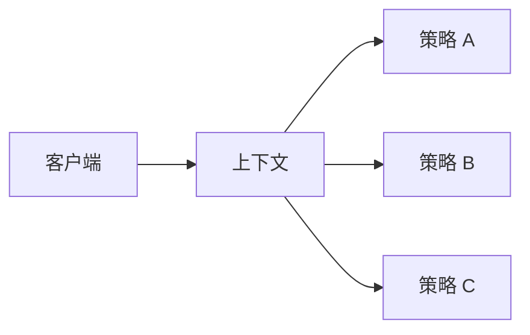

## Table of contents

## 策略模式

策略模式把一组可互换的算法封装成独立单元，由上下文在运行时选择。JavaScript 中策略通常不是类，而是函数或对象字面量；模式的价值集中在消除分支、隔离规则变更，而不是构造出完整的类层级。

### 1. 计算奖金

#### 1.1 if-else 版本

绩效奖金按等级乘以不同系数，最直接的实现是一串条件判断：

```js
function calculateBonus(level, salary) {
  if (level === "A") {
    return salary * 1.5;
  }
  if (level === "B") {
    return salary * 1.2;
  }
  if (level === "C") {
    return salary * 1;
  }
  return 0;
}

calculateBonus("B", 10000); // 12000
```

- 规则与分发写在同一函数里，阅读时需要同时理解「有哪些等级」与「每个等级怎么算」。
- 函数体积随规则数量增长，分支之间的变量作用域相互影响。
- 单元测试只能整体覆盖 `calculateBonus`，无法单独验证某个系数。

#### 1.2 违反开放-封闭的问题

开放-封闭原则要求对扩展开放、对修改封闭。上面的写法在两种变更下都会被迫修改本体：

| 变更 | 需要改动的代码 | 风险 |
| --- | --- | --- |
| 新增等级 `D` | 在 `calculateBonus` 中插入分支 | 插入位置错误会改变原有匹配顺序 |
| 调整 `A` 的系数 | 修改函数体内的常量 | 需要重新回归所有等级 |
| 按部门叠加规则 | 继续增加嵌套判断 | 条件组合爆炸 |

- 每次变更都触碰同一个函数，回归范围与规则数量无关，无法收敛。
- 规则无法在运行时组合，例如「A 级且属于销售部」需要额外的分支。
- 规则若来自配置或后端下发，`if-else` 无法动态承载。

### 2. 策略模式的 JavaScript 实现

#### 2.1 策略对象

把每个等级的计算逻辑抽成独立函数，用对象建立索引：

```js
const bonusStrategies = {
  A: (salary) => salary * 1.5,
  B: (salary) => salary * 1.2,
  C: (salary) => salary * 1,
};

function calculateBonus(level, salary) {
  const strategy = bonusStrategies[level];
  return strategy ? strategy(salary) : 0;
}
```

- 新增等级只需增加一个键，`calculateBonus` 不变。
- 每个策略是独立函数，可以单独测试与复用。
- 策略签名统一为 `(salary) => number`，调用方不感知具体算法。

#### 2.2 上下文委托

经典的策略模式由策略、上下文与客户端三部分组成。上下文持有策略并负责转调，客户端决定注入哪一个：

```js
class BonusContext {
  constructor(strategy) {
    this.strategy = strategy;
  }

  setStrategy(strategy) {
    this.strategy = strategy;
  }

  calculate(salary) {
    return this.strategy ? this.strategy(salary) : 0;
  }
}

const context = new BonusContext(bonusStrategies.A);
context.calculate(10000); // 15000
context.setStrategy(bonusStrategies.C);
context.calculate(10000); // 10000
```

下图给出客户端、上下文与策略之间的调用关系，上下文只依赖策略的统一签名，不依赖具体实现。



- 上下文带来的是运行时切换能力：同一个 `context` 可以在不同阶段使用不同策略。
- 规则固定、只需一次选择时，`bonusStrategies[level](salary)` 的查表写法已经足够，额外包一层类没有收益。
- 上下文适合策略需要携带状态或需要被多个调用方共享选择的场景。

#### 2.3 多态体现

- 所有策略实现同一签名，调用方通过统一接口调用，具体算法对调用方不可见。
- 选择发生在运行时，`level` 来自用户输入或接口返回，代码路径由数据决定。
- 移除某个策略时只需删除对应键，不存在散落在各处的分支残留。

### 3. 表单校验

#### 3.1 规则策略对象

表单校验的规则天然可枚举，适合用策略对象组织：

```js
const validateRules = {
  isNonEmpty(value, message) {
    if (value.trim() === "") {
      return message;
    }
  },
  minLength(value, length, message) {
    if (value.length < Number(length)) {
      return message;
    }
  },
  isMobile(value, message) {
    if (!/^1[3-9]\d{9}$/.test(value)) {
      return message;
    }
  },
};
```

- 每个规则只做一件事，返回错误信息或 `undefined`，调用方据返回值判断。
- 规则之间互不依赖，可以自由组合。
- 规则名即键名，新增规则不触碰校验流程。

#### 3.2 校验器与 errorMessage

```js
class Validator {
  constructor() {
    this.cache = [];
  }

  add(value, configs) {
    for (const config of configs) {
      const parts = config.split(":");
      const name = parts.shift();
      const message = parts.pop();
      this.cache.push(() => validateRules[name](value, ...parts, message));
    }
    return this;
  }

  validate() {
    for (const check of this.cache) {
      const error = check();
      if (error) {
        return error;
      }
    }
    return null;
  }
}

const validator = new Validator();
validator
  .add("", ["isNonEmpty:用户名不能为空"])
  .add("abc", ["minLength:6:用户名长度不能少于 6 位"]);

validator.validate(); // "用户名不能为空"
```

- `add` 把规则名与参数解析成一次待执行的闭包，`validate` 只负责按顺序执行。
- 错误信息随规则配置传入，展示文案与校验逻辑解耦，便于国际化。
- 规则按添加顺序短路，返回首个错误，符合表单逐项提示的交互习惯。

#### 3.3 可改进点

- 规则与参数拼在一个字符串里，参数含冒号时解析错误，改为 `{ name, args, message }` 的对象配置更稳健。
- 只返回首个错误，需要一次性提示全部问题时改为收集数组。
- 唯一性校验依赖接口，需要把 `validate` 改为异步并串行执行，避免并发请求浪费。
- 规则名拼写错误会在运行时静默失效，TypeScript 中用联合类型约束规则名可以在编译期拦截。

```ts
type RuleName = keyof typeof validateRules;

interface RuleConfig {
  name: RuleName;
  args?: unknown[];
  message: string;
}
```

### 4. 缓动动画与更广义的算法

缓动曲线是策略模式的典型应用：动画驱动逻辑固定，曲线算法可替换。

```js
const tween = {
  linear: (t, b, c, d) => (c * t) / d + b,
  easeIn: (t, b, c, d) => c * (t /= d) * t + b,
  strongEaseIn: (t, b, c, d) => c * (t /= d) * t * t * t * t + b,
};
```

```js
function animate(element, property, end, duration, easing) {
  const start = parseFloat(getComputedStyle(element)[property]);
  const startTime = performance.now();

  function step(now) {
    const elapsed = Math.min(now - startTime, duration);
    const value = easing(elapsed, start, end - start, duration);
    element.style[property] = `${value}px`;

    if (elapsed < duration) {
      requestAnimationFrame(step);
    }
  }

  requestAnimationFrame(step);
}

animate(box, "left", 300, 1000, tween.easeIn);
```

- 缓动函数统一签名为 `(已过时间, 起始值, 变化量, 总时长)`，驱动层只负责计算进度并写样式。
- 新增曲线不影响驱动逻辑，曲线也可以从配置中按名称选取。
- CSS `transition` 与 Web Animations API 已覆盖大部分场景，策略模式的价值在于曲线需要在运行时按数据切换，或需要自定义时间轴。

更广义地看，凡是「同一目的、多种算法、运行时选择」都可以套用该结构：压缩算法、排序算法、运费计算、折扣叠加、序列化格式选择。

### 5. 优缺点与一等函数对象

#### 5.1 优缺点

| 维度 | 表现 |
| --- | --- |
| 扩展 | 新增策略不改上下文与调用方 |
| 可读性 | 长分支被拆成命名清晰的独立单元 |
| 可测试性 | 每个策略可单独断言 |
| 成本 | 策略分散在多个位置，需要索引统一管理 |
| 过度设计 | 分支只有两三个且不会增长时，引入策略只增加间接层 |

- 策略数量多时需要约定命名与目录结构，否则查找成本高于 `if-else`。
- 策略之间有共享逻辑时，容易复制粘贴出多份近似实现，应抽出公共函数而非继续复制。

#### 5.2 用函数替代策略类

JavaScript 的函数本身就是一等对象，策略类的大多数职责可以由函数承担：

```js
const strategies = new Map([
  ["A", (salary) => salary * 1.5],
  ["B", (salary) => salary * 1.2],
]);

function calculate(level, salary) {
  const strategy = strategies.get(level);
  return strategy ? strategy(salary) : 0;
}
```

- 策略类只在需要持有配置或状态时才有意义，例如带 `min`、`max` 边界的校验器。
- 函数形式的策略没有 `this` 依赖问题，便于作为参数传递与组合。
- 需要记录调用统计或做前置校验时，用高阶函数包装策略函数，比继承基类更轻。

#### 5.3 与 Map / 表驱动结合

```js
const rateTable = new Map([
  ["A", 1.5],
  ["B", 1.2],
  ["C", 1],
]);

function calculateBonus(level, salary) {
  const rate = rateTable.get(level);
  return rate === undefined ? 0 : salary * rate;
}
```

- 使用 `Map` 而非普通对象，可以避免 `toString`、`constructor`、`__proto__` 等键名命中原型成员。
- 普通对象作为字典时，`level in obj` 会把原型链上的属性算进去，`Object.hasOwn` 或 `Object.create(null)` 可以规避。
- 表驱动把映射关系外置为数据，便于从配置文件或接口动态生成策略，也便于快照测试。
- 当策略只是「参数映射」时，映射表比函数表更简单；当策略包含分支或需要组合参数时，函数表更合适。
