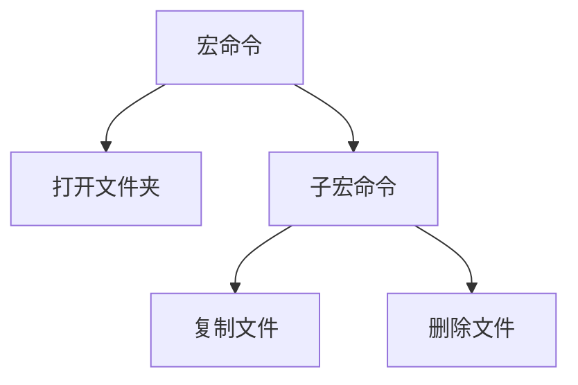

## Table of contents

## 组合模式

组合模式把对象组织成树形结构，用统一接口处理单个对象与对象组合。调用方对整棵树发起请求，具体由每个节点自行处理，或继续向子节点下传。

### 1. 从宏命令到组合模式

宏命令的 `execute` 遍历命令列表。如果列表元素既可以是普通命令，也可以是另一个宏命令，结构就从线性列表变成树：



图中的根节点与子宏命令承担「组合」职责，叶子节点承担具体动作。调用根节点一次，请求沿树扩散到每个叶子。组合对象与叶对象暴露同名方法，是这套结构成立的前提。

### 2. 用途：树形结构与统一接口

组合模式适用于两类特征同时存在的场景：

- 数据本身是树形结构：文件夹与文件、菜单与菜单项、DOM 节点、组织架构、商品分类。
- 调用方希望对「整棵树」与「单个节点」使用相同的操作，而不关心当前节点是容器还是末端。

模式涉及三个角色的命名：

- Component：抽象构件，声明 `add`、`remove`、业务方法。
- Composite：组合对象，持有子节点列表，把请求转发给子节点。
- Leaf：叶对象，没有子节点，直接实现业务方法。

统一接口带来的直接效果是调用方不需要写 `if (node instanceof Folder)` 这类类型判断，递归逻辑收敛在组合对象内部。

### 3. 请求在树中传递

以文件扫描为例。文件夹与文件都需要支持 `scan`，文件夹还要支持 `add`：

```js
function Folder(name) {
  this.name = name;
  this.files = [];
}

Folder.prototype.add = function (file) {
  this.files.push(file);
};

Folder.prototype.scan = function () {
  console.log("scan folder:", this.name);
  this.files.forEach((file) => file.scan());
};

function File(name) {
  this.name = name;
}

File.prototype.add = function () {
  throw new Error("leaf cannot add");
};

File.prototype.scan = function () {
  console.log("scan file:", this.name);
};
```

组装并触发：

```js
const root = new Folder("root");
const src = new Folder("src");
const assets = new Folder("assets");

src.add(new File("index.ts"));
assets.add(new File("logo.png"));
root.add(src);
root.add(assets);

root.scan();
```

`root.scan()` 的输出顺序由树结构决定：先打印根，再依次进入 `src`、`assets`，每个文件夹打印自身后继续下传。调用方只写一行，递归深度与节点数量由数据决定。

请求的下传方向是自上而下，返回值则可能自下而上汇总。统计文件总数、计算总大小时，组合对象把子节点的返回值聚合：

```js
Folder.prototype.count = function () {
  return this.files.reduce((total, file) => total + file.count(), 0);
};

File.prototype.count = function () {
  return 1;
};
```

### 4. 更强大的宏命令

把上节的 `scan` 换成 `execute`，就得到支持嵌套的宏命令：

```js
const macroCommand = {
  commands: [],
  add(command) {
    this.commands.push(command);
  },
  execute() {
    this.commands.forEach((command) => command.execute());
  },
};

const subMacro = {
  commands: [],
  add(command) {
    this.commands.push(command);
  },
  execute() {
    this.commands.forEach((command) => command.execute());
  },
};

macroCommand.add(subMacro);
macroCommand.execute();
```

两份实现完全相同，差别名不同。这说明组合模式的抽象与业务语义无关：只要对象满足「可容纳同类型子节点」与「响应同一消息」，就能挂到树上。

实践中把重复结构提取为工厂或类，避免每新增一种宏命令就复制一份 `add` 与 `execute`：

```js
function createComposite() {
  return {
    children: [],
    add(child) {
      this.children.push(child);
    },
    execute() {
      this.children.forEach((child) => child.execute());
    },
  };
}
```

### 5. 抽象类在 JavaScript 中的替代方式

传统面向对象语言用抽象类强制叶对象与组合对象实现同一接口，编译期就能发现遗漏。JavaScript 没有抽象类语法，常见的替代手段有三种：

```ts
abstract class Node {
  abstract scan(): void;

  add(_node: Node): void {
    throw new Error("not supported");
  }
}
```

| 手段 | 检查时机 | 成本 |
| --- | --- | --- |
| 基类方法抛错 | 运行时 | 无编译期保障，错误延迟暴露 |
| TypeScript `abstract` / `interface` | 编译期 | 需要类型系统，构建链路增加校验 |
| 鸭子类型约定 | 无 | 依赖文档与约定，重构时容易遗漏 |

项目中的选择取决于团队对类型系统的依赖程度。纯 JavaScript 代码库通常用第一种：基类给出抛错实现，子类覆盖；配合单元测试覆盖每个节点的接口完整性，把运行期检查前移到测试阶段。

### 6. 透明性带来的安全问题与两种解决方案

统一接口要求叶对象也实现 `add`，但叶对象没有子节点，调用 `add` 在语义上是错误的。这个矛盾源于「透明性」：调用方不判断节点类型，错误只能在运行时暴露。

两种解法：

| 方案 | 接口设计 | 优点 | 缺点 |
| --- | --- | --- | --- |
| 透明式 | 叶对象也定义 `add`/`remove`，抛错或忽略 | 调用方无需类型判断 | 错误延迟到运行时 |
| 安全式 | `add`/`remove` 只在组合对象上定义 | 误用在类型层面即可发现 | 调用方需判断节点类型，统一性下降 |

透明式的实现就是上文的 `File.prototype.add` 抛错。安全式则让叶对象完全不暴露该方法：

```js
function File(name) {
  this.name = name;
}

File.prototype.scan = function () {
  console.log("scan file:", this.name);
};

// no add/remove on File
```

安全式在插入节点时必须先判断类型：

```js
function append(parent, node) {
  if (typeof parent.add !== "function") {
    throw new Error("cannot add child to a leaf");
  }
  parent.add(node);
}
```

TypeScript 可以用类型守卫缩小范围，把运行时判断转为编译期约束：

```ts
interface Leaf {
  scan(): void;
}

interface Composite extends Leaf {
  add(node: Leaf): void;
}

function isComposite(node: Leaf): node is Composite {
  return typeof (node as Composite).add === "function";
}
```

项目中的取舍偏向透明式加类型守卫：对外接口保持统一，内部在写入路径上做一次校验。这样调用方读代码时不必区分节点类型，错误也会在首次组装树结构时暴露，而不是等到深层递归才出现。

### 7. 引用父对象

删除子节点、计算相对路径、沿树向上查找配置，都需要子节点能访问父节点。在 `add` 时建立反向引用：

```js
Folder.prototype.add = function (file) {
  file.parent = this;
  this.files.push(file);
};

Folder.prototype.remove = function (file) {
  const index = this.files.indexOf(file);

  if (index === -1) {
    return;
  }

  this.files.splice(index, 1);
  file.parent = null;
};
```

父引用让叶对象可以向上冒泡事件，也能实现「从任意节点查找最近的配置」：

```js
File.prototype.getRoot = function () {
  let node = this;

  while (node.parent) {
    node = node.parent;
  }

  return node;
};
```

代价是双向引用形成环。现代 JavaScript 的垃圾回收器能处理循环引用，但对象池、手动释放、序列化（`JSON.stringify` 遇到环会抛错）都需要显式断开或提供自定义序列化。DOM 的 `parentNode` 是同一思路的宿主实现，也带来同样的遍历与引用管理成本。

### 8. 使用条件与代价

组合模式并非通用结构，适用条件需要同时满足：

- 业务对象确实是树形结构，扁平列表强行套用只会多出一层无意义的递归。
- 叶对象与组合对象的行为足够接近，统一接口不会导致大量空实现。
- 调用方确实需要对整棵树做同一操作，而不是频繁按类型分支处理。

代价集中在三处：

| 维度 | 表现 |
| --- | --- |
| 性能 | 每次请求沿树遍历，深度大时递归开销与栈空间上升 |
| 调试 | 统一接口隐藏实际执行者，日志需打印节点路径 |
| 约束 | 缺少抽象类时，接口完整性依赖约定或类型系统 |

DOM 树是组合模式在宿主环境中的原型：`Node` 统一了元素、文本、注释的接口，`appendChild` 在元素节点上有效、在文本节点上抛错，正好对应透明式的取舍。理解 `childNodes` 的递归与事件冒泡的路径，就能理解组合模式在真实系统中如何落地，以及为什么深层嵌套的 DOM 会成为性能瓶颈。
