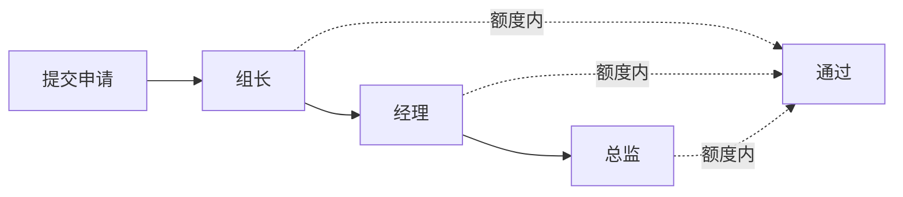

## Table of contents

## 职责链模式

职责链把「谁能处理这个请求」从一段连续的判断语句，改成一条由处理节点串起来的链。请求沿链传递，节点只判断自己是否处理，处理不了就交给下一个。这个模式的收益不在代码行数，而在节点可以独立增删、独立测试、独立排序。

### 1. 审批流中的职责链

现实中的审批就是一条职责链。一张报销单提交后先到组长，额度超出组长权限就转给经理，再超出就转给总监，任一节点批准后流程终止，不再向上传递。



图中的实线表示转交关系，虚线表示在某一层终止。三条约束对应职责链的全部语义：

- 请求从链首进入，按固定顺序逐层传递。
- 每个节点只判断自己权限内的事，不关心上游是谁、下游还有多少节点。
- 请求一旦被处理就终止，不会继续传递。

### 2. 顺序 if-else 的问题

把审批规则直接翻译成代码，得到的是顺序判断：

```js
function approve(amount) {
  if (amount <= 500) {
    return "leader";
  } else if (amount <= 2000) {
    return "manager";
  } else if (amount <= 10000) {
    return "director";
  }
  throw new Error("amount out of range");
}
```

这段代码在规则稳定、层级固定时没有明显问题。需求一旦变化，代价开始显现：

- 新增一级审批（如 5000 元以上需要财务复核）必须修改这个函数，并在正确位置插入分支，顺序错了规则就错。
- 调整额度或调换层级顺序，同样要改函数体，无法通过配置完成。
- 每个分支依赖前面所有分支的排除结果，单独测试某个层级时无法绕开整条逻辑。
- 分支中的业务动作（发通知、写审批记录、调用外部系统）会不断膨胀，函数最终变成几百行的流程单。

### 3. 重构为职责链

结构上只需两个要素：节点自身的处理逻辑，以及指向下一个节点的引用。

```js
class Approver {
  constructor(name, limit) {
    this.name = name;
    this.limit = limit;
    this.next = null;
  }

  setNext(next) {
    this.next = next;
    return next;
  }

  handle(amount) {
    if (amount <= this.limit) {
      return `${this.name} approved ${amount}`;
    }
    if (!this.next) {
      return null;
    }
    return this.next.handle(amount);
  }
}
```

组装链的过程与业务规则分离：

```js
const leader = new Approver("leader", 500);
const manager = new Approver("manager", 2000);
const director = new Approver("director", 10000);

leader.setNext(manager).setNext(director); // setNext returns next, so calls can be chained

leader.handle(300); // leader approved 300
leader.handle(1500); // manager approved 1500
leader.handle(8000); // director approved 8000
leader.handle(20000); // null, no node can handle it
```

`setNext` 返回下一节点，使链的表达式从左到右读起来与审批顺序一致。`handle` 是递归调用，链的长度通常在个位数，递归深度不构成压力；若链可能很长，改成循环更稳妥，见第 4 节。

重构后职责的边界变得清晰：

| 关注点 | 重构前 | 重构后 |
| --- | --- | --- |
| 单条规则 | 函数中的一个分支 | 一个节点对象 |
| 规则顺序 | 代码书写顺序 | 组装时的调用顺序 |
| 新增规则 | 修改 `approve` | 新增节点并插入链 |
| 单条测试 | 需构造整条流程 | 可直接调用节点 |
| 请求归属 | 由最后一个 `else` 兜底 | 由链尾节点的返回值表达 |

### 4. 可拆分的节点与链的组装

类版本适合节点持有状态（额度、名称、下游引用）。当节点只是纯函数时，用数组描述链更轻，也更容易从配置生成：

```js
const NEXT = "nextSuccessor";

function leader(amount) {
  return amount <= 500 ? `leader:${amount}` : NEXT;
}

function manager(amount) {
  return amount <= 2000 ? `manager:${amount}` : NEXT;
}

function director(amount) {
  return amount <= 10000 ? `director:${amount}` : NEXT;
}

function buildChain(nodes) {
  return function run(input) {
    for (const node of nodes) {
      const result = node(input);
      if (result !== NEXT) {
        return result;
      }
    }
    return null;
  };
}

const approve = buildChain([leader, manager, director]);
```

`NEXT` 是一个哨兵值，表示「本节点不处理，继续向下」。用哨兵而不是 `undefined`，是因为节点完全可能合法地返回 `undefined`（例如只做副作用、不产出结果的处理节点），两者必须能区分。

两种组织方式各有适用面：

| 维度 | 类 + next 引用 | 数组 + 哨兵 |
| --- | --- | --- |
| 节点状态 | 可保存在实例上 | 需通过闭包或参数传入 |
| 动态增删 | 修改 `next` 指针 | 修改数组即可 |
| 顺序调整 | 重新串接指针 | 排序数组 |
| 递归与循环 | 天然递归 | 默认循环 |
| 序列化配置 | 不直观 | 可直接由 JSON 生成 |

### 5. 异步职责链

节点内部一旦出现 I/O（查询额度、调用风控），同步返回值的约定就不够用了。回调风格把「继续传递」写成显式的 `next` 调用：

```js
function runAsync(nodes, input, callback) {
  let index = 0;

  function step(err, result) {
    if (err) {
      return callback(err);
    }
    if (result !== undefined && result !== NEXT) {
      return callback(null, result);
    }
    const node = nodes[index++];
    if (!node) {
      return callback(null, null);
    }
    node(input, step);
  }

  step();
}
```

每次调用 `step` 时读到的 `index` 都指向尚未执行的节点，`step` 同时充当「下一个节点的回调」与「链的推进器」。错误只要在任意一层出现就短路整条链，这与同步版本中抛出异常的效果一致。

Promise 风格把同样的语义写得更直：

```js
async function run(nodes, input) {
  for (const node of nodes) {
    const result = await node(input);
    if (result !== NEXT) {
      return result;
    }
  }
  return null;
}
```

也可以先做函数组合，再一次性执行：

```js
const pipeline = nodes.reduceRight(
  (next, node) => (input) =>
    node(input).then((result) => (result === NEXT ? next(input) : result)),
  () => Promise.resolve(null),
);

const result = await pipeline(order);
```

`reduceRight` 从链尾向前折叠，`next` 始终代表「当前节点之后的所有节点」。组合出的 `pipeline` 是纯函数，可以被缓存、复用、单独测试，这是数组组织方式在异步场景下的额外收益。

### 6. 优缺点

优点集中在解耦与可组合：

- 发送者不需要知道哪个节点会处理请求，也不需要知道链上有多少节点。
- 节点之间没有引用关系，只依赖统一的输入输出约定，可以独立替换与复用。
- 链的构成是运行时数据，增删节点不需要修改已有节点。

代价同样明确：

- 请求可能无人处理。链走完后返回 `null` 只是把这个事实推迟到调用方，必须在链尾放一个兜底节点或显式抛出业务异常。
- 链过长时每次请求都要逐层判断，未命中节点的判断成本会被累加；几十层的链需要评估是否需要按场景拆分多条短链。
- 节点间的约定（返回哨兵、是否允许异步）是隐式的，缺少类型约束时容易写错。TypeScript 中应把节点签名定义成统一类型。

### 7. 用 AOP 实现职责链

节点的核心动作是「先执行自己，若无法处理再执行下一个」，这正好是 `after` 织入的语义。把链的推进写成函数组合，节点就不需要持有 `next`：

```js
const NEXT = "nextSuccessor";

function after(fn, next) {
  return function (...args) {
    const result = fn.apply(this, args);
    if (result === NEXT) {
      return next.apply(this, args);
    }
    return result;
  };
}

const approve = after(after(leader, manager), director);
```

`after` 返回的包装函数先调用 `fn`，只有返回哨兵时才调用 `next`。多次 `after` 嵌套后，调用顺序与书写顺序一致，从左到右就是链的方向。

早年的写法把 `after` 挂到 `Function.prototype` 上，让任何函数都能 `.after()`：

```js
Function.prototype.after = function (next) {
  const self = this;
  return function (...args) {
    const result = self.apply(this, args);
    return result === NEXT ? next.apply(this, args) : result;
  };
};
```

这种写法在多人协作的项目中会污染全局原型，与库或框架的同名扩展冲突时排查成本很高。现在的做法是导出一个独立的 `after` 工具函数，语义相同而副作用为零。原型扩展只在一次性脚本或教学示例中成立。

### 8. 获取上传对象的链式尝试

浏览器兼容代码是职责链的典型场景：按优先级依次尝试几种能力检测，第一个成功的实现被采用。

```js
const NEXT = "next";

function getActiveX() {
  try {
    return new ActiveXObject("Microsoft.XMLHTTP");
  } catch (e) {
    return NEXT;
  }
}

function getXHR() {
  return typeof XMLHttpRequest !== "undefined" ? new XMLHttpRequest() : NEXT;
}

function getFormData() {
  return typeof FormData !== "undefined" ? new FormData() : NEXT;
}

function getUploadObject() {
  const factories = [getActiveX, getXHR, getFormData];
  for (const factory of factories) {
    const result = factory();
    if (result !== NEXT) {
      return result;
    }
  }
  throw new Error("no upload object available");
}
```

三个工厂函数彼此不知道对方存在，增删一种实现只需改 `factories` 数组。`try/catch` 把「能力不存在」这种环境差异收敛为同一个哨兵返回值，调用方拿到的要么是可用的对象，要么是一个明确的错误。

这与 Koa 中间件在结构上同源，但语义有差别。Koa 的中间件通过 `await next()` 把控制权交给下游，并在下游返回后继续执行，形成洋葱模型；职责链的「转交」是单向的，命中即终止，不会回到上游。两者都能做到节点可插拔，区别在于是否需要「请求前后都做处理」：

| 维度 | 职责链 | Koa 中间件 |
| --- | --- | --- |
| 控制流 | 单向传递，命中终止 | 进入与返回两段 |
| 下游调用 | 节点决定是否转交 | `await next()` 必然进入下游 |
| 组装方式 | 业务代码按需组装 | 框架统一注册与编排 |
| 典型用途 | 多级审批、能力探测、规则匹配 | 日志、鉴权、错误捕获、响应包装 |

需要「命中即停止」的规则匹配用职责链，需要「前后环绕」的处理用中间件。把两者混为一谈，会在职责链里写出多余的返回逻辑，或者在中件间里忘记 `await next()` 而静默中断链路。
