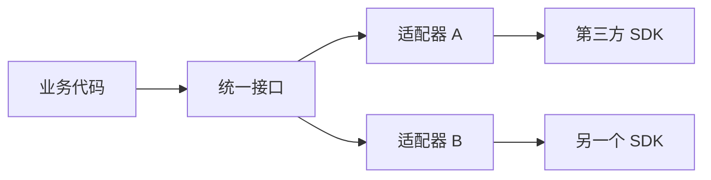

## Table of contents

## 适配器模式

适配器解决的是接口不兼容。两个对象的职责可以对接，但方法名、参数形状、数据结构对不上，此时在中间加一层转换，让调用方按预期接口使用。它不改变被适配对象的行为，只改变交互的形态。

### 1. 现实中的适配器

不同国家的插座标准不同，电器本身没有变化，插入方式需要转换。电源适配器把 220V 交流转换为设备需要的直流电压，输入与输出的语义仍是供电，变化的是接口形态与参数范围。

软件中的对应关系很直接：

- 后端返回的字段命名与前端组件期望的结构不一致。
- 旧函数的参数是位置参数，新代码习惯传配置对象。
- 三个地图 SDK 的初始化、打点、定位方法名各不相同。
- 支付渠道的成功判定、错误码、回调时机存在差异。

这些场景的共同点是：两端都正确，只是约定不同。适配器承担的正是这层约定转换。

### 2. 数据格式适配

接口字段风格不一致是最常见的场景。后端使用 snake_case，前端组件按 camelCase 消费：

```js
// api/user.js
export function adaptUser(raw) {
  return {
    id: raw.user_id,
    name: raw.user_name,
    avatar: raw.avatar_url ?? "",
    createdAt: raw.created_at,
  };
}

export async function fetchUsers() {
  const response = await fetch("/api/users");
  const { data } = await response.json();
  return data.map(adaptUser);
}
```

转换放在 API 层，组件只接收统一结构：

```js
const users = await fetchUsers();
render(users[0].name);
```

若省略这一层，字段名会渗透到每个组件：列表页写 `user.user_name`，详情页写 `user.user_name`，某天后端改名时需要全局搜索替换。适配器把「后端字段名」这一外部约定收敛到一个函数内，后端变更时只需改 `adaptUser`。

接口存在多个版本时，适配器同时承担兼容职责：

```js
function adaptOrder(raw) {
  if (raw.schema_version === 1) {
    return {
      id: raw.order_id,
      amount: raw.total_fee / 100,
      items: raw.goods.map((item) => ({ id: item.goods_id, count: item.num })),
    };
  }
  return {
    id: raw.id,
    amount: raw.amount,
    items: raw.items,
  };
}
```

版本分支集中在一处，业务代码不需要感知 `schema_version`。代价是适配器内部出现条件判断，版本数量增加后应改为按版本注册多个转换函数，而不是让单个函数持续膨胀。

### 3. 参数适配与旧接口迁移

函数签名变化同样需要适配。旧实现使用位置参数与回调：

```js
function legacyRequest(url, method, data, callback) {
  // ...
}
```

新代码习惯对象参数与 Promise：

```js
function request({ url, method = "GET", body, onSuccess, onError }) {
  legacyRequest(url, method, body, (err, data) => {
    if (err) {
      onError?.(err);
      return;
    }
    onSuccess?.(data);
  });
}
```

调用方按新签名书写，旧实现保持不动：

```js
request({
  url: "/api/orders",
  method: "POST",
  body: payload,
  onSuccess: (data) => console.log(data),
  onError: (err) => console.error(err),
});
```

这种「新接口包旧实现」的方向可以在迁移期使用：新代码按目标接口编写，旧调用点逐步替换，全部迁移后删除适配器。反过来让旧代码适配新接口，会把改动扩散到所有历史调用点，风险更高。

参数适配还包括单位与默认值。图表库要求宽高为数字像素，业务传入的可能是 `"600px"` 字符串；支付金额在界面上是元、接口要求分。转换应显式写在适配器里：

```js
function adaptChartOptions({ width = 600, height = 400, unit = "px" }) {
  return {
    width: parseInt(width, 10),
    height: parseInt(height, 10),
    unit,
  };
}
```

默认值与单位换算属于接口契约的一部分，放在适配器中比散落在调用处更容易统一验证。

### 4. 第三方能力的统一封装

业务依赖多个外部服务时，适配器的价值从「格式转换」上升到「隔离供应商」。



上图中业务代码只依赖统一接口，适配器分别对接不同供应商。更换供应商时只替换适配器实现，业务代码不需要改动。

以地图为例，先定义业务需要的接口：

```ts
interface MapAdapter {
  init(container: HTMLElement, center: [number, number]): void;
  addMarker(point: [number, number], label: string): void;
  setCenter(point: [number, number]): void;
  destroy(): void;
}
```

再分别实现：

```ts
class AmapAdapter implements MapAdapter {
  private map: any = null;

  init(container: HTMLElement, center: [number, number]) {
    this.map = new AMap.Map(container, { center, zoom: 12 });
  }

  addMarker([lng, lat]: [number, number], label: string) {
    this.map.add(new AMap.Marker({ position: [lng, lat], title: label }));
  }

  setCenter(center: [number, number]) {
    this.map?.setCenter(center);
  }

  destroy() {
    this.map?.destroy();
    this.map = null;
  }
}
```

换用 Mapbox 时新增一个实现，接口不变：

```ts
class MapboxAdapter implements MapAdapter {
  private map: any = null;

  init(container: HTMLElement, center: [number, number]) {
    this.map = new mapboxgl.Map({
      container,
      center: [center[0], center[1]],
      zoom: 12,
    });
  }

  addMarker(point: [number, number], label: string) {
    new mapboxgl.Marker().setLngLat(point).setPopup(new mapboxgl.Popup().setText(label)).addTo(this.map);
  }
  // ...
}
```

坐标顺序是这类适配最容易出错的地方：高德使用 `[lng, lat]`，部分 SDK 使用 `{ lat, lng }` 对象。适配器的职责之一就是把这种差异吸收在内部，对外只暴露一种约定。

支付渠道的差异更大，除了方法名，还包括错误码与回调时机：

```ts
interface PaymentAdapter {
  pay(order: Order): Promise<PayResult>;
}

type PayResult =
  | { ok: true; tradeNo: string }
  | { ok: false; code: "CANCELLED" | "FAILED" | "PENDING"; message: string };
```

微信、支付宝、Stripe 的实现各自把原始响应映射为 `PayResult`。业务侧只判断 `ok` 与归一化后的 `code`，不接触各渠道的原始错误码。这种归一化必须在适配器内完成，否则渠道差异会以 `if (channel === "wechat")` 的形式重新渗入业务代码。

存储接口是另一个常见例子。`localStorage` 是同步 API，服务端存储是异步 API，统一接口按异步设计：

```ts
interface StorageAdapter {
  get(key: string): Promise<string | null>;
  set(key: string, value: string): Promise<void>;
  remove(key: string): Promise<void>;
}
```

同步实现包一层 `Promise.resolve` 即可，调用方不需要为不同后端写两套逻辑。

统一封装有三条边界需要守住：

- 适配器只做协议转换与错误归一化，不承载业务规则。折扣计算、库存校验属于业务层。
- 能力差异用显式接口表达，例如 `supportsRefund(): boolean`，不要用「调用后抛错」隐式告知。
- 每个适配器都需要契约测试，用同一组用例验证不同实现的行为一致。

### 5. 与装饰者、代理、外观的区分

四个模式都引入了一个中间对象，容易在选择时混淆。区分维度是接口是否改变、是否增加职责、是否控制访问、包装了几个对象：

| 模式 | 接口 | 目的 | 与原对象关系 | 典型场景 |
| --- | --- | --- | --- | --- |
| 适配器 | 转换为目标接口 | 让不兼容的接口可以协作 | 包装一个或多个对象 | 字段映射、SDK 统一封装 |
| 装饰者 | 与原对象一致 | 增加职责 | 必然调用原对象，可多层 | 日志、埋点、缓存之外的增强 |
| 代理 | 与原对象一致 | 控制访问 | 可能不调用原对象 | 懒加载、权限校验、请求缓存 |
| 外观 | 定义新的简化接口 | 降低子系统使用成本 | 包装多个对象 | 把多个模块组合成一个门面 |

判断顺序可以固定为三步：

1. 接口是否改变了？改变则是适配器或外观；未改变则是装饰者或代理。
2. 接口改变时，面向的是单个不兼容对象，还是一组子系统？前者是适配器，后者是外观。
3. 接口未改变时，是否一定调用原对象？一定调用是装饰者，可能不调用是代理。

外观与适配器的区别常被忽略：外观不要求子系统实现某个接口，它只是把多个调用组合成一个更简单的入口，例如把「初始化地图、加载图层、绑定事件」封装成 `initMap()`。适配器则要求目标接口明确，实现方必须满足该接口。

### 6. 使用判断

适配器的适用条件很窄：两端接口不兼容，且至少一端不受控制。后端字段风格、第三方 SDK、历史遗留接口都属于不受控的一端。

不需要适配器的情况同样明确：

- 两端都在自己手里，直接统一接口即可。为内部代码加适配层，只会多一层跳转。
- 只是想在调用前后加逻辑，用装饰者或 AOP。
- 只是想隐藏复杂度，用外观或直接封装函数。

滥用带来的成本：

- 每接入一个供应商就增加一个适配器，数量随集成数增长，缺少契约测试时行为容易漂移。
- 适配器内部堆积业务规则后，会变成第二个业务层，排查问题时需要同时读业务代码与适配器。
- 过度抽象会掩盖设计错误：如果适配器里出现大量按调用方区分的条件分支，说明统一接口本身没有抽象对，应该重新设计接口而不是继续加分支。

工程上的做法是把适配器集中在固定目录，按能力命名（`adapters/map`、`adapters/payment`），并在适配器边界完成三件事：入参校验、错误码映射、能力声明。业务代码只依赖接口，不 import 任何第三方 SDK 类型。

迁移完成后及时删除旧适配器。适配器是为过渡存在的结构，长期保留会让「旧接口已下线」这一事实变得不可见，后来者无法判断哪些代码仍在被使用。
