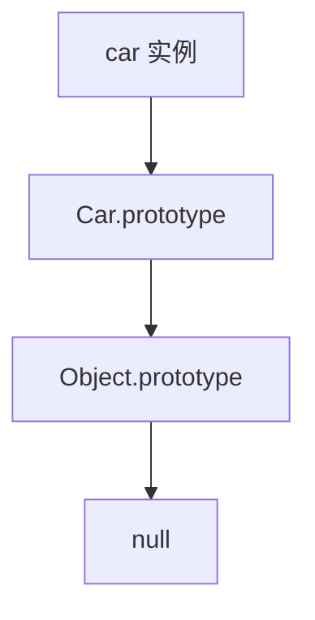

## Table of contents

## 面向对象的JavaScript

JavaScript 没有类式语言的静态类型系统，对象的能力在运行时才被确认，封装与继承都建立在函数与原型之上。设计模式在这里因此与 GoF 原著有明显偏差：策略可以是一个对象字面量，工厂可以是一个函数，单例可以是一段闭包。

### 1. 动态类型语言与鸭子类型

#### 1.1 动态类型与类型检查的代价

```js
function add(a, b) {
  return a + b;
}

add(1, 2); // 3
add({}, []); // "[object Object]"
```

- 类型与值在运行时绑定，类型错误在最晚的时刻才暴露：`add({}, [])` 不抛异常，而是产出语义错误的字符串。
- 收益是复用成本低：同一段 `map`、`filter` 逻辑可作用于任意形状的元素，不需要为每种类型声明接口。
- TypeScript 把结构检查提前到编译期，但类型编译后擦除，`interface` 不产生检查代码，外部数据仍要由运行时校验兜底。

#### 1.2 鸭子类型在 JavaScript 中的表现

判断依据是能力集合，而不是构造器或原型身份：对象只要具备所需的方法与属性，就能胜任某个角色。

```js
function startEngine(vehicle) {
  if (typeof vehicle.run !== "function") {
    throw new TypeError("run() is required");
  }
  return vehicle.run();
}

startEngine({ run: () => "car running" }); // "car running"
```

- 两个对象没有共同父类，调用方只看 `run` 是否存在，新增类型不需要修改 `startEngine`；`typeof` 校验把隐式失败变成显式错误。

#### 1.3 用 TypeScript interface 做编译期约束

```ts
interface Runner {
  run(): string;
}

function startEngine(vehicle: Runner): string {
  return vehicle.run();
}

startEngine({ run: () => "bicycle rolling" }); // ok, structural typing
```

- `interface` 采用结构类型，形状匹配即可赋值，不要求显式 `implements`；类型断言 `as Runner` 不产生检查，外部数据应先校验再断言。

### 2. 多态

多态指同一操作作用于不同对象，产生与各自类型相符的行为。JavaScript 通过原型委托与鸭子类型实现，调用方视角相同。

#### 2.1 同一接口不同实现与继承

同一接口可以来自隐式契约，也可以来自父类声明。前者只需若干对象具备同名方法：

```js
const shapes = [{ area: () => 10 }, { area: () => 20 }, { area: () => 35 }];
const total = shapes.reduce((sum, shape) => sum + shape.area(), 0);
```

后者由子类覆写父类方法，调用方只依赖父类接口：

```js
class Animal {
  speak() {
    throw new Error("not implemented");
  }
}

class Dog extends Animal {
  speak() {
    return "woof";
  }
}

const chorus = animals => animals.map(animal => animal.speak());
```

- 子类覆写父类方法，`chorus` 只依赖父类声明的接口；JavaScript 没有 `abstract`，基类方法抛错是常见替代，继承带来的强耦合在模式实现中往往不必要。

#### 2.2 鸭子类型实现多态

```js
function makeSound(animal) {
  return animal.speak();
}

makeSound({ speak: () => "meow" });
makeSound({ speak: () => "woof" });
```

- 两个对象没有继承关系，多态由调用点的方法查找完成，适合少量方法的外部插件与测试替身。

#### 2.3 多态抵消条件分支的收益

按类型分发的写法把行为集中在同一个函数里，多态写法把行为分散到各自对象上：

```js
function getSpeed(vehicle) {
  switch (vehicle.type) {
    case "car":
      return 120;
    case "boat":
      return 40;
    default:
      return 0;
  }
}

const getSpeed2 = vehicle => vehicle.speed();
```

| 方案          | 新增类型时的改动   | 分支数量       | 类型判断位置   |
| ------------- | ------------------ | -------------- | -------------- |
| `switch` 分发 | 修改 `getSpeed`    | 随类型线性增长 | 集中在分发函数 |
| 多态          | 新增一个对象或子类 | 无             | 不存在         |

- 类型固定且只有两三种时 `switch` 的可读性更好；类型持续增加、各分支逻辑较长时，多态把变化点局部化。

### 3. 封装

封装的四层含义依次递进：隐藏数据、隐藏实现、隐藏类型、隔离变化。JavaScript 的封装强度弱于 Java，不同手段的隔离能力也不同。

#### 3.1 封装数据

```js
function createCounter() {
  let count = 0;
  return {
    increment: () => (count += 1),
    get value() {
      return count;
    },
  };
}
```

- 状态保存在闭包里，外部只能通过 `increment` 与 `value` 访问；每次调用工厂生成独立状态，需要共享时把变量提到工厂外部。

#### 3.2 封装实现

```js
function createUploader(endpoint) {
  const validate = file => file.size > 0 && file.size < 10 * 1024 * 1024;
  return {
    async upload(file) {
      if (!validate(file)) throw new Error("invalid file");
      const body = new FormData();
      body.append("file", file);
      return fetch(endpoint, { method: "POST", body }).then(res => res.json());
    },
  };
}
```

- 只暴露 `upload`，校验与表单构造可以随时替换，调用方不受影响；内部函数不进入返回对象，外部无法绕过校验直接发请求。

#### 3.3 封装类型

```ts
interface Cache {
  get(key: string): unknown;
  set(key: string, value: unknown): void;
}

export function createCache(): Cache {
  const store = new Map<string, unknown>();
  return {
    get: key => store.get(key),
    set: (key, value) => void store.set(key, value),
  };
}
```

- 返回类型声明为 `Cache`，内部从 `Map` 换成 LRU 或持久化存储时，调用代码不需要改动；构造器被隐藏后，调用方拿不到 `new` 的入口。

#### 3.4 封装变化

封装变化指识别最可能改动的部分，把它隔离到独立单元，其余代码只依赖稳定的抽象。

| 变化点   | 隔离方式             | 对应模式 |
| -------- | -------------------- | -------- |
| 算法实现 | 抽出可替换的策略对象 | 策略模式 |
| 创建过程 | 工厂函数或工厂方法   | 工厂模式 |
| 访问开销 | 代理层推迟或合并调用 | 代理模式 |

- 判断标准是「改动是否会波及调用方」：会波及的部分需要隔离，不会波及的就地实现即可；过度抽象会让调用链变长。

#### 3.5 四种私有手段

| 手段         | 隔离强度           | 运行时开销   | 适用场景           |
| ------------ | ------------------ | ------------ | ------------------ |
| 闭包         | 强，词法不可达     | 常驻变量环境 | 工厂函数、模块模式 |
| `Symbol`     | 弱，仅规避命名冲突 | 可忽略       | 内部标记、避免覆盖 |
| `#` 私有字段 | 强，语法级限制     | 可忽略       | `class` 内部状态   |
| 模块作用域   | 强，未导出即不可见 | 无           | 文件级单例与状态   |

```js
// Closure
function createWallet() {
  let balance = 0;
  return { deposit: n => (balance += n), getBalance: () => balance };
}

// Symbol: skipped by Object.keys, reachable via Reflect.ownKeys
const SECRET = Symbol("secret");
const account = { [SECRET]: "token", name: "Mimas" };

// Private field: enforced by syntax
class Account {
  #balance = 0;
  deposit(n) {
    this.#balance += n;
  }
}

// Module scope: unexported bindings stay private
const state = new Map();
export const get = key => state.get(key);
export const set = (key, value) => state.set(key, value);
```

- `Symbol` 只提供约定级隐藏，`Reflect.ownKeys` 仍能取到，不应作为安全边界；`#` 字段在访问时才检查，两者都不会出现在 `Object.keys` 结果中；模块作用域无需闭包包装，还能享受静态分析与 tree shaking。

### 4. 原型模式与基于原型的对象系统

#### 4.1 原型模式与 Object.create

原型模式用「以已有对象为模板创建新对象」替代类实例化。JavaScript 不拷贝属性，而是让新对象通过原型链委托属性查找。

```js
const baseConfig = { retries: 3, timeout: 5000 };
const strict = Object.create(baseConfig);
strict.retries = 0;

strict.timeout; // 5000, inherited from prototype
```

- `strict` 自身只有 `retries`，未覆盖的属性不占用新对象内存；修改 `baseConfig.timeout` 会同步影响所有未覆盖该属性的派生对象。
- `Object.setPrototypeOf` 能在创建后改写原型，但会让引擎丢弃已生成的内联缓存；`__proto__` 是历史访问器，创建时确定原型应直接用 `Object.create`。

#### 4.2 原型链与 instanceof

```js
function Car() {}
const car = new Car();

car instanceof Car; // true
Object.getPrototypeOf(car) === Car.prototype; // true
Object.getPrototypeOf(Car.prototype) === Object.prototype; // true
```

下图给出 `car` 实例到 `null` 的原型链走向，`instanceof` 的判定就是沿这条链查找 `Car.prototype`。



- 原型被整体替换后，替换前创建的实例不再通过判定；跨 realm 时 `instanceof` 对内置构造器失效，应改用 `Object.prototype.toString.call(value)`，`Symbol.hasInstance` 可以自定义判定。

#### 4.3 class 语法糖背后的原型

```js
class Person {
  constructor(name) {
    this.name = name;
  }

  greet() {
    return `hi ${this.name}`;
  }
}

typeof Person; // "function"
```

- `class` 编译后仍是构造函数加原型方法，`new` 的行为与函数构造器一致。
- 方法挂在原型上且不可枚举，用对象字面量手动挂载则可枚举；`class` 不会被提升到可用状态，调用时必须带 `new`，类体内默认严格模式。

#### 4.4 原型继承的问题

```js
function Queue() {}
Queue.prototype.items = [];

const queueA = new Queue();
const queueB = new Queue();
queueA.items.push(1);
queueB.items; // [1] shared across all instances
```

- 引用类型属性挂在 `prototype` 上会被所有实例共享，`push` 修改的是同一份数组；实例状态必须写在构造函数或 `class field` 中。
- ES5 的组合继承把方法放在原型、属性放在构造函数；`class` 的 `extends` 使用原型链与 `super`，本质仍是原型委托。
