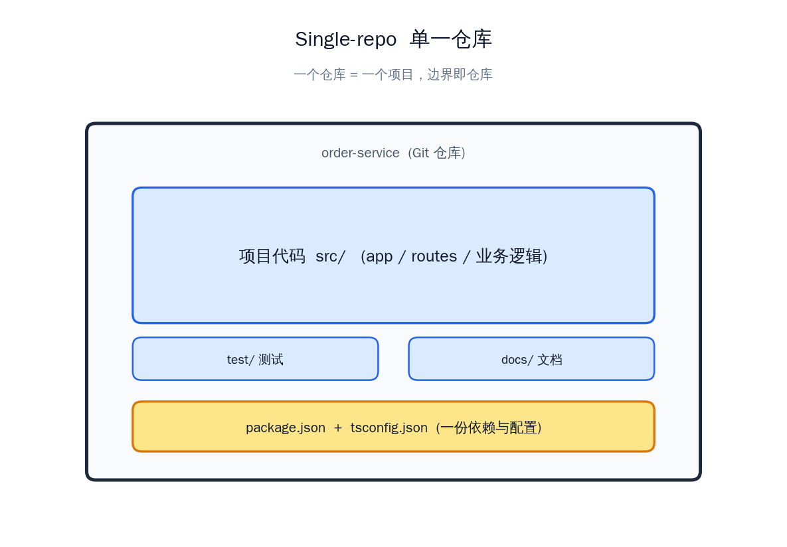
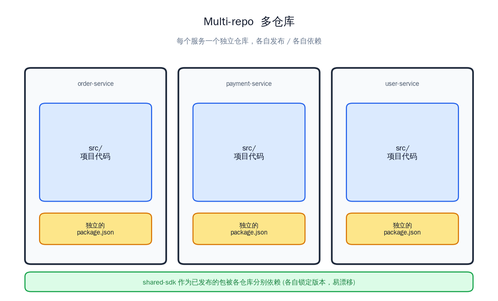
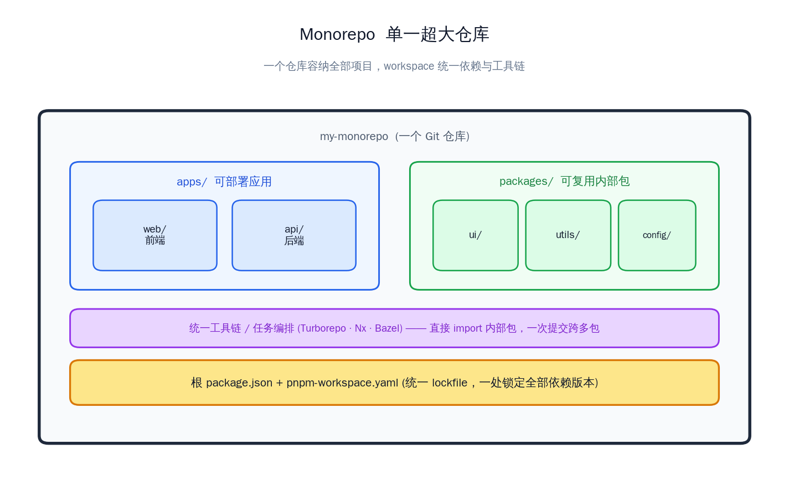

在接手项目重构时，我们发现原有的单仓（Single-Repo）管理方式在集成测试、业务功能输出以及增量构建等方面存在诸多不便。\
为此，我们采用 Turborepo 将项目平滑迁移至 Monorepo 架构，从根本上解决了这些工程化难题。\
此处是对于Monorepo实践过程和知识点的记录。
## Table of contents

## Monorepo简介
在常用的代码组织架构中，有Single-repo、Multirepo、Monorepo这三种代码库组织方式。
### Single-repo
一个应用的全部代码都使用一个代码仓库管理，模块间仅通过简单划分或不划分进行组织。\
整个应用类似npm包，仅在根目录存在一个package.json文件管理版本和依赖关系。通常适用于Monolith（巨石）应用，即整个应用作为一个整体。\
```
// 例如：vue2框架项目结构
vue
|——src
|  |——compiler
|  |——core
|  |——platforms
|  |——server
|  |——sfc
|  └──shared
...
└────package.json
```

### Multirepo
多仓库，将应用内各个模块都彻底隔离和封装。
- 每个项目/模块都是独立的仓库，互不干扰，最终使用npm包实现代码共享。
- 管理粒度更细，但不同项目依赖可能重复、跨项目改动需要多次提交和协调、代码共享使用的npm包会有延迟、各仓库独立构建配置，配置分散。
- 适用于微服务，技术栈异构等场景。
- 例如node后端框架fastify就使用了Multirepo管理。

### Monorepo
既类似Single-repo使用一个仓库管理代码，又实现类似Multirepo对子项目进行彻底的封装和隔离。
- 物理集中，逻辑拆分。
- 缺点是难以实现细粒度的权限控制，复杂度较高。
- 与monolith（巨石）项目的区别：monolith项目一定会同时部署，且一般不做模块化分割，与monorepo不等价。
